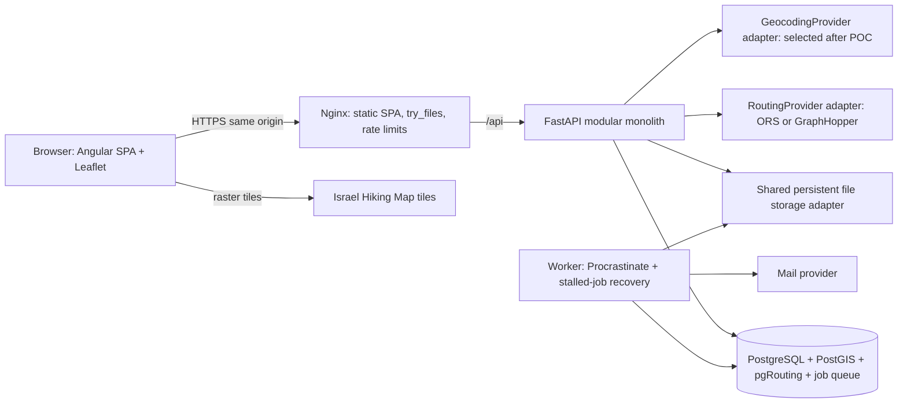
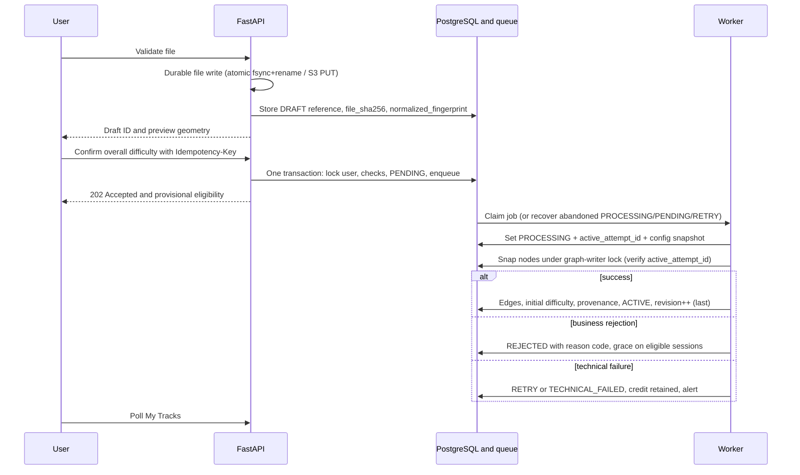
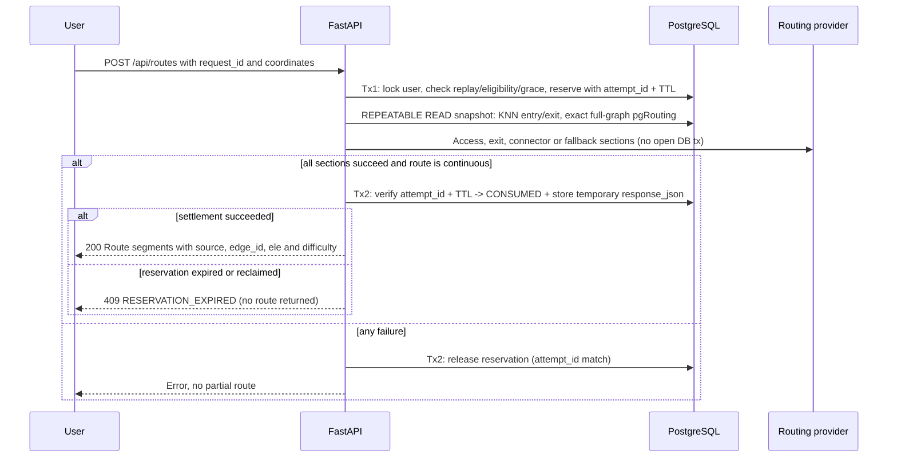

# OnTrack v2.4 — Architecture & Technology Stack

**Status:** Adopted design baseline. POC gates (Section 9) and unresolved product policies (Section 11) remain open.  
**Inputs:** `docs/PRD.md` (PRD v2.4, product source of truth) and `docs/SPEC.md` (testable requirements; acceptance criteria are referenced as `SPEC AC-n`).  
**Purpose:** Define the architecture and technology stack for rebuilding OnTrack, and explain the reasoning behind every decision so that implementers and reviewers can challenge it.

> **Note to reviewer:** This document is self-contained. `FR-xxx`, `PRD AC-xx` and `§x.x` refer to the PRD. A statement about the legacy system that is an *inference*, not a fact from the PRD, is marked **(inferred)**. Section 10 lists risks; Section 11 lists the decisions still open. Where the PRD leaves a policy open, this document gives a **build default** that is configurable, and marks it *pending product approval*. It does not finalize product policy.

---

## 1. Product Summary (context)

OnTrack is a web application for planning off-road 4x4 routes, focused on Israel.

- Users pick a **start** and **finish** on a Hebrew topographic map (Israel Hiking Map raster tiles).
- The server calculates a **hybrid route**: an access section from an external routing provider, a shortest path through the community trail network, an exit section from the provider, or a provider fallback when there is no network coverage (§6.2).
- The route is drawn with **difficulty-colored segments** (1 Easy / 2 Moderate / 3 Hard) and exported **client-side as GPX**.
- The trail network is built from GPX/KML tracks supplied by **admin batch imports** and **user uploads**.
- **Contribution model (v2.4):**
  - Route creation requires a configurable number of qualifying uploads (default 1).
  - Credit is **provisional immediately** after durable acceptance. Ingestion is **asynchronous**.
  - A business rejection removes credit, with bounded **session grace**. Technical failures keep credit.
  - An optional **lifetime free route allowance** (working assumption).
- Explicit community ratings are averaged per canonical edge; upload difficulty initializes only new edges. Node snapping replaces geometric overlap matching (§6.3–6.4).
- Roles: guest, `regular`, `system` (admin), `inactive` (policy undecided).
- Must be fully usable on desktop and mobile browsers (touch and mouse).
- Legacy security defects must be fixed (§8.2).

---

## 2. Architectural Drivers

Every decision below traces back to one or more of these drivers.

| # | Driver | PRD source | Architectural implication |
|---|---|---|---|
| D1 | Nearest-point lookup and snapping within radii in meters | §6.2, §6.3, §8.1 | Real **spatial indexes**, not the legacy latitude windows. |
| D2 | Shortest path over the trail graph; routing objective still open | §6.2, Open #4 | Graph engine with a **configurable cost function**. |
| D3 | Initial difficulty and explicit community ratings | FR-021, FR-023, §6.4 | Separate rating service and per-user edge reports. |
| D4 | Provisional credit immediately after durable acceptance; asynchronous ingestion; no duplicate credit | FR-018, FR-020, §6.5, §6.6 | **Atomic acceptance + durable processing obligation**; separate atomic publish of graph changes. |
| D5 | Server-side enforcement of auth, roles, ownership and eligibility on every request | FR-004, FR-010, FR-018, §8.2 | Central authorization dependencies; no logic that exists only in the UI. |
| D6 | Revocable, time-limited sessions that survive restarts; token unreadable by page scripts | FR-003, §8.2 | **Server-side sessions** in the database, `HttpOnly` cookie. |
| D7 | Uploaded files are untrusted | FR-020, §8.2 | Hardened parsing, size limits, server-owned geometry. |
| D8 | Asynchronous batch ingestion with email; no concurrent duplicate jobs | FR-013, §8.1 | Durable job runner with locking. |
| D9 | Touch-friendly map interactions and edge rating | FR-021, §8.3 | Leaflet edge selection by stable edge ID. |
| D10 | External routing failures must not produce partial or exportable routes | §7.1, FR-007 | Explicit all-or-nothing route assembly. |
| D11 | All-data views cached (~10 min) and invalidated after committed changes | FR-011, §8.1, PRD AC-27 | Graph revision + HTTP `ETag`. |
| D12 | Many product decisions are open | §10 | Open decisions become **configuration or data changes**, not rewrites. |
| D13 | Free allowance: never exceeded under concurrency; retries and failures not charged | FR-018, §6.5, PRD AC-20/21 | **Reserve → compute → settle** accounting with row locks and request identity. |
| D14 | Rejection grace is bound to existing sessions, capped in time, not extendable | FR-018, PRD AC-16/22 | Grace stored **on the session**, set inside the rejection transaction. |
| D15 | Configurable node snapping and undirected edge reuse | §6.3, PRD AC-24/25/30 | Indexed nearest-node search; unique unordered endpoint pair; no splitting. |
| D16 | Routing stays responsive and consistent while ingestion runs | §6.6, PRD AC-26 | MVCC snapshot reads, short transactions, one graph writer, benchmarked exact full-graph routing. |

---

## 3. Decision Summary

| Area | Decision | Primary drivers |
|---|---|---|
| Architecture style | **Modular monolith** + one background worker process | D4, D5, D12 |
| Database | **PostgreSQL + PostGIS + pgRouting** (single database for everything, including the job queue) | D1–D4, D13–D16 |
| Backend | **Python (current supported stable, pinned after dependency checks) + FastAPI**, SQLAlchemy 2 + GeoAlchemy2, Alembic, Pydantic v2 | D5, D7 |
| Background jobs | **Procrastinate** (PostgreSQL-backed queue) + recovery safeguards, POC-gated; fallback order: RabbitMQ + Celery + outbox, then custom `SKIP LOCKED` only with justification | D4, D8 |
| Authentication | Opaque server-side sessions, `HttpOnly; Secure; SameSite=Lax` cookie, **Argon2id** | D5, D6, D14 |
| External routing | `RoutingProvider` adapter; **ORS or GraphHopper** selected after POC | D10 |
| Location search (MVP) | `GeocodingProvider` adapter behind `GET /api/map/search`; provider selected after Israel Hebrew/English POC evaluation | FR-025 |
| Contribution levels (MVP) | Pure derived function from `ACTIVE` upload count; zero extra DB table | FR-024 |
| Internationalization (MVP) | Runtime Angular i18n (`@jsverse/transloco`), `he` (RTL default) + `en` (LTR), CSS logical properties + CDK `BidiModule`, `users.preferred_language` + guest `localStorage`, stable backend error codes, localized email templates | FR-027, §8.3 |
| Frontend | **Angular + TypeScript** SPA (standalone components, Router, Signals, RxJS) | D9, D11 |
| Map | **Leaflet** wrapped in Angular components; targeted Turf.js helpers only if needed | D9 |
| UI and forms | Angular Material/CDK, typed Reactive Forms; optional Tailwind for layout | §8.3, FR-001 |
| API contract | FastAPI OpenAPI → generated Angular TypeScript client | Client/server consistency |
| Testing | pytest + Testcontainers (real PostGIS/pgRouting), Angular unit tests, **Playwright** (desktop + mobile) | All SPEC ACs |
| Deployment | Docker Compose on a Linux VPS; **Nginx** serves the SPA and proxies `/api` on one HTTPS origin; self-managed PostgreSQL | D6, FR-016 |

---

## 4. Decisions and Rationale

### 4.1 Architecture style: modular monolith

**Decision.** One deployable backend with feature modules (`auth`, `users`, `tracks`, `ingestion`, `network`, `routing`, `eligibility`, `configuration`, `ratings`, `search`, `admin`, `health`). A **worker process** runs from the same codebase. One Angular SPA.

**Why.**
- **Atomicity (D4, D13, D14).** Acceptance, credit, grace and allowance rules all need transactions that span users, uploads, sessions and the job queue. With one database these are local transactions. Microservices would need sagas just to keep a counter correct.
- **The PRD points this way.** §9.4: a separate graph-update service existed and was merged back. §6.6 names a modular monolith with a database-backed queue as the baseline.
- **Scale.** A niche, single-country community; load does not justify distribution.
- **FR-010** requires the admin area inside the same application.

**Alternatives.** Microservices (consistency and operational cost, no benefit). Serverless (long-running ingestion, persistent connections, cold starts on routing).

---

### 4.2 Database: PostgreSQL + PostGIS + pgRouting

**Decision.** A single PostgreSQL database with PostGIS and pgRouting stores users, sessions, config, uploads, the trail graph, ratings, usage accounting and job-queue tables.

**Why.**
- **Spatial indexes (D1).** GiST indexes support KNN (`ORDER BY geom <-> :pt LIMIT k`) and radius search (`ST_DWithin`) in meters. Use either a geography expression index matching the query expression, or a projected metric column (e.g., Israeli TM Grid, EPSG:2039) if Israel-only is confirmed. Verify plans with `EXPLAIN ANALYZE`.
- **Configurable cost (D2).** `pgr_dijkstra` reads costs from SQL. `cost = 1` reproduces the legacy hop-count baseline; `cost = length_m` minimizes distance; future objectives are new cost expressions. Open decision #4 becomes configuration.
- **Transactions (D4, D13, D14).** Acceptance + job enqueue, graph publish + status + revision, and rejection + grace are each a single local transaction.
- **MVCC (D16).** Routing reads a committed snapshot while the worker writes. Readers never see half-ingested tracks and do not wait for the writer.
- **Raw ratings (D3).** Individual reports are rows; averages are derived, so recalculation and policy changes are query changes.

**Alternatives.**
- *Neo4j* (legacy `ROAD` relationship suggests it was used **(inferred)**): good at traversal, weaker at spatial matching. Needs a second store for users and uploads, which breaks D4.
- *In-memory NetworkX graph:* simple, but it must be reloaded after every ingestion, is duplicated per process, and still needs a spatial index. Kept as a fallback if pgRouting fails the POC.
- *GraphHopper/OSRM/Valhalla with a custom graph:* built offline from OSM-style data; a poor fit for incremental updates after every upload.

---

### 4.3 Backend: Python + FastAPI

**Decision.** FastAPI; SQLAlchemy 2 for transactions and ordinary models; GeoAlchemy2 for spatial column types; **parameterized SQL** for complex PostGIS/pgRouting operations; Alembic for migrations; Pydantic v2 for validation. Pin the Python version after confirming that all geo libraries support it.

**Why.**
- **Domain libraries.** `gpxpy`, `fastkml`, `shapely`, `pyproj` and `defusedxml` cover parsing, geometry, geodesy and safe XML. §6.3 is mostly geometry work.
- **Continuity.** The legacy backend was Python **(inferred** from Celery/Redis settings and server-rendered pages, §9.4).
- **Declarative validation (D5, D7).** Pydantic models encode the FR-001 field rules, difficulty `1..3` and configuration ranges, and reject bad input before business logic runs.
- **Authorization by dependency (D5).** `current_user`, `require_admin` and `route_entitlement` are attached per route, which makes it hard to forget a check (legacy defect §9.2 #6).
- **OpenAPI** generates the Angular client (§4.11), so contract drift fails the frontend build.

**Alternatives.** Django + GeoDjango (strong GIS; heavier for an API-only backend; reasonable second choice). NestJS (one language; weaker geo libraries). Flask (no built-in validation or OpenAPI).

---

### 4.4 Backend code organization

**Decision.** Feature modules, each with routers, services, repositories and schemas as needed:
- shared **pure** geometry/domain functions with no I/O;
- `integrations/` (routing provider, file storage, mail);
- `workers/` (job handlers);
- `core/` (config, security, DB, logging).

No generic repository hierarchy.

**Why.**
- §6 business rules caused most legacy defects (KML axis swap, dropped final point, route continuity gap, broken averaging). Pure functions make them unit-testable without a database, with one regression test per defect.
- Adapters behind interfaces allow faking external services in tests and swapping providers. The current external configuration is unknown (§9.5).
- Raw SQL for spatial work keeps complex queries readable and their index usage visible. ORMs obscure both.

---

### 4.5 Background jobs: Procrastinate + stalled-job recovery (POC-gated)

**Decision.**
- **The source of truth is the durable database record** (`uploads` for user submissions; `batch_files` for per-file batch imports). Confirming an upload sets `PENDING` in the same database transaction and connection that enqueues a Procrastinate job.
- **Recovery covers `PENDING`, `RETRY`, AND abandoned `PROCESSING` attempts (ARCH-02 / ARCH-21):**
  - Verify during the Queue POC whether Procrastinate's built-in heartbeat and stalled-job recovery are sufficient as the authoritative liveness source.
  - Supplement with explicit per-attempt lease metadata (`active_attempt_id`, `processing_started_at`, `last_heartbeat_at`, `lease_expires_at`, `attempt_count`) on `uploads` and `batch_files`. Healthy long-running workers renew `last_heartbeat_at` / `lease_expires_at` periodically, so a **healthy long-running job is never reclaimed solely because `processing_started_at` is old**.
  - A periodic reconciler re-enqueues orphaned `PENDING`/`RETRY` rows and reclaims `PROCESSING` rows only when `lease_expires_at < now()` (genuinely abandoned).
  - **Universal stale-worker fencing:** Every worker state transition — **`ACTIVE`, `REJECTED`, `RETRY`, and `TECHNICAL_FAILED`** — executes conditionally with `WHERE id = :id AND status = 'PROCESSING' AND active_attempt_id = :attempt_id`. If `rowcount == 0`, the stale worker rolls back cleanly and cannot overwrite a newer processing attempt.
- **Jobs, priority & batch email semantics (ARCH-23):** user ingestion (higher priority than batch files; no preemption of an already running graph transaction), per-file batch ingestion (`batch_files`), decoupled retryable batch summary/failure email job (**at-least-once** notification delivery with best-effort duplicate suppression via `email_sent_at` — standard SMTP does not guarantee exactly-once delivery, and email retries never repeat idempotent graph ingestion), draft & orphan-file cleanup, session/reservation/replay cleanup.
- Queueing locks prevent duplicate concurrent batch scheduling. Handlers are idempotent.
- Bounded retries with backoff; technical exhaustion sets `TECHNICAL_FAILED`, retains provisional credit, and raises an operational alert.

**Why.**
- **§6.6 / PRD AC-17 / AC-18 / AC-23.** Acceptance must be durable before responding, and a worker crash mid-`PROCESSING` or queue outage must neither lose work nor double-publish.
- **No Redis.** Legacy Celery/Redis settings were unused (§9.4); keeping one database minimizes moving parts until proven insufficient.
- **No FastAPI `BackgroundTasks`.** Lost on restart, no locking, no recovery.

**Fallback order (if Procrastinate fails its POC or another verified requirement justifies switching).**
1. **Procrastinate with PostgreSQL** (preferred baseline).
2. **RabbitMQ + Celery + Transactional Outbox** (with publisher confirms and durable delivery — do not exclude RabbitMQ merely because initial deployment is a single VPS, and do not deploy it unless Procrastinate fails its POC or a verified requirement justifies it).
3. **Custom PostgreSQL `SELECT … FOR UPDATE SKIP LOCKED` worker** only if there is a documented justification, because a custom queue adds long-term ownership for leases, retries, scheduling, priority and monitoring.

**Alternatives.** Celery/arq + Redis (extra infrastructure without RabbitMQ's broker semantics or Postgres transactional enqueue).

---

### 4.6 Authentication and sessions

**Decision.**
- **Login** creates a random 256-bit opaque token AND a separate non-secret **`session_id`** (public UUID). Store the token's **SHA-256 hash** alongside `session_id` in `sessions(token_hash PK, session_id UNIQUE, user_id, created_at, expires_at, revoked_at, grace_until)`. Return `session_id` (never the secret token) in `/api/auth/login` and `/api/auth/me`.
- **Cookie:** `HttpOnly; Secure; SameSite=Lax; Path=/`.
- **Logout, pending revocation & multi-tab coordination (ARCH-12 / ARCH-24):**
  - Normal logout revokes the session row and clears the `HttpOnly` cookie.
  - Because frontend JavaScript cannot delete an `HttpOnly` cookie if the logout API fails while the backend is unreachable, the SPA persists `logout_pending = {session_id, timestamp}` in `localStorage` and broadcasts across browser tabs (`BroadcastChannel` + `storage` event): all tabs clear sensitive UI state, navigate to `/login`, display a non-confirmed local logout indicator, and block `GET /api/auth/me` from silently restoring that locally logged-out session on reload.
  - `POST /api/auth/logout` accepts an optional `expected_session_id`. When a tab retries logout after connectivity returns, it sends the pending `expected_session_id`; if the browser's `HttpOnly` cookie now belongs to a **newer** server session (established in another tab), the server does **not** revoke the newer session and returns `200` with `revoked: false (superseded)`.
  - Establishing a new login in any tab clears `logout_pending` and broadcasts the new `session_id` to all tabs so a stale tab never revokes a fresh login, without ever exposing authentication tokens to JavaScript.
- **Passwords & `inactive` enforcement (Gate 1 confirmed):** Passwords use Argon2id (`argon2-cffi`/`pwdlib`), retaining the FR-001 4–16 character rules for now. Accounts with `user_type = 'inactive'` are **blocked** from logging in (returning the same generic invalid-credentials message to avoid enumeration) and rejected (`401`/`403`) on any existing session request.
- **CSRF:** `SameSite=Lax`, plus an `Origin` check and a required custom header (`X-Requested-With`) on unsafe methods.
- **Every request** loads the user, role and current config, so role, threshold and config changes apply immediately (FR-018).
- **Rate limiting** applies to auth and all resource-intensive endpoints (§4.15).

**Why.**

| Requirement / defect | How the design addresses it |
|---|---|
| Revoked session not reusable (FR-003) | The row is revoked; the next lookup fails. |
| In-memory revocation lost on restart (§8.2) | Sessions persist in Postgres. |
| Token readable by scripts (§8.2) | `HttpOnly` cookie. |
| Salted one-way hash (FR-001) | Argon2id (OWASP recommendation; built-in salt). |
| Restore identity on open (FR-004) | SPA calls `GET /api/auth/me` on load. |
| Navbar updates without a refresh (§9.2 #2) | The login response returns the user; the Angular auth signal updates directly. |
| Grace bound to the session, not transferable (FR-018) | `grace_until` lives on the session row; a new login creates a row without grace. |
| No stale client or token claims (FR-018) | No eligibility claims in the token; computed per request. |

**Why not JWT?** The PRD requires revocation and session-bound grace, which are both server state. JWT would need a deny-list plus a session table anyway.

**Enumeration (FR-002).** Same message and status for an unknown user and a wrong password, plus a dummy hash verification so timing matches.

---

### 4.7 Hybrid routing

**Decision.** `POST /api/routes` runs the following steps:

1. **Entitlement** (§4.10): authorize, check replay cache for `request_id`, and evaluate contribution eligibility, session grace or free allowance. If the free allowance is used, reserve it with a unique `attempt_id` and TTL.
2. **Graph reads** run in one short `REPEATABLE READ READ ONLY` transaction, so entry search, exit search and shortest-path calculation see the same committed snapshot (D16).
   - **Entry/exit selection:** indexed metric KNN search for the geographically nearest network node within `ROUTING_CLOSE_RADIUS_M`, expanding to `ROUTING_FAR_RADIUS_M` if none is found (strict PRD §6.2 baseline). Connectivity-aware top-k candidate preference is an optional enhancement that requires explicit product approval (Open #4) before replacing strict nearest-node selection.
   - **Internal path (exact correctness baseline):** run **full-graph** `pgr_dijkstra(directed := false)` over all `ACTIVE` edges using the configured `ROUTING_COST_MODE` (`distance` in meters recommended pending product approval; `hops` retained as legacy POC comparison mode). Benchmark full-graph performance first; if faster execution is needed, evaluate exact **Bidirectional Dijkstra (`pgr_bdDijkstra`)** or other exact algorithms. Geographic bounding-box pruning is **disallowed** unless shortest-path optimality is provably preserved or approximate routing is explicitly approved as a product trade-off. Include a regression test where the globally shortest path exits an initial bounding box (`SPEC AC-78`).
3. **External sections** run with **no DB transaction open**. The provider adapter is called with bounded timeouts, limited retries and explicit quota (429) handling:
   - access: start → entry (`driving-car`);
   - exit: exit → finish (`driving-car`);
   - disconnected entry/exit: entry → exit (`driving-car`);
   - no entry found: start → finish via the fallback profile;
   - entry found, no exit: start → entry access **plus** entry → finish fallback. This fixes the legacy continuity defect.
4. **Assembly.** Concatenate the sections and **verify continuity**: each section's end must be within tolerance of the next section's start. If any required section fails or continuity fails, release any reservation and return an error with **no partial route**. The client then keeps GPX disabled (D10).
5. **Settle** the free-allowance reservation atomically with ownership verification and persist temporary technical replay state **before** returning the HTTP response (§4.10). If settlement fails (e.g., expired/reclaimed reservation), do **not** return the route.

Response segments carry `source` (`network`/`external`), `provider_profile` for external sections, `edge_id` for network segments only, ordered points `{lat, lng, ele?}` (omitting or `null` when unavailable), `avg_difficulty` (effective mean or initial fallback; number or `null`) and `display_level` (1–3 or `null`). Difficulty is never part of cost or filtering (PRD AC-14).

**Fallback profile policy (build default, pending product approval).** Implement the PRD §6.2 baseline: the fallback uses the provider's mountain-bike profile (`cycling-mountain` on ORS; the equivalent on GraphHopper), configurable via `ROUTING_FALLBACK_PROFILE`. Every external section, and the fallback in particular, is drawn in the **neutral connector style**. The legend states that **passability for 4x4 is not verified**. This keeps PRD behavior while meeting "must not be represented as proof of 4x4 passability" (§6.2).

**Provider selection (POC).** Compare ORS and GraphHopper on 20–30 representative Israeli start/finish pairs. Criteria: continuity, vehicle access, unpaved coverage, failure rate, quota and cost. ORS is the reference because the legacy app used it. Neither guarantees 4x4 legality or passability.

**Future multi-waypoint & AI extensibility (without premature MVP features).** Structure `routing_service` around a reusable two-point leg function `calculate_leg(origin, destination)` so future multi-waypoint composition (PRD §12.3) can chain legs cleanly without altering MVP two-point behavior. Keep `POST /api/routes` contracts cleanly extensible for optional future preferences without implementing multi-waypoint routing, difficulty-aware costs, saved routes, or LLM calls in the MVP.

---

### 4.8 Ingestion pipeline: node snapping and edge initialization
One asynchronous pipeline serves batch imports and user uploads. No geometric overlap matching, edge splitting or linear referencing.

1. Parse safely and preserve separate source segments: for GPX, parse all `<trk>` and `<trkseg>` elements in order (configurable build default) without creating links between disconnected segments. Validate coordinates, enforce configurable size/point limits (`MAX_UPLOAD_MB = 10`, `MAX_UPLOAD_POINTS = 50,000`), durably store the original file before persisting any DB reference (§4.15), and compute two distinct identities:
   - **`file_sha256`:** SHA-256 of raw file bytes (source file integrity & storage identity).
   - **`normalized_fingerprint`:** deterministic SHA-256 over the canonical UTF-8 representation of all ordered segments (`segment_index`), with each point formatted to fixed `6`-decimal-degree precision (`~0.11 m`: `(round(lat, 6), round(lon, 6))`), preserving point order and explicit segment boundaries while ignoring irrelevant XML metadata (`<time>`, `<name>`, `<desc>`, `<ele>`, namespaces/whitespace). This is the **single proposed duplicate-detection fingerprint** for same-user credit exclusion and `tracks.id` (no runtime switching between duplicate algorithms; physical trail equivalence and geometric matching remain out of scope; cross-user duplicate policy remains pending early approval).
   Do inexpensive validation for the interactive draft; defer point reduction and graph queries to the worker.
2. Worker snapshots `POINT_SIMPLIFICATION_DISTANCE_M` and `NODE_SNAP_RADIUS_M` (proposed defaults 20 m each) at first processing attempt and persists them in `ingestion_config_snapshot` on `uploads` / `batch_files` so retries use identical settings. Reduce each source segment by geodesic distance from previous retained point; preserve both source endpoints during reduction (noting that subsequent snapping may shift endpoint coordinates within `NODE_SNAP_RADIUS_M`). Record large input gaps for POC analysis; densification is optional future refinement, never an automatic link across segment gaps.
3. Stage points in bulk. Under the transaction-scoped graph-writer advisory lock, verify `active_attempt_id` ownership and renew worker heartbeat/lease as needed, then find nearest candidates using indexed metric `ST_DWithin` and exact distance ordering with node ID tie-break. Reuse the nearest within radius, otherwise create a node (storing finite `ele` if present on the source point, `NULL` otherwise). Ensure ordered decisions include nodes inserted earlier in the same transaction; a bulk candidate join against the old graph alone is insufficient. Benchmark SQL-side batching or staged queries to avoid one network round trip per point.
4. **Separated provenance (`ARCH-17`):** Upsert canonical track content into `tracks(id = normalized_fingerprint)` with `ON CONFLICT (id) DO NOTHING`. Create/complete an **`ingestion_runs`** record binding this specific submission (`upload_id` or `batch_file_id`), `track_id`, `ingestion_config_snapshot`, and graph state (idempotent per submission). For consecutive distinct snapped nodes in each segment, insert or reuse an edge with unique unordered endpoint IDs (`LEAST(source,target), GREATEST(source,target)`). Skip self-loops. **Edge geometry representation:** each edge stores the straight 2-point `LINESTRING(source.geom, target.geom)` between its snapped endpoints, and `length_m` is computed geodetically (`ST_Length(geom::geography)`) directly from that stored edge geometry so geometry and length always match. Reuse existing edge without modifying geometry or difficulty (`ON CONFLICT DO NOTHING`, never an upsert overwriting ratings). New user edges get overall upload difficulty; unrated batch edges get 1. Record provenance in `edge_contributions(edge_id, ingestion_run_id, track_id)` with `PRIMARY KEY (edge_id, ingestion_run_id)` (`ON CONFLICT DO NOTHING`) so multiple uploads or re-ingestions of identical track content under different graph states or snapping settings each retain complete provenance without PK collision or graph duplication.
5. **Consistent lock order & atomic publish:** Ingestion acquires locks strictly in order `advisory_lock(graph_writer)` → `nodes` → `edges` → `tracks` → `ingestion_runs`/`edge_contributions` → `uploads`/`batch_files` (verifying `active_attempt_id`) → `graph_metadata(revision)` **last** before commit. One file per transaction (`batch_files` tracks per-file batch progress so interrupted batches resume cleanly without duplicating finished files; batch summary email is queued separately). Pending/failed work is invisible to shared routing.

**Business rejection (build default, pending product approval).** Reject deterministic invalid content such as `DEGENERATE_GEOMETRY` (no usable segment after reduction/snapping, subject to POC and product approval); never reject merely for infrastructure failure, ambiguous proximity or absence of newly created edges. A valid file reusing all edges may become ACTIVE subject to the existing duplicate policy. `OUTSIDE_SERVICE_AREA` and `QUALITY_RULE_FAILED` stay disabled pending product approval.

**Known trade-offs.** Node-pair identity cannot guarantee recognition of the same physical trail recorded with different sampling densities; combining point reduction and node snapping can also increase effective graph-node spacing, introduce geometry deviation, create redundant edges, or merge parallel trails and grade-separated crossings by radius alone. No claim of guaranteed topology correctness. Measure all geometry and topology metrics on labeled fixtures and real files (§9). Escalate unacceptable results before release. Do not silently introduce geometric matching, edge splitting or densification.

**Independent rating service & concurrency control.** `edge_ratings` stores one current explicit integer report per `(edge_id, user_id)`, upserted only by explicit authorized rating actions. Initial difficulty remains immutable under ingestion and is the fallback when no reports exist; otherwise use `AVG` of explicit reports, excluding initial difficulty. To prevent lost updates, stale returned averages, and deadlocks under concurrent ratings and ingestion:
1. Lock the target edge row first (`SELECT id, initial_difficulty FROM edges WHERE id = :edge_id FOR UPDATE`), serializing concurrent ratings on the same edge in consistent lock order (`edges` → `edge_ratings` → `graph_metadata(revision)` last).
2. Upsert `edge_ratings(edge_id, user_id, difficulty, updated_at)` under the unique `(edge_id, user_id)` constraint.
3. Recompute exact `avg_difficulty`, `display_level`, and `report_count` inside the same transaction so the response matches the committed state.
4. Increment `graph_metadata(revision)` last before commit.
5. Wrap rating and ingestion writes in bounded retry handling for PostgreSQL deadlocks (`40P01`) and serialization failures (`40001`).
No route entitlement check for rating (proposed policy); no credit granted. No edge splitting or rating migration in this release.

### 4.9 User upload flow

**Decision.**
1. **`POST /api/uploads/validate`** (multipart):
   - enforce limits, parse safely and check valid non-degenerate source geometry; defer simplification and snapping to the worker;
   - store the immutable original file and the server-owned `DRAFT` geometry, with stable segment IDs;
   - return the draft ID and preview geometry. No credit.
2. **Client:** select one mandatory overall difficulty (1–3); preview the entire draft in that color. No portion overrides or client-supplied replacement coordinates.
3. **`POST /api/uploads/{id}/confirm`** with an `Idempotency-Key` header. In one transaction:
   - lock the user row;
   - verify ownership, `DRAFT` status, the overall difficulty, and same-user duplicates across all credit-bearing statuses;
   - set `PENDING`, enqueue the job and store the idempotency record (bound to a payload fingerprint).
   
   Return **202** with the submission and current eligibility after commit, without waiting for ingestion.
4. **Worker:** `PENDING → PROCESSING → ACTIVE`, or `REJECTED (reason code)`, or `RETRY → TECHNICAL_FAILED` (credit retained, recoverable).
5. **`DELETE /api/uploads/{id}`** cancels a draft. A scheduled job expires abandoned drafts. Drafts never count.

**Why.**
- **Server-owned geometry (D7, FR-020).** The client sends only overall difficulty and draft identity, so it cannot inject coordinates.
- **Immediate credit (FR-018, PRD AC-02).** The commit includes both the credit-bearing status and the durable obligation, which is exactly the PRD's definition of durable acceptance.
- **Idempotency bound to payload (PRD AC-19).** A retry returns the original result; reusing a key with a different payload is rejected.
- **Same-user duplicate check across credit-bearing statuses** prevents double credit while the first copy is still pending.

---

### 4.10 Entitlement: eligibility, grace and free allowance

**Decision.** One `route_entitlement` service evaluates the following on every route request:

```
qualifying_count = count(uploads WHERE user_id = :u
                         AND status IN (PENDING, PROCESSING, RETRY, TECHNICAL_FAILED, ACTIVE))
contribution_eligible = qualifying_count >= MIN_REQUIRED_TRACKS
admin_exempt = (user.user_type == 'system')
grace_valid = session.grace_until > now() AND session not revoked/expired
allowed = authorized AND (user.user_type != 'inactive') AND (admin_exempt OR contribution_eligible OR grace_valid OR free_allowance_available)
```

**Grace, set inside the rejection transaction (D14):**
1. Lock the user row (`SELECT … FOR UPDATE`).
2. Compute `count_before` (including this submission) and `count_after = count_before − 1` against the **current** `MIN_REQUIRED_TRACKS`.
3. Set the upload to `REJECTED` with its reason code.
4. If `count_before >= threshold AND count_after < threshold AND REJECTED_TRACK_GRACE_PERIOD_HOURS > 0`, then for each active, non-revoked session of the user whose `grace_until` is null or already past: set `grace_until = LEAST(now() + grace_hours, expires_at)`. Sessions with grace still running are not extended.

Consequences:
- **New logins** start without grace.
- **Refreshes and retries** cannot extend grace, because the value is set once per loss of eligibility.
- **Only sessions that were already eligible** benefit: `count_before >= threshold` means the account was contribution-eligible at rejection time.
- **Losing eligibility again later** (after re-qualifying) grants a fresh grace, consistent with "the rejection that caused loss of eligibility".

**Free allowance (D13): owned reservation state machine, in-flight entitlement checks & frontend replay (ARCH-04 / ARCH-05 / ARCH-19 / ARCH-20).**
Reservation states: `RESERVED` → `CONSUMED` | `RELEASED` | `EXPIRED`.
1. **Uniform request identity (all route requests):** Every `POST /api/routes` (free-allowance, grace, or contribution-eligible) sends a client-generated `request_id` (UUID) bound to the normalized `(start_lat, start_lng, end_lat, end_lng)` `coord_fingerprint`.
   - Frontend generates one `request_id` per logical *Create Track* action, reuses it when retrying after an ambiguous network/timeout error (enabling recovery of an already-settled route even if free allowance now shows `0`), and generates a new `request_id` whenever Start/Finish coordinates change or a new calculation starts.
2. **Transaction 1 (short, no external calls).** Lock the user row (`SELECT … FOR UPDATE`).
   - First check existing `route_usage(user_id, request_id)`:
     - different `coord_fingerprint` → `422` (`SPEC AC-83`, applies to all callers);
     - `CONSUMED` with `replay_expires_at > now()` and stored `response_json` → return the stored response immediately without consuming extra allowance or re-calling providers (`SPEC AC-82`);
     - `CONSUMED` after `replay_expires_at` has elapsed → return `409 REQUEST_ID_EXPIRED` (frontend explains expiry and creates a new `request_id` for a fresh logical calculation);
     - `RESERVED` with `expires_at > now()` → `409` (in-flight duplicate);
     - `RESERVED` with `expires_at <= now()` or `RELEASED`/`EXPIRED` → mark `EXPIRED` if needed and allow a fresh reservation attempt below.
   - If `contribution_eligible` or `grace_valid`, record lightweight request-ID fingerprint binding (no allowance consumed) and proceed without reservation.
   - Otherwise, check `count(CONSUMED) + count(RESERVED WHERE expires_at > now()) < FREE_ROUTE_CREATIONS`. If available, insert/claim `route_usage` in state `RESERVED` with a fresh `attempt_id` (UUID) and `expires_at = now() + RESERVATION_TTL_S`. Otherwise return `403 ROUTE_NOT_ALLOWED`.
3. **Compute the route** with **no DB transaction open** (§4.7).
4. **Transaction 2 (atomic ownership-verified settlement & in-flight reevaluation).**
   - On route failure/cancellation: update `SET state = 'RELEASED' WHERE user_id = :u AND request_id = :r AND attempt_id = :attempt AND state = 'RESERVED'`, then return the error.
   - On route success: lock the user row and **first verify session & entitlement state**:
     1. If the session expired or was revoked during calculation → release reservation (`RELEASED`) and return **`401 Unauthorized`** (no route returned).
     2. Reevaluate `contribution_eligible` and `grace_valid`: if the user became independently eligible while the route was calculating (e.g., confirmed an upload granting provisional credit), release the free-allowance reservation (`RELEASED`, **no allowance consumed**) and return `200` with the route (`SPEC AC-71`, pending product approval).
     3. Otherwise, execute atomic settlement:
        `UPDATE route_usage SET state = 'CONSUMED', response_json = :payload, replay_expires_at = now() + REPLAY_WINDOW_S WHERE user_id = :u AND request_id = :r AND attempt_id = :attempt AND state = 'RESERVED' AND expires_at > now()`.
        *(Lowering `FREE_ROUTE_CREATIONS` while a live owned reservation is already in flight does not retroactively invalidate that reservation unless product chooses stricter cancellation — pending approval.)*
     4. **Stale-attempt fencing:** If `rowcount == 0` (expired/reclaimed reservation), **do NOT return the calculated route**; return `409 RESERVATION_EXPIRED` (`SPEC AC-81`). Only after Transaction 2 commits may the API transmit the `200` route response.
   - Temporary `response_json` is strictly internal technical replay data (pruned by the cleanup job once `replay_expires_at` passes) and is never exposed as a user-visible saved-route or history feature.

**Why.**
- Row-level locking on the user makes PRD AC-21 hold under concurrency without global locks.
- Per-attempt `attempt_id` + `expires_at > now()` verification during settlement eliminates the reservation-expiration race where two concurrent requests could both succeed (`SPEC AC-81`).
- Persisting `response_json` atomically at settlement makes retries deterministic after HTTP response loss without depending on unchanged graph/provider state (`SPEC AC-82`).
- Order of checks (contribution, then grace, then allowance) guarantees allowance is consumed only when nothing else applies (`FR-018`). Setting `FREE_ROUTE_CREATIONS = 0` disables free allowance cleanly.

**Admin exemption (Gate 1 confirmed):** `system` administrators are exempt from the upload threshold for route creation and playground testing (§4.18) and never consume free allowance. `FREE_ROUTE_CREATIONS` defaults to **`0`** (confirmed; contribution-only initially), while remaining configurable via FR-022 so the reservation/replay state machine activates cleanly if an administrator raises it above `0`.

---

### 4.11 Frontend: Angular + TypeScript SPA

**Decision.**
- **Angular building blocks:** standalone components, Angular Router with lazy-loaded features (`auth`, `map`, `upload`, `my-tracks`, `admin`), Signals for local and UI state, RxJS/HttpClient for server calls, typed Reactive Forms.
- **API client:** generated from FastAPI's OpenAPI schema.
- **Cross-cutting concerns live in one place:**
  - an HTTP interceptor for 401 (clear state → `/login`) and for the `X-Requested-With` header;
  - a global loading service (FR-015);
  - a health poller (`timer(0, 60000)`, FR-014) in the root shell, so it runs on guest screens too.
- **Logout & pending revocation:** Always clear local state and navigate to `/login` even if the logout request fails (§7.1). On failure, persist `logout_pending` locally, display a non-confirmed local logout notice, block automatic session restoration on refresh, retry server-side revocation when `/api/health` recovers, and clear `logout_pending` without revoking a newly established session if the user logs in again (§4.6, `SPEC AC-11`).
- **Polling:** My Tracks polls while any submission is `PENDING/PROCESSING/RETRY` (FR-019).
- No SSR.

**Why.**
- **Owner familiarity.** This is the primary reason: the project owner knows Angular, which lowers review and maintenance cost.
- **Batteries included.** Angular ships its own router, forms, HTTP client, DI and test tooling. That leaves fewer library choices for the multi-agent development workflow and gives more consistent structure across agents.
- **No SEO need.** Every product screen is behind login, so SSR adds nothing.

**Alternative.** React + Vite + TanStack Query (the earlier proposal) is equally capable. It was not chosen because of familiarity, not technical merit.

---

### 4.12 Map and GPX export

**Decision.**
- **Leaflet**, wrapped in thin Angular components, with the Canvas renderer and grouped layers. It renders the Israel Hiking raster tiles, the FR-005 defaults (center `32.6, 35.0`, zoom 13, bounds 7–16), markers and difficulty-colored polylines.
- **Edge selection, interaction mode & viewport protection (FR-006, FR-021):** `/track-map` exposes an explicit **`Plan Route` (default) / `Rate Trails`** mode toggle so edge taps and Start/Finish clicks never collide (especially on mobile touch). In `Plan Route` mode, map taps exclusively set Start/Finish. In `Rate Trails` mode, tapping an `ACTIVE` edge (from the viewport-bounded network layer or from a calculated route's network segments, both sharing stable edge IDs) opens the rating dialog with effective difficulty, report count, and the user's current report without altering Start/Finish. Handle nearby edges with screen-space tolerance and an explicit disambiguation picker on desktop and mobile (`SPEC AC-97`). External connectors cannot be rated.
  - **Server-side viewport protection (`GET /api/network/edges?bbox=…&zoom=…`):** never trust client-supplied `zoom` alone. Server validates bbox coordinate ranges, rejects or constrains bboxes exceeding `NETWORK_LAYER_MAX_BBOX_SPAN_DEG` / maximum geographic area (even if `zoom >= NETWORK_LAYER_MIN_ZOOM`, default `12`), runs an indexed spatial query with `LIMIT NETWORK_LAYER_MAX_EDGES + 1` (default `2000`, deterministic `ORDER BY id`), applies a DB `statement_timeout`, and rate-limits requests (`SPEC AC-87`). Returns `truncated: true` when capped so the UI prompts the user to zoom in. Optional Turf.js only if needed.
- **Shared difficulty presentation:** one `difficultyColor(level)` helper and one `<ot-difficulty-legend>` component used by the planning map, upload preview and admin map (FR-023). External connectors use a neutral dashed style, and the legend shows the "4x4 passability not verified" note (§4.7).
- **GPX export is a pure TypeScript function** with no server call (FR-009):
  - GPX 1.1 namespace and schema declared consistently, with OnTrack metadata;
  - **one `<trk>` with exactly one `<trkseg>`**, because the calculated route is continuous by construction (§4.7 step 4);
  - `<trkpt lat lon>` in route order, with `<ele>` only when it is a finite number;
  - file name `route.gpx`.
  
  Segment breaks are kept for **uploaded tracks** in the upload preview, not in route export.

**Why.**
- The tiles are raster, which is Leaflet's core strength, and Leaflet handles touch reliably.
- Stable server edge IDs keep rating targets unambiguous; touch selection uses a generous hit area (PRD AC-09).
- One color helper is the simplest way to guarantee "same colors everywhere".
- A single `trkseg` follows FR-009 literally and fixes the legacy GPX defects (§9.2 #5).

**Alternative.** MapLibre GL / vector tiles, only if measured admin-map volume requires it (§4.13).

---

### 4.13 Admin all-data views and caching

**Decision.**
- `GET /api/admin/network/edges` and `/nodes` return GeoJSON for `ACTIVE` data only. Both require `system`, and authorization is checked **before** any conditional response or cache hit.
- **Snapshot consistency:** read `graph_metadata.revision` and query the corresponding edges/nodes inside **one `REPEATABLE READ READ ONLY` transaction**, so the `ETag` (`graph_revision + representation parameters`) always corresponds to the exact snapshot serialized (`SPEC AC-86`).
- `Cache-Control: private, no-cache`. The server may cache serialized GeoJSON per process, keyed strictly by `(graph_revision, endpoint, representation_params)` with a 600 s maximum lifetime (no Redis needed).
- The browser sends `If-None-Match` and receives `304` when nothing has changed (only after verifying authorization).
- `graph_revision` is bumped in **every** transaction that changes geometry or ratings, invalidating admin all-data caches and any cached user-facing viewport representations consistently.

**Why.**
- FR-011/§8.1/PRD AC-27 want caching **and** invalidation after committed changes. The legacy invalidation function was never called (§9.3).
- A revision stored in the database is correct across processes; plain in-memory caches go stale.
- Checking authorization before the `304` stops unauthorized users from learning about data from cache hits (PRD AC-27).

**Scaling path.** If payloads become too large, serve viewport-based vector tiles (`ST_AsMVT`) and render with MapLibre. Deferred until real volumes are measured (§9.5).

---

### 4.14 UI toolkit and forms

**Decision.** Angular Material/CDK for dialogs, form controls and accessible primitives. Typed Reactive Forms with one validator per FR-001 checklist rule, which drives both the live checklist and the *Sign up* enabled state. Optional Tailwind for layout. The upload dialog is full-screen below a mobile breakpoint.

**Why.**
- Material/CDK provides focus trapping, keyboard navigation and responsive dialogs.
- One validator per rule maps one-to-one onto the checklist UX.
- The server still re-validates everything (D5).

---

### 4.15 Deployment and operations

**Decision.**
- **Docker Compose** on a low-cost Linux VPS: `nginx`, `api` (FastAPI), `worker` (same image), `postgres` (PostGIS + pgRouting, persistent volume).
- **Nginx:**
  - serves the Angular build with **`try_files $uri $uri/ /index.html`**, so direct navigation and refresh of `/privacy-and-terms-of-use` and every SPA route work (FR-016, §9.2 #3). Angular then renders the 404 page for unknown routes (FR-017);
  - proxies `/api/` to FastAPI. **`/api/health` is answered by FastAPI**, never by Nginx, so the banner reflects the real backend (FR-014). It does a cheap DB ping and nothing heavier;
  - `limit_req` on auth and resource-intensive API routes; `client_max_body_size 12m` (giving 2 MB headroom for multipart framing above the authoritative FastAPI `MAX_UPLOAD_MB = 10` limit);
  - TLS (e.g., Let's Encrypt). HTTPS is required for `Secure` cookies; local development explicitly configures non-secure cookies.
- **Abuse prevention & resource protection (single-VPS compatible, no Redis):**
  - Combine Nginx per-IP `limit_req` with FastAPI per-user rate & concurrency limits across `POST /api/auth/login`, `POST /api/auth/register`, `POST /api/routes`, `GET /api/network/edges`, `POST /api/uploads/validate`, `POST /api/uploads/{id}/confirm`, and `PUT /api/network/edges/{id}/rating`.
  - Enforce configurable `MAX_ACTIVE_DRAFTS_PER_USER`, PostgreSQL `statement_timeout` on interactive queries, external routing provider timeouts and quota guards, returning HTTP `429` with safe, actionable messages (`SPEC AC-88`).
- **Configuration & public settings:** secrets in environment/secret files; product settings in `app_config`. Only FR-022 settings (including both metric thresholds) are editable in the UI, and secrets are never exposed. Expose non-secret client settings (`SUPPORT_EMAIL`, `NETWORK_LAYER_MIN_ZOOM`, `MAX_UPLOAD_MB`) via `GET /api/config/public` (default `SUPPORT_EMAIL=support@ontrack.local` in dev; required env var in prod). Keep the 9-section Privacy & Terms text in a dedicated frontend content module (`legal-content.ts`) with a production-build guard preventing placeholder legal copy from shipping (`SPEC AC-98`).
- **Storage durability & safe cleanup coordination (ARCH-15 / ARCH-22):** original uploaded files reside on a persistent volume shared by `api` and `worker` behind a storage adapter (S3-compatible optional). Local writes follow temp-file write → `flush()` + `fsync(file_fd)` → atomic `os.replace()` → `fsync(dir_fd)` on the destination directory (where supported by the target filesystem) — or verified S3 PUT completion — **before** persisting any DB reference (`SPEC AC-91`).
  - **Confirm vs. cleanup concurrency:** Draft cleanup selects expired `DRAFT` rows with `SELECT … FOR UPDATE SKIP LOCKED`, deletes/expires the DB row **first** inside the transaction, and unlinks the file only after commit if no other row references `original_ref`; `POST /uploads/{id}/confirm` locks the `DRAFT` row (`SELECT … FOR UPDATE`) before transitioning to `PENDING`, eliminating concurrent deletion races (`SPEC AC-92`). Files published to storage whose DB insert failed are swept only after `ORPHAN_FILE_GRACE_MINUTES` (e.g., 30 min) so in-flight validations before DB insert are never deleted. Accepted, processing, active, and `batch_files` assets are never touched by cleanup.
  - Batch ingestion (`FR-013`) reads through a `TrackSource` adapter: `LocalDirectoryTrackSource` (`LOCAL_TRACKS_DIR`) for `server`, and `S3TrackSource` (S3-compatible endpoint/bucket/prefix via env vars, with local MinIO or in-memory fake for dev/tests) for `cloud`.
- **Backups:** daily off-host DB dumps plus source files; restores tested.
- **Observability:** structured JSON logs, queue-age and failure metrics, an alert on `TECHNICAL_FAILED`, optional Sentry.
- **CI:** GitHub Actions running lint, typecheck, unit tests, Testcontainers integration tests and Playwright.
- **Architecture check, in Phase 0:** confirm that the `pgrouting/pgrouting` image (or a PostGIS image with pgRouting built in) runs on the target CPU architecture. ARM hosts such as Oracle free tier may need a custom image.
- **Hosting candidates:** Hetzner (paid) or Oracle free tier. Pricing and capacity are not guaranteed.

**Why.**
- Same origin keeps cookies first-party and avoids CORS (D6).
- A self-managed Postgres avoids managed providers that lack pgRouting. Revisit when operations justify the cost.
- An always-on host removes the legacy "keep awake" use of health polling (FR-014).

---

### 4.16 Testing strategy

**Decision.** Every `SPEC AC-n` maps to at least one automated test, or to an explicitly listed manual/POC check (`SPEC` §8).
- **Unit (pytest):** parsers (KML order, multi-segment), normalization (endpoints and segment separation kept), rating aggregation and display rounding, eligibility formula, grace rules, allowance state machine, validation rules.
- **Integration (pytest + Testcontainers with the real PostGIS/pgRouting image):** ingestion transactions, node snapping fixtures (PRD AC-24/25), routing cases, admin authorization, idempotent confirm, atomic acceptance + enqueue, worker crash/redelivery, concurrent allowance, `ETag`/authorization, fault injection for durable-acceptance failure. **The routing provider is faked** through the adapter.
- **Frontend unit (Angular test runner):** GPX builder (validated against the GPX 1.1 XSD), color mapping, form validators, interceptors.
- **E2E (Playwright):** desktop (1280×800) and mobile (360×740, touch) projects for the main flows (PRD AC-09).
- **POC measurements:** routing and ingestion latency, snapping quality (Section 9).

**Why.** Spatial SQL behaves differently on mocks or SQLite, so only the real extension images can be trusted. AC mapping is how the `qa-engineer` agent validates work.

---

### 4.17 Migrating legacy data

**Decision.** Do **not** copy the legacy graph. **Re-ingest the original files** through the new pipeline. Migrate user accounts. Keep legacy password hashes only if the algorithm is known and acceptable, and rehash to Argon2id on next login; otherwise use a support-assisted reset.

**Why.**
- The legacy graph contains known defects: swapped KML coordinates and dropped final points.
- Re-ingestion produces unrated edges that display as level 1 (PRD AC-10).
- It exercises the node snapping pipeline on real data before launch, revealing the real network size (§9.5).

---

### 4.18 Admin planning playground

**Decision.** The playground (FR-010) is an admin screen that calls the **same** `POST /api/routes` endpoint and shows the same response, plus diagnostics only admins can see: entry/exit nodes, which sections are external, and timings. Confirmed Gate 1 admin exemption applies (`system` admins need zero uploads).

**Why.** One routing code path means the playground tests exactly what users get.

---

### 4.19 Community contribution levels (`FR-024`)

**Decision.** Compute contribution levels via a pure domain function `derive_contribution_level(active_count)` strictly from `COUNT(*) FROM uploads WHERE user_id = :u AND status = 'ACTIVE'`:
- `0–5` → `Explorer` (`tracks_to_next = 6 - active_count`)
- `6–9` → `Adventurer` (`tracks_to_next = 10 - active_count`)
- `10–19` → `Trailblazer` (`tracks_to_next = 20 - active_count`)
- `20+` → `Trail Master` (`next_level = null`, `tracks_to_next = null`)

Return `{level, badge_key, active_count, next_level, tracks_to_next}` inside `GET /api/auth/me`, `GET /api/me/entitlement`, and `GET /api/me/uploads`.

**Why.**
- **Zero extra tables or synchronization bugs:** deriving from `ACTIVE` uploads guarantees automatic updates on ingestion commit and cross-session persistence.
- **Strict isolation:** completely decoupled from provisional route-creation credit (`PENDING`/`PROCESSING`/`RETRY`/`TECHNICAL_FAILED`), `user_type` roles, routing costs, and edge-rating weights.

---

### 4.20 Map location search (`FR-025`)

**Decision.**
- Introduce a provider-independent `GeocodingProvider` protocol in `backend/app/integrations/geocoding/` strictly separated from `routing/`, exposed via authenticated `GET /api/map/search?q=…&lang=…` (available to all active authenticated users regardless of route-creation entitlement).
- **Do not hardcode a provider prior to evaluation.** Evaluate candidate providers (e.g., OSM Nominatim/Photon, ORS Pelias, Israel GovMap/GIS, Mapbox, Google Places) in `T-030`/`T-028` on Israel Hebrew & English coverage, POI/natural-site coverage, autocomplete support, usage/caching terms, quotas, and cost. Use `FakeGeocodingProvider` in automated tests.
- **Client behavior:** Angular search input debounces keystrokes (~300 ms) and cancels stale in-flight requests via RxJS `switchMap`. Selecting a result centers/zooms Leaflet and places a temporary search marker without mutating Start/Finish; explicit `Set as Start` / `Set as Finish` actions allow adopting the searched coordinates.
- **Server protection:** Validate query length/sanitization, enforce per-user/IP rate limits (`429`), bounded HTTP timeouts, safe error/quota handling (`503`/`429`), and short-TTL in-process response caching **only where permitted by the selected provider's terms**.

**Why.** Keeps external provider lock-in, API keys, rate limiting, and quota control server-side while delivering responsive Hebrew/English search on desktop and mobile.

---

### 4.21 Future-capability placeholders & extensibility (`FR-026`, `PRD §12`)

**Decision.**
- MVP renders visible, client-only **"Coming Soon"** controls (`Save Route` after route generation, `My Routes` nav/personal item, `Add Waypoint`, and `AI Route Planner` displaying `Multi-Stop AI Planning` in its tooltip/preview) that invoke **zero** backend endpoints.
- **No speculative infrastructure:** do NOT create `saved_routes` tables, multi-waypoint endpoints, difficulty-weighted routing paths, or LLM SDK integrations in the MVP. Structural anticipation is limited to clean boundaries: `tracks` vs. future `saved_routes`, reusable `calculate_leg(origin, destination)`, `GeocodingProvider` reuse, and extensible `POST /api/routes` contracts.

---

### 4.22 Internationalization (i18n), RTL/LTR & Localized Notifications (`FR-027`)

**Decision.**
- **Frontend runtime i18n from Day 1:** Use `@jsverse/transloco` (standalone/Signals-friendly, lazy feature scopes, zero reload required) with centralized JSON catalogs (`he.json` and `en.json` under `frontend/src/assets/i18n/`, organized by shared + lazy feature scopes `auth/`, `map/`, `upload/`, `admin/` to avoid file conflicts across parallel developers). Zero hardcoded user-facing strings in components or services. Adding future locales requires only adding new JSON catalogs and registering the locale code.
- **RTL/LTR & logical layout:** Toggle `<html lang="he" dir="rtl">` vs. `<html lang="en" dir="ltr">` together with Angular CDK `BidiModule` (`Directionality`) at runtime without reloading the page or resetting active component state (Start/Finish markers, calculated route, form inputs, modals). Enforce **CSS logical properties** (`margin-inline`, `padding-inline`, `inset-inline`, `text-align: start/end`) so Angular Material components, drawers, dialogs, and Leaflet overlays mirror cleanly in both RTL and LTR on desktop and mobile.
- **Default & persistence:**
  - First-time unauthenticated visitors default to **`he` (Hebrew, RTL)**; guest language choices persist in `localStorage`.
  - Authenticated accounts store `users.preferred_language` (`'he'` default, `'he' | 'en'`), updated via `PATCH /api/me/preferences` and returned in `/api/auth/login` and `/api/auth/me` (registration also accepts optional `preferred_language` defaulting to `'he'`). Once authenticated, the server preference syncs to `localStorage` and persists across logins/devices.
- **Stable backend error & domain codes:** Backend APIs always return stable machine-readable error codes (`{code, message, details?}`), upload/rejection codes, and contribution-level keys (`explorer`, `adventurer`, `trailblazer`, `trail_master`); the frontend translates these codes/keys locally instead of displaying hardcoded English backend strings.
- **Localized emails & legal copy:** `integrations/mail/` renders bilingual HTML/text templates (`he` with `dir="rtl"`, `en` with `dir="ltr"`) based on the recipient's `users.preferred_language`. `legal-content.ts` stores the 9-section Privacy & Terms text keyed by both `'he'` and `'en'` with a production-build guard preventing placeholder copy in either language from shipping (`AC-98`).
- **UGC & map tiles:** User names, usernames, and uploaded filenames are preserved verbatim without translation. Map tile labels remain Hebrew (Israel Hiking Hebrew) in the MVP. Location search (`FR-025`) accepts Hebrew and English queries regardless of active UI language.

**Why.** Retrofitting RTL and i18n after building Angular views is expensive and error-prone. Establishing `@jsverse/transloco`, CDK `BidiModule`, CSS logical properties, and stable backend codes in Phase 2–3 (`T-008`, `T-009`, `T-013`) guarantees clean bilingual UX across every screen from the first feature PR.

---

## 5. High-Level Architecture



## 6. Key Sequences

### 6.1 Upload, acceptance and ingestion


### 6.2 Route request with free allowance


---

## 7. Data Model (logical)

- `users(id PK, username UNIQUE, email UNIQUE (case-insensitive), first_name, last_name, password_hash, user_type, preferred_language TEXT NOT NULL DEFAULT 'he' CHECK (preferred_language IN ('he', 'en')), created_at)`
- `sessions(token_hash PK, session_id UUID UNIQUE NOT NULL, user_id FK -> users, created_at, expires_at, revoked_at, grace_until)` — index `(user_id, expires_at)`; `session_id` is non-secret and coordinates multi-tab logout retries without exposing `token_hash` or the cookie token.
- `app_config(key PK, value JSONB, updated_by FK -> users, updated_at)` — validated per key; updates are all-or-nothing.
- `graph_metadata(id CHECK id = 1 PK, revision BIGINT NOT NULL)` — single canonical revision row, **always updated last before commit** in ingestion and rating transactions.
- `uploads(id PK, user_id FK -> users, filename, original_ref, file_sha256, normalized_fingerprint, status CHECK IN (DRAFT, PENDING, PROCESSING, RETRY, TECHNICAL_FAILED, ACTIVE, REJECTED), overall_difficulty SMALLINT CHECK 1..3 NULL, ingestion_config_snapshot JSONB NULL, active_attempt_id UUID NULL, attempt_count INT DEFAULT 0, processing_started_at TIMESTAMPTZ NULL, last_heartbeat_at TIMESTAMPTZ NULL, lease_expires_at TIMESTAMPTZ NULL, rejection_code TEXT NULL, error_category TEXT NULL, safe_error_message TEXT NULL, track_id FK -> tracks NULL, created_at, accepted_at, processed_at)`
  - partial unique `(user_id, normalized_fingerprint)` where status is credit-bearing (`PENDING`, `PROCESSING`, `RETRY`, `TECHNICAL_FAILED`, `ACTIVE`); index `(status, lease_expires_at)` for stalled-job recovery; index `(user_id, created_at DESC)`.
- `upload_segments(id PK, upload_id FK -> uploads ON DELETE CASCADE, segment_index INT, geom LINESTRING(4326))` — unique `(upload_id, segment_index)`.
- `tracks(id TEXT PK /* canonical normalized_fingerprint */, normalized_geom MULTILINESTRING(4326), created_at)` — canonical content identity inserted with `ON CONFLICT (id) DO NOTHING`.
- `ingestion_runs(id UUID PK, source_type CHECK IN (upload, batch_file), upload_id FK -> uploads NULL, batch_file_id FK -> batch_files NULL, track_id FK -> tracks NOT NULL, config_snapshot JSONB NOT NULL, graph_revision_before BIGINT NOT NULL, created_at, completed_at)` — partial unique `(upload_id) WHERE upload_id IS NOT NULL` and `(batch_file_id) WHERE batch_file_id IS NOT NULL`, preserving complete per-submission provenance even when identical track content is ingested by multiple users or under different snapping configurations (`ARCH-17`).
- `nodes(id BIGSERIAL PK, geom POINT(4326), ele REAL NULL)` — GiST index on metric geography/projected expression matching `ST_DWithin` and KNN queries.
- `edges(id BIGSERIAL PK, source BIGINT FK -> nodes, target BIGINT FK -> nodes, geom LINESTRING(4326) /* 2-point straight segment between source & target */, length_m REAL CHECK length_m > 0, initial_difficulty SMALLINT CHECK 1..3)` — GiST index on `geom`, unique `(LEAST(source, target), GREATEST(source, target))`, `CHECK (source <> target)`.
- `edge_contributions(edge_id FK -> edges, ingestion_run_id FK -> ingestion_runs, track_id FK -> tracks)` — primary key `(edge_id, ingestion_run_id)` (`ON CONFLICT DO NOTHING`) plus index `(track_id)`; no interval matching.
- `edge_ratings(edge_id FK -> edges, user_id FK -> users, difficulty SMALLINT CHECK 1..3, updated_at)` — primary key `(edge_id, user_id)`.
- `edge_difficulty` (view: `COALESCE(AVG(r.difficulty), e.initial_difficulty) AS avg_difficulty, COUNT(r.*) AS report_count` per edge).
- `route_usage(id BIGSERIAL PK, user_id FK -> users, request_id UUID, coord_fingerprint TEXT, attempt_id UUID, state CHECK IN (RESERVED, CONSUMED, RELEASED, EXPIRED, NON_ALLOWANCE), expires_at TIMESTAMPTZ NULL, response_json JSONB NULL, replay_expires_at TIMESTAMPTZ NULL, created_at, settled_at)` — unique `(user_id, request_id)`; index `(user_id, state, expires_at)` and `(replay_expires_at)` for cleanup.
- `idempotency_records(user_id FK -> users, operation TEXT, key TEXT, payload_fingerprint TEXT, status_code INT, response_json JSONB, created_at, expires_at)` — primary key `(user_id, operation, key)`.
- `batch_imports(id UUID PK, initiated_by FK -> users, source CHECK IN (cloud, server), status CHECK IN (QUEUED, RUNNING, COMPLETED, COMPLETED_WITH_ERRORS, FAILED), total_files INT, imported_count INT, skipped_count INT, failed_count INT, email_sent_at TIMESTAMPTZ NULL, started_at, finished_at)`.
- `batch_files(id BIGSERIAL PK, batch_id UUID FK -> batch_imports ON DELETE CASCADE, source_ref TEXT, file_sha256 TEXT NULL, status CHECK IN (PENDING, PROCESSING, RETRY, COMPLETED, SKIPPED, FAILED), attempt_count INT DEFAULT 0, active_attempt_id UUID NULL, processing_started_at TIMESTAMPTZ NULL, last_heartbeat_at TIMESTAMPTZ NULL, lease_expires_at TIMESTAMPTZ NULL, ingestion_config_snapshot JSONB NULL, error_category TEXT NULL, safe_reason TEXT NULL, track_id FK -> tracks NULL, started_at, finished_at)` — unique `(batch_id, source_ref)`; index `(batch_id, status)` and `(status, lease_expires_at)`.
- Procrastinate job tables (managed via explicit Alembic/queue schema migrations).

State-transition invariants: `DRAFT → PENDING` (atomic with enqueue under `DRAFT` row lock), `PENDING/RETRY → PROCESSING` (sets `active_attempt_id` + lease), `PROCESSING → ACTIVE | REJECTED | RETRY | TECHNICAL_FAILED` (fenced by `active_attempt_id`), `RESERVED → CONSUMED | RELEASED | EXPIRED` (fenced by `attempt_id`, valid session, and `expires_at`). Geometry index expressions must match query expressions.

## 8. API Sketch

| Method & path | Auth | Purpose | SPEC |
|---|---|---|---|
| `POST /api/auth/register` | guest | Create account (accepts optional `preferred_language`, default `'he'`) | AC-1–6, AC-111 |
| `POST /api/auth/login` | guest | Create session, return user + `preferred_language` | AC-7–9, AC-111 |
| `POST /api/auth/logout` | user | Revoke session (accepts optional `expected_session_id` to prevent multi-tab stale-retry revocation) | AC-10–11 |
| `GET /api/auth/me` | user | Current user + `preferred_language` + non-secret `session_id` + derived `contribution_level` (`ACTIVE` count only) | AC-14, AC-100–103, AC-111 |
| `PATCH /api/me/preferences` | user | Update authenticated user preferences (`preferred_language`: `'he' \| 'en'`) | AC-109–111 |
| `GET /api/health` | public | Backend availability | AC-48 |
| `GET /api/config/public` | public | Non-secret client config (`support_email`, `network_layer_min_zoom`, `max_upload_mb`) | AC-8, AC-48, AC-53, AC-74 |
| `GET /api/map/search?q=…&lang=…` | user | Provider-independent Hebrew/English location search (no route entitlement required; rate limited, cached if permitted) | AC-104–107 |
| `GET /api/me/entitlement` | user | Count, threshold, free remaining, `grace_until`, allowed + reason + `contribution_level` | AC-66–72, AC-100–103 |
| `POST /api/routes` | user + entitlement | Hybrid route (`request_id`, start, end; exact full-graph pgRouting; optional admin diagnostics) | AC-22–31, AC-38, AC-71–72, AC-78, AC-81–83, AC-88 |
| `POST /api/uploads/validate` | user | Validate file, durable store, create draft (draft quota + rate limited) | AC-53–55, AC-88, AC-91–92, AC-94 |
| `POST /api/uploads/{id}/confirm` | owner | Accept submission (`202`, `Idempotency-Key`, rate limited) | AC-56–60, AC-83, AC-88, AC-91, AC-94, AC-99 |
| `DELETE /api/uploads/{id}` | owner | Cancel draft | AC-55, AC-92 |
| `GET /api/me/uploads` | user | My Tracks | AC-73 |
| `GET/PUT /api/admin/config` | system | FR-022 settings | AC-46–47, AC-77 |
| `GET /api/admin/users` | system | Users directory | AC-42 |
| `GET /api/admin/network/edges` / `nodes` | system | All-data map (single-snapshot `ETag`, auth-first) | AC-39–41, AC-86, AC-93 |
| `GET /api/network/edges?bbox=…&zoom=…` | user | Active selectable edges, stable IDs & effective difficulty; server validates bbox area/extent, zoom, `LIMIT`, timeout & rate (`truncated` flag) | AC-74–76, AC-87–88, AC-93, AC-97 |
| `GET/PUT /api/network/edges/{id}/rating` | user | Effective difficulty, count and own report; row-locked atomic rating update + rate limit | AC-74–76, AC-84–85, AC-88, AC-93 |
| `POST /api/admin/imports` | system | Start batch import (`cloud`/`server`) with durable `batch_files` recovery | AC-43–45, AC-89–90 |

Errors use one shape: `{code, message, details?}`. `message` is safe to show to users; internal errors are never exposed (FR-019). Entitlement denials use `ROUTE_NOT_ALLOWED` with a reason (`BELOW_THRESHOLD`, `ALLOWANCE_EXHAUSTED`).

---

## 9. Delivery Plan and POC Gates

| Phase | Scope | PRD coverage |
|---|---|---|
| 0 | Monorepo, Docker Compose (verify pgRouting image on target architecture), CI, schema skeleton, generated client | — |
| 1 | **POC: node snapping and reduction** (timebox 2 weeks) | §6.3, §6.4, PRD AC-24/25 |
| 2 | **POC: routing + provider comparison** (timebox 1 week) | §6.2, PRD AC-26 |
| 3 | **POC: queue/atomic acceptance** (timebox 3–5 days) | §6.6, PRD AC-17/18/19/23 |
| 4 | Auth, sessions, shell, health, legal, 404, SPA fallback | FR-001–004, 014–017 |
| 5 | Ingestion pipeline, batch import + email, legacy re-ingestion | FR-013, §6.3 |
| 6 | Map, start/finish, hybrid routing, difficulty colors/legend, GPX | FR-005–009, 015, 023 |
| 7 | Draft upload, overall difficulty and independent edge rating, lifecycle, entitlement (credit/grace/allowance), My Tracks | FR-018–021, §6.5 |
| 8 | Admin: config, users, all-data maps, playground | FR-010–012, 022 |
| 9 | Production deployment, restore test, security review, full AC sign-off | §8, all ACs |

**Distinct Verification & Release Gates (never treat synthetic tests as real-data sign-off):**
1. **Synthetic correctness gates (swarm-executable):** Verify algorithms, concurrency, recovery, security, and exact routing against deterministic synthetic fixtures (including a 5,000-point stress track, sparse/dense recordings, sharp curves/switchbacks, parallel trails, overpasses, reverse traversal, no-elevation files, disconnected multi-segment GPX, optimal-path-outside-bbox regression, and mocked providers).
2. **Real-data quality gate (human-supplied legacy track archive):** Benchmark `(5,5), (10,10), (20,20), (20,10), (30,20)` m on the real dataset and 5×/10× growth projections; review topology metrics and approve thresholds.
3. **Live external routing provider evaluation (human-supplied ORS & GraphHopper API keys):** Compare providers on 20–30 representative Israeli pairs and select the production provider.
4. **Production release gate:** Approved routing objective, topology error limits, product policies (§11), approved legal text (`SPEC AC-98`), legacy user migration, backup/restore drill, and production smoke tests (`SPEC AC-95`).

**Proposed initial performance targets (proposed targets, NOT measured results):**

| Operation | Proposed initial target |
|---|---|
| Typical file validation | p95 ≤ 2 s (excluding network transfer) |
| Upload confirmation (`POST /uploads/{id}/confirm`) | p95 ≤ 500 ms |
| Typical ingestion (up to 5,000 points) | p95 ≤ 30 s |
| Internal route calculation (excluding provider HTTP time) | p95 ≤ 1 s |
| Internal routing during active ingestion | p95 ≤ 2 s |

**POC exit criteria:**

| POC | Pass when | If it fails |
|---|---|---|
| Node snapping | Verify radius boundary, nearest-node selection, deterministic ties, same-job nodes, reverse edge reuse, no self-loops, segment gaps, straight-line edge geometry matching `length_m`, and unchanged existing ratings. Compare `(5,5), (10,10), (20,20), (20,10), (30,20)` m across sparse, dense, reverse, switchbacks, parallel trails, overpasses, no-elevation, mixed-density, and multi-segment fixtures. Measure and record: original/reduced/final counts, new/reused edges, max & percentile consecutive node spacing, geometry deviation, false joins, missed joins, redundant edges, route quality, CPU/RAM/DB I/O, and p95 ingestion latency (target ≤ 30 s for ≤ 5,000 pts). | Tune settings; seek product approval for acceptable topology error limits; do not add geometric matching, edge splitting or densification silently. |
| Routing | Exact full-graph `pgr_dijkstra` passes optimal-path-outside-bbox regression (`SPEC AC-78`) and continuity checks; benchmark current + 5× and 10× graph size (targets: p95 ≤ 1 s idle, ≤ 2 s during ingestion). Document ORS vs. GraphHopper comparison once live keys are supplied. | Evaluate exact `pgr_bdDijkstra`, index/SQL tuning, or in-memory NetworkX exact fallback (§4.2); never use approximate bounding-box pruning without explicit product approval. |
| Queue | Acceptance + enqueue roll back together; **worker terminated mid-`PROCESSING`** is recovered without credit loss or duplicate writes (`SPEC AC-79`); resuming stale worker is fenced (`SPEC AC-80`); duplicate delivery creates no duplicates; reconciler recovers lost enqueues; job retention configured. | Switch to **RabbitMQ + Celery + Transactional Outbox** (§4.5); consider custom `SKIP LOCKED` only with documented justification. |
| Location search | Evaluate candidate geocoding providers on representative Hebrew & English Israel queries (cities, roads, landmarks, POIs, natural sites), autocomplete support, usage/caching terms, quotas, latency & cost (`T-030`/`T-028`); verify fake-provider unit/integration suite (`AC-104`–`AC-107`). | Switch provider behind `GeocodingProvider` adapter without touching routing or UI contracts. |

Record hardware specs, PostgreSQL size, dataset composition, concurrency level, p50/p95 latencies, CPU/RAM/IO and `EXPLAIN ANALYZE` query plans before fixing thresholds or sizing the VPS.

---

## 10. Risks and Trade-offs

| Risk | Mitigation |
|---|---|
| Node snapping & reduction distort geometry, widen spacing, or cause false/missed joins | Benchmark all 5 threshold pairs and geometry/spacing metrics on synthetic + real datasets; escalate limits to product; preserve original files |
| Database contention between ingestion, concurrent ratings and routing | Single graph writer, per-edge rating row lock, consistent lock order (`graph_metadata` last), deadlock retries, exact full-graph benchmark + 5×/10× tests, MVCC reads |
| Abandoned `PROCESSING` jobs or queue recovery failure | Procrastinate stalled-job recovery + `active_attempt_id` fencing + reconciler; fallback to RabbitMQ + Celery + outbox |
| Free-allowance reservation expiration race or lost HTTP response | Owned reservation state machine (`attempt_id` + TTL check at settlement) + temporary technical `response_json` replay window |
| External routing unsuitable for 4x4 or quota exhausted | Live ORS vs. GraphHopper comparison; neutral styling + "not verified" legend; configurable fallback; rate/quota limits |
| API/storage resource abuse (uploads, routes, oversized viewports, ratings) | Per-user/IP rate & concurrency limits, max bbox span/area validation, draft quotas, DB statement timeouts, atomic durable storage + safe orphan cleanup |
| Indefinite provisional credit from `TECHNICAL_FAILED` | Alerts, operator recovery runbook, queue-age metric; policy change requires product approval |
| Legacy password rule (4–16 characters) is weak | Kept per FR-001 pending approval; explicitly flagged for product replacement with passphrase policy before production |
| Large admin map payload or ETag snapshot drift | Single `REPEATABLE READ` snapshot for revision + GeoJSON, auth-first `ETag`, Canvas, later vector tiles |
| Single VPS failure | Off-host backups, tested restore; not highly available by design |
| pgRouting image availability on target CPU | Verified in Phase 0 |

---

## 11. Remaining Decisions

Build defaults are configurable; none of them is a final product decision.

| Topic | Build default (configurable — pending product approval) | PRD ref |
|---|---|---|
| Routing objective & entry selection | `distance` recommended (pending approval), `hops` comparison baseline; strict nearest-node entry/exit | Open #4 |
| Fallback profile | Mountain-bike profile, neutral style, "not verified" legend | §6.2 |
| Business rejection reasons | Only `DEGENERATE_GEOMETRY` enabled | Open #1, #6, #15 |
| Reduction / snap thresholds | 20 m each, independent; POC confirmation required; no automatic rebuild | FR-022, §6.3 |
| Free allowance / grace | **Confirmed (`T-000`):** `FREE_ROUTE_CREATIONS = 0` (configurable), `REJECTED_TRACK_GRACE_PERIOD_HOURS = 24` (edits apply to future rejections only) | PRD §10.1 |
| Admin exemption from threshold | **Confirmed (`T-000`):** `system` administrators are exempt for route creation & playground testing | PRD §10.1 |
| `MIN_REQUIRED_TRACKS = 0` | Rejected (positive integers only) | FR-022 |
| Password policy | **Confirmed for now (`T-000`):** legacy 4–16 char rules retained (modern passphrase deferred) | FR-001, PRD §10.1 |
| Inactive accounts | **Confirmed (`T-000`):** blocked from login (generic error) and denied on all protected requests | PRD §2, §10.1 |
| Supported upload formats / limits | **Confirmed (`T-000`):** GPX only (`MAX_UPLOAD_MB = 10`, Nginx `12m`, `MAX_UPLOAD_POINTS = 50,000`); parse all `<trk>`/`<trkseg>` separately | PRD §10.1 |
| Duplicate detection fingerprint | **Confirmed (`T-000`):** canonical 6-decimal `normalized_fingerprint` for same-user exclusion & `tracks.id`; `file_sha256` for raw integrity; cross-user duplicates allowed; 0-new-edge uploads qualify | PRD §10.1 |
| Cloud batch track source | S3-compatible bucket via `S3TrackSource` (MinIO/fake in dev & tests) | FR-013, §9.5 |
| Map interaction & network layer guard | `Plan Route` (default) / `Rate Trails` mode toggle; `NETWORK_LAYER_MIN_ZOOM = 12`, `NETWORK_LAYER_MAX_EDGES = 2000`, server-validated max bbox extent | FR-006, FR-021 |
| Support contact & legal text | `SUPPORT_EMAIL` env var (`support@ontrack.local` in dev); replaceable bilingual (`he` + `en`) 9-section `legal-content.ts` blocked from shipping as placeholder in prod | FR-002, FR-014, FR-016, FR-027 |
| UI language & RTL/LTR | **Confirmed (`FR-027`):** Hebrew (`he`, RTL) default for first-time visitors + English (`en`, LTR); runtime switching via `@jsverse/transloco` + CDK `BidiModule`; persisted on `users.preferred_language` & guest `localStorage`; additional locales deferred | FR-027, §8.3 |
| Location search provider | Provider-independent `GeocodingProvider` (`FakeGeocodingProvider` in tests); production provider selected after Israel Hebrew/English POC evaluation | FR-025, PRD §10.1 |
| Contribution level labels | Proposed `Explorer` (0–5), `Adventurer` (6–9), `Trailblazer` (10–19), `Trail Master` (20+); strictly derived from `ACTIVE` count | FR-024, PRD §10.1 |
| External connector difficulty | `null`, neutral style | FR-023 |

No benchmarks have been run yet. Do not treat suggested thresholds or resource sizing as measured facts.
