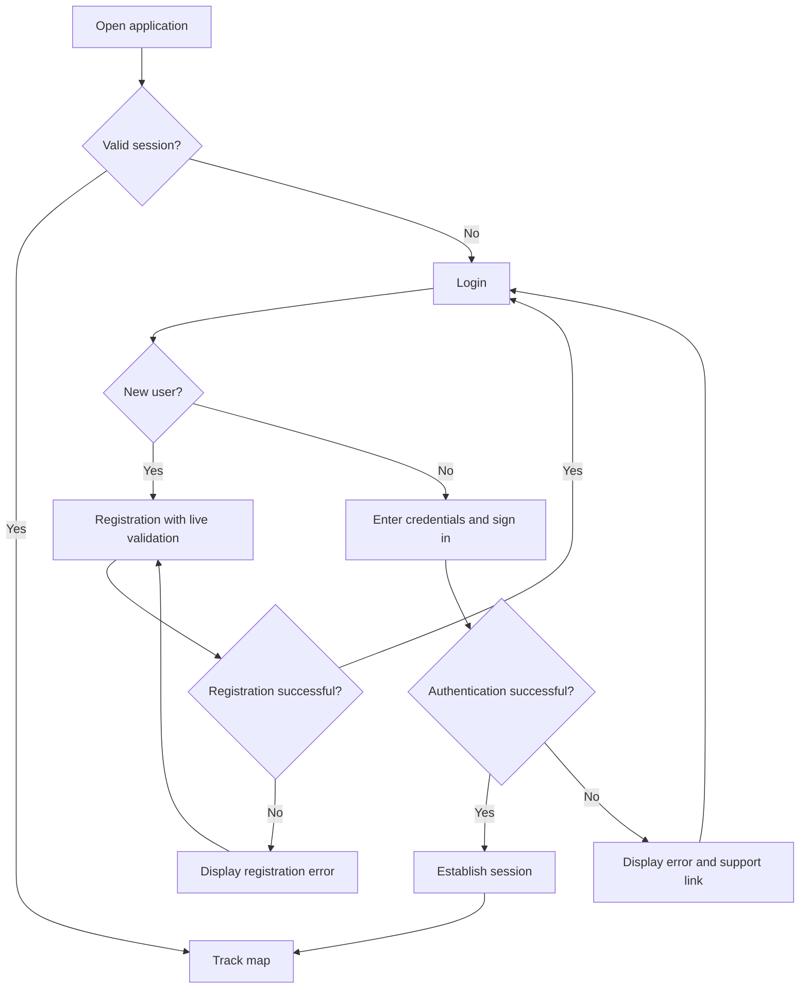
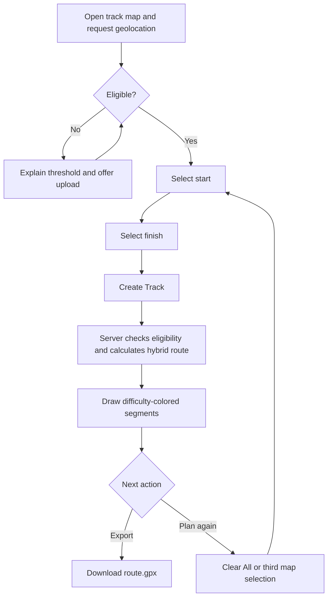
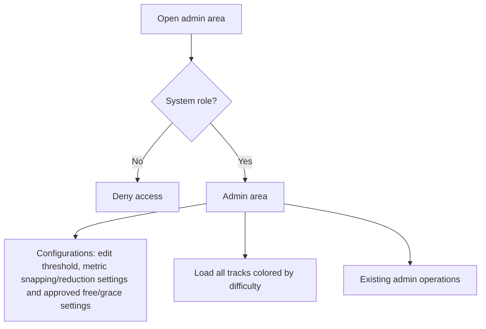
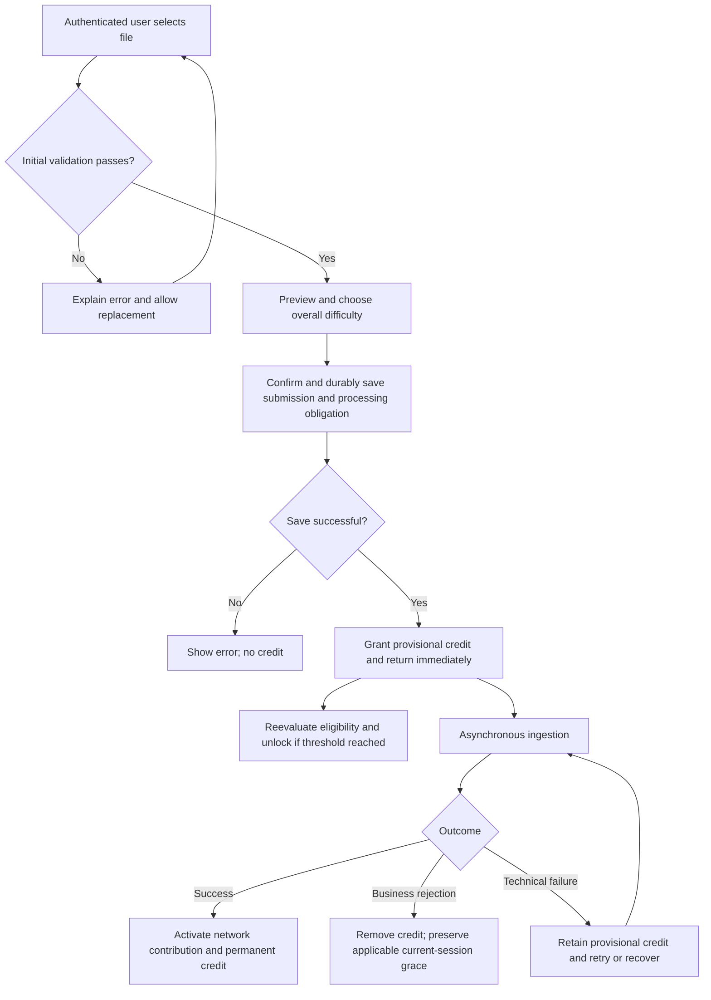
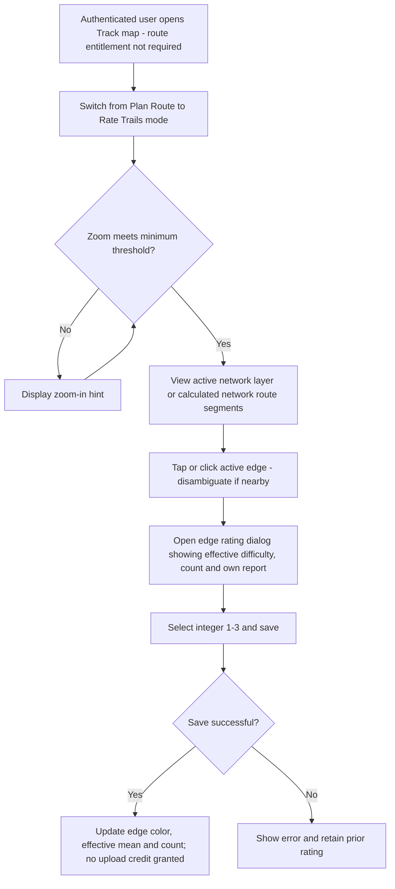
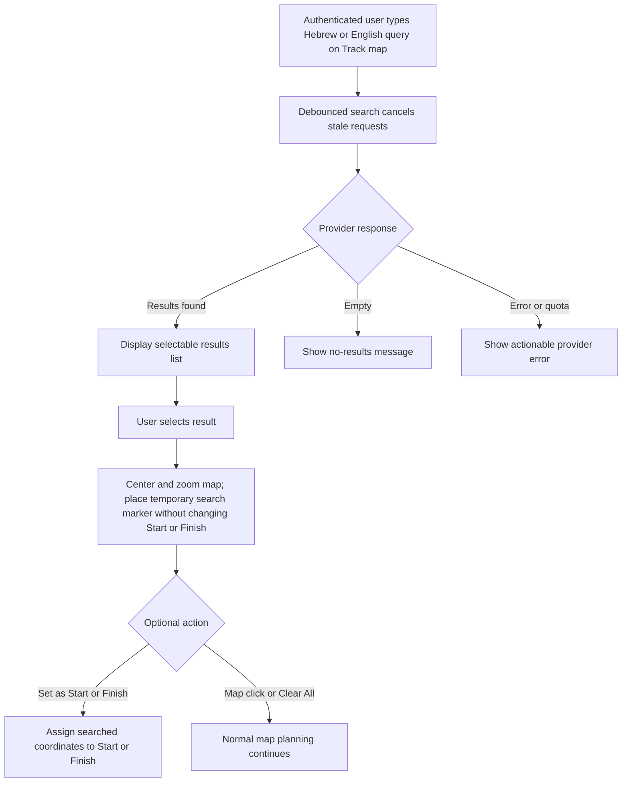
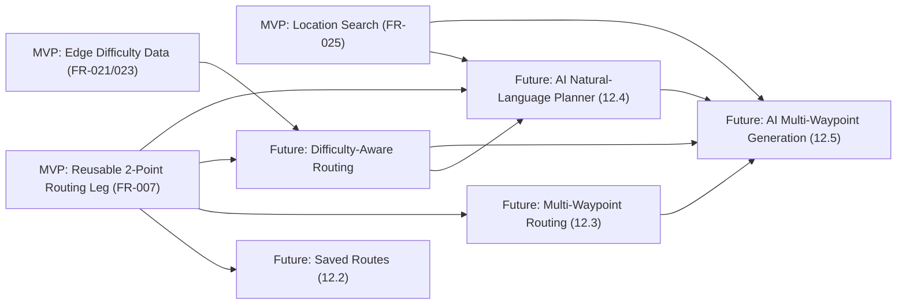

# OnTrack — Product Requirements Document (PRD)

**Target version:** 2.4  
**Purpose:** Rebuild the existing OnTrack web application with the updated product requirements below.

This edition supersedes v2.3: node-only snapping, overall upload difficulty and independent community edge ratings replace geometric overlap matching and upload portion overrides. Immediate provisional credit, asynchronous ingestion and rejection policy remain unchanged. Optional free usage and grace-period settings are explicitly marked as working assumptions. Existing functionality is to be retained unless explicitly superseded by a target requirement. Section 9 documents legacy defects, not behaviors to reproduce. Working assumptions are provisional; unresolved product decisions are listed in Section 10. Technology choices and implementation details are maintained in ARCHITECTURE.md; this PRD remains the product source of truth. The Technical Overview is a reference for the previous implementation, not a constraint on the new architecture.

## 1. Product Overview

### 1.1 Purpose
OnTrack is a web application for planning off-road driving routes for 4x4 vehicles. Users select a start and finish point on a topographic map. The application calculates a route using a shared network of trails collected from previously recorded tracks, supplemented by connecting sections from external routing services. Users can download the resulting route as a GPX navigation file.

### 1.2 Goals
- Encourage community contributions by requiring a configurable minimum number of qualifying track submissions, with immediate provisional credit after validation and durable saving before route creation is enabled.
- Provide trail difficulty information through three difficulty levels and color-coded segments.
- Support full functionality on desktop and mobile browsers.
- Enable off-road drivers to plan routes between two locations without manually assembling every trail segment.
- Combine existing track files into a connected trail network that can be reused to generate new routes.
- Export standard GPX files compatible with navigation applications and devices.
- Provide centralized administration for track ingestion, geographic coverage inspection, configuration and registered-user visibility.

### 1.3 Target Audience
- Off-road enthusiasts and 4x4 drivers. The existing product focuses on Israel, as reflected in its default map location, Hebrew Israel Hiking Map tiles and local track collection.
- System administrators responsible for enriching the track repository, inspecting data quality and monitoring registered users.

### 1.4 Value Proposition
Unlike conventional road navigation or using a single static track file, OnTrack combines multiple off-road tracks into a shared trail network and generates a customized route between a selected start and finish, including access and exit sections, with a downloadable navigation file.

## 2. User Roles and Permissions

| Role | Target capabilities | Restrictions |
|---|---|---|
| Guest (unauthenticated) | Register, log in, switch UI language (`he`/`en`), read privacy policy and terms | No protected screens, uploads or route creation |
| Regular user (`regular`) | View map, search locations (Hebrew/English), view own contribution level & badge, rate active edges, upload track files, view own uploads | Route creation subject to contribution eligibility, optional free usage (`FREE_ROUTE_CREATIONS`, default `0`) and session grace rules; export of an already generated route remains available; contribution level does not grant permissions or affect routing/rating weights; no admin access |
| Administrator (`system`) | Regular-user capabilities plus administration, configuration, all-track and all-point maps, user directory and batch ingestion | Server-side and UI role enforcement; **confirmed exempt** from the upload threshold for route creation and playground testing |
| Inactive user (`inactive`) | None (deactivated account) | **Confirmed blocked** from logging in (generic credential error to prevent enumeration) and denied on all protected screens/APIs |

Every upload must be associated with the authenticated account as determined by the server. Personal data is accessible only to the account owner; administrative data is restricted to administrators. Contribution levels are strictly separate from authentication roles, administrative permissions, route-creation eligibility, and edge difficulty ratings.

## 3. Functional Requirements

Stable requirement identifiers FR-001 through FR-027 are retained and extended. The requirements are grouped into five modules.

### Module A — Authentication & Account Management

#### FR-001 — User Registration
**Goal:** Allow a new user to create an account.

- Collect first name, last name, email, username and password.
- Display a live validation checklist. Enable `Sign up` only when all fields satisfy validation rules.
- Provide links to login, terms of use and privacy policy.
- Validate inputs on both client and server; enforce unique usernames and email addresses.
- Store passwords using a secure one-way salted hash; assign role `regular` by default.
- On success, return account creation confirmation (`succeed`) and redirect to login.
- On failure, display specific errors for invalid or duplicate usernames/emails, invalid passwords, invalid names or general failures.
- First and last names: required, minimum one character, UI maximum 16 characters (legacy storage maximum 50).
- Email: required, valid email format and unique (legacy storage maximum 50 characters).
- Username: 4–32 characters in the UI, English letters only (`a-z`, `A-Z`), unique.
- Password: 4–16 characters under the retained legacy product rules, including at least one lowercase letter, one uppercase letter, one digit and one special character from `@$!%*?&`. See Section 6.1. **Security flag (requires explicit product approval before production):** replacing this weak legacy rule with a modern passphrase-length policy (allowing long passphrases, avoiding arbitrary character restrictions and rejecting common/compromised passwords) is strongly recommended; do not change the active rule silently before approval.
- The retained terms flow uses a textual statement that registration/use constitutes acceptance; an explicit consent checkbox remains an open question.
- Inputs: `first_name`, `last_name`, `email`, `username`, `password`.
- Dependencies: FR-002, FR-016.

#### FR-002 — User Login
- Collect username and password; disable `Sign in` while either field is empty.
- Validate credentials against the stored password hash.
- On success, establish a session with configurable lifetime in days, return authenticated user details and navigate to `/track-map`.
- On failure, show `* Invalid username or password` and expose `Forgot password? contact support`, opening an email draft to support.
- Use the same failure message for unknown usernames and incorrect passwords to avoid account enumeration.
- Provide registration and terms links.
- Legacy behavior did not enforce `inactive` or lock accounts after failed attempts; the target inactive-account policy remains open. Do not treat missing security protections as required behavior.
- Inputs: `username`, `password`. Output: valid session and user details, or authentication failure.
- Dependencies: FR-004, FR-005.

#### FR-003 — User Logout
- Provide `Logout` in the authenticated navigation bar.
- Invalidate the active session on the server, clear local authentication state and navigate to `/login`.
- A successfully revoked session must not be reusable.
- Distinguish three states clearly:
  1. **Confirmed server-side logout:** server revokes the session, clears the cookie, and the client clears local state and navigates to `/login`.
  2. **Local logout during server outage:** if the logout request fails due to server/network unavailability, clear sensitive local authentication state, navigate to `/login`, record a local **pending server-side revocation** state, and do not falsely report confirmed server-side logout.
  3. **Pending server-side revocation:** after local logout, refreshing the browser must not silently restore the old session; when backend connectivity returns, attempt server-side revocation cleanly without revoking any newly created session if the user subsequently logs in again.
- Requires a valid authenticated session for server-side revocation. Output: confirmed logout or local logout with pending revocation, and login navigation.
- Legacy logout failure could leave the user stuck in an authenticated state; see Sections 7 and 9 for historical issues rather than desired behavior.
- Dependencies: FR-002, FR-004.

#### FR-004 — Session & Access Control
- Protect the track map, personal page and admin area. Redirect unauthenticated users or users with expired sessions to `/login`.
- Redirect authenticated users accessing `/login` or `/register` to `/track-map`.
- Verify the current `system` role for admin navigation and all administrative server operations. Unauthorized regular users are redirected to the track map in the UI and denied by the server.
- Restore user identity when opening the application with a valid session, **except** while local logout-pending revocation from FR-003 is active (a valid server-side cookie must never silently restore a locally logged-out session while revocation is pending).
- Display `Hello, <First Name> <Last Name>` and `Logout` in the navigation bar immediately after login, without requiring a refresh.
- Clicking the user's name opens the personal page; administrators receive a separate admin link.
- Sessions expire after a configurable number of days.
- User details include `id`, `username`, `first_name`, `last_name`, `email`, `user_type`.
- Dependencies: FR-002, FR-010, FR-019.

### Module B — Interactive Map & Track Planning

#### FR-005 — Interactive Topographic Map & Geolocation
- Display a Hebrew topographic map of Israel (Israel Hiking Map).
- Support pan and zoom. Default center: latitude `32.6000`, longitude `35.0000`; initial zoom `13`; zoom range `7–16`.
- Request browser geolocation when the map loads. If permission is granted and location is available, display a current-location marker and center the map on the user.
- If permission is denied or geolocation is unavailable, retain the default map center without an error message.
- Inputs: optional browser GPS coordinates and map interactions. Output: interactive map and optional location marker.
- Dependencies: FR-006, FR-007, FR-011.

#### FR-006 — Start & Finish Selection
- First map click/tap selects `Start`, displays a car marker and updates latitude/longitude fields.
- Second click/tap selects `Finish`, displays a road marker and updates its fields.
- Third click/tap clears the previous two markers, resets Finish and establishes a new Start. The legacy interaction retained the previously drawn route until recalculation or `Clear All`.
- Highlight the next required selection label (`Start` or `Finish`).
- Coordinate fields are read-only; display three decimal places but send full-precision coordinates for calculation.
- Only start and finish are supported; intermediate waypoints are not required in this version.
- Dependencies: FR-005, FR-007.

#### FR-007 — Off-Road Route Calculation
**Updated target requirement.**
- Enable `Create Track` only when both endpoints are selected and the authenticated user has contribution eligibility, an applicable grace grant or remaining configured free usage under FR-018.
- Verify eligibility on the server before calculating a route.
- Show global loading feedback and remove the previous calculated route when starting a new calculation.
- Calculate a continuous hybrid route consisting of an access section, a main trail-network section and an exit section, or an external fallback route when appropriate. See Section 6.2.
- Return ordered route points and road segments, with difficulty information for rated segments.
- Render the route using FR-023 difficulty colors; hide loading feedback when processing finishes.
- Enable GPX export only after successful route generation; do not reproduce the legacy empty-route export defect.
- Inputs: `start_lat`, `start_lng`, `end_lat`, `end_lng`.
- Do not display total distance, estimated travel time, elevation profile or overall difficulty in this version. Segment difficulty is displayed through color.
- Calculated routes are not saved to the user's account or added to the shared network. Refreshing the page removes the calculated route.
- Difficulty must not influence route selection, filtering or weighting in this release.
- Dependencies: FR-006, FR-009, FR-015, FR-018, FR-023.

#### FR-008 — Clear All
- Make `Clear All` available at all times on the planning map.
- Remove added map layers, including start/finish markers, calculated route and current-location marker.
- Reset coordinate fields and disable `Create Track` and `Create GPX File`.
- Dependencies: FR-005, FR-006.

#### FR-009 — GPX File Export
- Provide `Create GPX File` after successful route generation. Later loss of eligibility must not prevent export of an already generated route.
- Convert the displayed ordered route points into valid GPX XML with OnTrack metadata, one `trkseg` and `trkpt` elements containing latitude, longitude and elevation when available.
- Omit missing elevation rather than producing invalid values; ensure declared GPX version and schema are consistent.
- Download the file as `route.gpx` with no custom naming flow in this version.
- Retain client-side export without an additional server request, as in the existing product.
- Input: calculated route. Output: valid downloadable GPX file.
- Dependency: FR-007.

### Module C — System Administration & Track Data Management

#### FR-010 — Admin Area
**Updated target requirement.**
- Provide a dedicated administration area within the same web application, accessible only to `system` users through a dedicated navigation link.
- Include a configuration page (FR-022) and a repository map page (FR-011) that loads all tracks on demand.
- Retain the existing admin capabilities: all-point visualization, read-only user directory, batch ingestion and route-planning playground/testing.
- Enforce authorization on the server for every admin operation. Hiding UI controls alone is insufficient.
- No separate application or domain is required. Exact internal admin routes are implementation decisions.

#### FR-011 — All Data Map Visualization
- Enable administrators to inspect geographic coverage, connectivity and density of the shared trail network.
- `Load all tracks`: show loading feedback, retrieve all repository road segments and display them as bold dashed lines (legacy width 6), colored by difficulty per FR-023 rather than track ID.
- `Load all points`: show loading feedback, retrieve all repository points and display circular markers (legacy radius 4). Clicking a point displays its coordinates in a popup.
- Retain the all-data view without geographic/date/track filters or a dedicated clear button. The legacy caching interval is 10 minutes; invalidate or refresh affected data after successful ingestion.
- Dependencies: FR-005, FR-015, FR-023.

#### FR-012 — Users Directory
- Automatically load a read-only directory of registered users in the admin area.
- Display `ID`, `Username`, `First name`, `Last name`, `email`, `User type`.
- Do not expose passwords or account creation dates in this table.
- No search, filtering, sorting, editing, deletion or role modification is required in this version.
- Server-side administrator authorization is mandatory.
- Dependencies: FR-004, FR-010.

#### FR-013 — Batch Track Ingestion
- Retain administrator-controlled imports from cloud storage (`Update Tracks from Cloud`) or a local server directory (`Update Tracks from Server local`).
- Start asynchronous processing and immediately acknowledge initiation. The legacy flow has no dedicated visual progress indicator.
- Scan source files and parse supported formats. Legacy intended support includes GPX and KML; TWL and unsupported formats are skipped. Final supported-format policy remains open.
- Generate a deterministic track identifier, reduce points using a distance threshold, and add points and connections while snapping nearby points to connect the trail network (Section 6.3).
- Send the initiating administrator an email with the number of imported tracks and processing time, or a failure notification.
- Refresh affected map and network data after successful ingestion.
- Batch ingestion is separate from user browser uploads (FR-020).
- The legacy implementation lacked protection against concurrent duplicate batch jobs; this is historical, not a required behavior.
- Inputs: source `cloud` or `server`. Outputs: immediate acknowledgment and completion/failure email.
- Dependencies: FR-010 and shared repository.

### Module D — System Health, UX & Legal

#### FR-014 — Server Health Check & Notification Banner
- Check backend availability on application load and every 60 seconds, on all screens including guest screens.
- Hide the banner when healthy. On failure display a persistent red top banner: `Server is down, please try again later.` with `Contact support if needed` email link.
- Automatically recover the display when the backend becomes available again.
- The legacy periodic check also served to keep free-tier hosting awake; this is historical context.

#### FR-015 — Global Loading Spinner
- Show a translucent dark full-screen overlay with a spinning/bouncing off-road wheel icon and `Loading...` during route calculation and loading all tracks or points.
- Prevent duplicate interactions while those operations are running. Remove the overlay on success or failure.
- The retained global spinner is not used for login, registration, logout or starting batch ingestion; upload-specific feedback is handled in FR-020.
- Dependencies: FR-007, FR-011.

#### FR-016 — Privacy & Terms of Use
- Provide a publicly accessible `/privacy-and-terms-of-use` page linked from login and registration.
- Present the existing nine-section terms/privacy content covering user responsibilities, verification of road conditions, safety/liability disclaimers, limitations of data accuracy, collection and use of personal information, cookies, user conduct and suspension rights, and changes to terms.
- Provide `back to login page` navigation.
- Ensure direct navigation and refresh work in production. The exact legal text must come from the existing product or approved content; this PRD is not the legal text itself.
- Dependencies: FR-001, FR-002.

#### FR-017 — 404 Page Not Found
- Provide a friendly public 404 page for unknown routes with `Page not found!` and an action to return to `/` (legacy button label: `Go back to safty`).
- `/` redirects to `/track-map` or `/login` depending on authentication status.
- Dependency: FR-004.

### Module E — Community Track Contributions, Eligibility, Configuration & Difficulty

#### FR-018 — Route Creation Eligibility
**Updated target requirement.**
- An authenticated user qualifies for contribution-based route creation when the number of qualifying track submissions reaches the configured minimum (default: **1**).
- Award provisional credit immediately after initial validation, overall difficulty selection, explicit confirmation and durable saving of the submission and its processing obligation. Do not wait for graph ingestion or administrator approval.
- Provisional credit counts exactly like permanent credit toward the threshold while processing is pending, running or awaiting technical recovery. Successful ingestion converts it to permanent credit without counting it twice.
- Definitive business rejection removes the contribution credit. Do not interrupt the user's current planning session solely because of such a rejection; reevaluate on the next login. Technical failures must not revoke credit.
- **Working assumption:** Bound rejection-related session grace to a configurable maximum of 24 hours from the rejection that caused loss of eligibility; grace ends at logout, session expiry, revocation or the time limit, whichever comes first. It cannot be transferred to a new session or extended by retries or refreshes. Grant grace only to sessions already eligible before rejection.
- **Confirmed Gate 1 decision:** Offer a configurable lifetime allowance of successful free route creations per account, **confirmed default `0`** (contribution-only policy active by default; administrators may raise it via FR-022). Setting `FREE_ROUTE_CREATIONS = 0` disables free usage cleanly without affecting contribution-based eligibility. When enabled (`> 0`), free allowance is independent of contribution credit and consumed only when neither contribution eligibility nor grace applies.
  - **Successful logical route creation & finality:** A logical route creation succeeds once the server assembles a valid continuous route and atomically settles the reserved allowance prior to transmitting the HTTP response.
  - **Retries & lost responses:** Identical logical requests (same account, logical request ID and normalized inputs) within a bounded replay window must not consume additional allowance, including when the HTTP response is lost after settlement. Temporary internal server-side replay storage is permitted strictly for retry reliability and must not introduce user-visible saved routes or route history.
  - **Concurrency & in-flight entitlement changes (working assumption, pending approval):** Concurrent requests must be serialized/enforced atomically so remaining allowance can never be exceeded, and expired reservations cannot be settled by stale attempts. Failed calculations consume no allowance. If the user becomes independently contribution-eligible or grace-valid while a free-allowance route calculation is in flight (e.g., by confirming an upload), release the reservation without consuming allowance; if the session expires or is revoked in flight, deny completion (`401`) and release the reservation; live owned reservations remain valid for their attempt unless authorization fails, while policy for config reductions during active reservations remains pending explicit approval.
- Ineligible users may view the map, upload tracks and access their personal page. Explain why access is locked, remaining required uploads, any free allowance and grace expiry where applicable, and provide a direct upload action.
- Enforce authorization and eligibility on every route calculation request on the server. Do not rely on a stale client flag or session token claim. Configuration changes apply to subsequent checks (working assumption); grace protects rejection-related loss only, not unrelated authorization changes.
- **Retained working assumptions:** Counts accumulate over the account lifetime. Drafts, failed saves and same-user duplicate files do not count. One file counts once even if it contains multiple segments.
- Dependencies: FR-007, FR-019, FR-020, FR-022; Section 6.5.

#### FR-019 — Personal Page (My Tracks)
- List only the authenticated user's track submissions, including earlier sessions and pending, active, rejected and technically failed submissions.
- Show filename, submission date, processing status, provisional/permanent credit or no credit, and an actionable reason for rejection or a technical-delay message. Show qualifying count, required threshold and applicable free allowance/grace information.
- Refresh status without requiring logout; polling is acceptable. Provide an upload action in empty and rejected states. Do not expose raw internal errors.
- No requirement to save calculated routes, edit/delete uploaded tracks or download uploaded files again in this release.
- Dependencies: FR-004, FR-018, FR-020.

#### FR-020 — Track File Upload & Validation
- Open an authenticated upload modal; select a file and validate it before difficulty editing. Reject invalid files with an actionable explanation and allow replacement.
- Retain the initial validation assumptions: supported format, parseable structure, at least two distinct points, valid coordinates and no artificial links between disconnected segments. GPX is the proposed initial format. File-size/point-count limits and other formats remain open.
- Preview validated geometry on a map and require one overall difficulty (FR-021). Use a server-owned draft; confirmation references validated geometry, not replacement coordinates from the client. Expire abandoned drafts without awarding credit.
- On confirmation, durably store the original file or a recoverable reference, the account association, validated geometry/difficulty data, submission state and a durable obligation to process it. Acknowledge acceptance and update upload history and eligibility immediately after durable acceptance. HTTP 202 Accepted is a suggested API response, not a final ingestion confirmation.
- Automatically process accepted submissions asynchronously; do not block route planning on point reduction, node snapping, edge creation or final ingestion. No manual administrator approval is required.
- Only successfully integrated contributions may affect the shared routing network and aggregated difficulty. Pending, rejected and partially processed submissions must not be visible as active network data.
- Business rejection removes credit according to FR-018 and records an actionable reason. Technical failure schedules recovery/retry and retains provisional credit, including when automated retries are exhausted pending operational intervention.
- Cancellation before confirmation, initial validation failure or durable-save failure creates no qualifying credit. Repeated confirmations or processing retries must not duplicate credit or graph contributions.

#### FR-021 — Overall Upload Difficulty and Community Edge Rating
- Require one overall integer difficulty (1 Easy, 2 Moderate, 3 Hard) per validated upload, with no preselected value. Preview the whole upload using that value; no portion editor is required.
- During asynchronous ingestion, only newly created edges receive that value as their initial difficulty. Reused edges retain their initial difficulty and all existing ratings unchanged.
- Any authenticated, authorized user may explicitly rate an ACTIVE network edge after ingestion, regardless of route-creation entitlement (proposed policy). Provide a viewable network layer on the planning map, independent of route calculation, with selectable edges; calculated network route segments are also selectable. External connectors cannot be rated.
- Selecting an edge opens a dialog showing current effective difficulty, report count and the user's existing rating if present. Submit an integer 1–3; update color and displayed value after successful save. Support mouse and touch; disambiguate nearby selectable edges. Failed saves leave the existing rating unchanged.
- Proposed build policy: one current explicit rating per user per edge, editable; a repeated submission replaces rather than adds a report. Rating an edge does not earn upload credit. No requirement to rate multiple edges together.
- Dependencies: FR-005, FR-018, FR-020, FR-023.

#### FR-022 — Admin Configuration Page
**New requirement.**
- Allow administrators to view product configurations and edit the minimum number of track files required to unlock route creation.
- Default value: `1`. Persist the configuration and use it for server-side eligibility evaluation.
- **Working assumption:** Accept positive integers only. Whether `0` should unlock route creation for all authenticated users remains open.
- **Confirmed Gate 1 defaults:** Also expose `FREE_ROUTE_CREATIONS` (non-negative integer, **confirmed default `0`**) and `REJECTED_TRACK_GRACE_PERIOD_HOURS` (non-negative number of hours, **confirmed default `24`**; `0` disables extended grace; edits apply to future rejections only). `MIN_REQUIRED_TRACKS` defaults to `1`. The free allowance is lifetime-based, not reset by login or configuration edits.
- Expose independent `POINT_SIMPLIFICATION_DISTANCE_M` and `NODE_SNAP_RADIUS_M`, each with proposed default 20 meters, accepting finite positive numbers. Changes apply to future ingestion only; capture both values at job start and retain them for retries. No automatic rebuild of the existing graph.
- Reject invalid values. A failed save must leave the previous value unchanged. Display success or failure feedback.
- Do not expose secrets or API keys on this page.
- Dependencies: FR-010, FR-018.

#### FR-023 — Difficulty-Based Segment Coloring
**New requirement.**
- Use the same three difficulty colors on the planning map, upload preview and admin map. Each rated segment is displayed using its effective difficulty.
- **Proposed palette:** green = 1 Easy; orange = 2 Moderate; red = 3 Hard. Provide a persistent textual legend.
- Color by segment difficulty, not original `track_id`.
- **Confirmed:** Existing unrated tracks default to difficulty level 1.
- **Confirmed:** Conflicting explicit user ratings for the same canonical edge are combined using their arithmetic mean. Initial difficulty is a fallback only when no explicit reports exist (proposed policy). Map the average to one of three display colors using the provisional rule in Section 6.4.
- Treatment of unrated external routing connectors remains open.
- **Confirmed:** Difficulty is for visualization only in this release. Difficulty-based filtering, weighting or route optimization is deferred to a future version.

#### FR-024 — Community Contribution Levels (MVP)
**New MVP requirement.**
- Automatically assign a community contribution level to each registered account based solely on the number of track submissions in **`ACTIVE`** status associated with that account.
- **Proposed level thresholds & names** (terminology may be refined if approved):

| Qualifying `ACTIVE` tracks | Proposed Level |
|---|---|
| `0–5` | Explorer |
| `6–9` | Adventurer |
| `10–19` | Trailblazer |
| `20` or more | Trail Master |

- **Strict separation from route-creation eligibility:** Provisional contribution credit (`PENDING`, `PROCESSING`, `RETRY`, `TECHNICAL_FAILED`) used for route-creation eligibility (`FR-018`) must **not** count toward the contribution level. Only successfully ingested `ACTIVE` tracks count.
- Automatically update the user's level whenever their `ACTIVE` track count changes; persist across sessions.
- Display the current contribution level with a distinct visual badge/icon alongside the user's name in the navigation bar and on the personal page (`My Tracks`).
- Display the user's total qualifying `ACTIVE` count and how many additional `ACTIVE` tracks are needed to reach the next level. Users at the highest level (`Trail Master`, `20+`) display their total count without a next-level target.
- Contribution levels are strictly independent of authentication roles (`regular`/`system`/`inactive`), administrative permissions, route-creation eligibility, and edge difficulty ratings. They must not influence route calculation or weight edge difficulty ratings in the MVP.
- Dependencies: FR-004, FR-019, FR-020.

#### FR-025 — Map Location Search (MVP)
**New MVP requirement.**
- Provide a responsive location search input on the main planning map (`/track-map`) supporting both desktop and mobile browsers.
- Allow authenticated users — regardless of route-creation eligibility — to search geographic locations in **Hebrew and English** (with emphasis on Israel coverage): cities, settlements, roads, landmarks, points of interest, natural sites, and trail-related locations, subject to the evaluated provider's coverage.
- Display matching results in a selectable list, with debounced autocomplete suggestions while typing where supported by the selected provider.
- Selecting a search result centers the map on the result coordinates, adjusts zoom appropriately, and displays a **temporary search location marker**.
- Searching or selecting a search result must **not** automatically overwrite or clear the user's selected route `Start` or `Finish` points.
- Allow the user to use a searched location as route `Start` or `Finish` via the existing map interaction or an explicit action (e.g., `Set as Start` / `Set as Finish` on the search marker/result).
- Handle empty results, ambiguous queries, provider outages, and quota limits gracefully with clear, actionable user feedback.
- Use a **provider-independent geocoding/location-search interface**, keeping search logic separate from the core routing engine; evaluate candidate providers before selecting one (do not hardcode a provider prior to evaluation). Apply debouncing, in-flight request cancellation, permitted caching, and rate limiting.
- Dependencies: FR-005, FR-006, FR-008.

#### FR-026 — Planned Future-Feature Placeholders (MVP UI Only)
**New MVP requirement.**
- Display clear, non-functional **"Coming Soon"** placeholder controls in the MVP UI indicating planned post-MVP capabilities (detailed in Section 12):
  - `Save Route` button (shown after successful route generation on `/track-map`).
  - `My Routes` navigation item or personal-page section.
  - `Add Waypoint` / `Multi-Point Route` button on `/track-map`.
  - `AI Route Planner` button on `/track-map`, displaying a preview/tooltip that also notes the planned `Multi-Stop AI Planning` option.
- Interacting with any placeholder displays a clear "Coming Soon" message or tooltip and **must not** trigger unfinished backend API calls, create database tables, or execute speculative LLM/persistence logic.
- Dependencies: FR-004, FR-007, FR-019; Section 12.

#### FR-027 — Multilingual Support (Hebrew & English, RTL/LTR) (MVP)
**New MVP requirement.**
- Provide full **Hebrew (`he`)** and **English (`en`)** localization across all user-facing and administrative screens from the initial MVP release.
- Provide a visible language selector accessible from both authenticated and unauthenticated screens (including `/login`, `/register`, `/privacy-and-terms-of-use`, `404`, `/track-map`, `My Tracks`, and Admin).
- **Default language:** First-time visitors default to **Hebrew (`he`)**, with the ability to switch to English (`en`) at any time.
- **Persistence:** Persist the selected language across browser refreshes (browser-local storage for unauthenticated users) and across login sessions (persisted on the authenticated user's account).
- **Full RTL/LTR layout:** Render full right-to-left (`dir="rtl"`) layout for Hebrew and left-to-right (`dir="ltr"`) layout for English across all controls, menus, dialogs, forms, and map overlays.
- **Runtime switching without state loss:** Switching languages must take effect immediately without requiring a page reload or losing in-progress application state (selected Start/Finish markers, calculated route, form inputs, open dialogs).
- **Translation completeness:** Translate all menus, buttons, dialogs, live validation checklists, error messages, tooltips, difficulty labels, contribution levels, "Coming Soon" placeholders, health banner, and system notifications.
- **Localized email notifications:** Render outgoing email notifications (including admin batch-import summary and failure emails) in the recipient user's preferred language.
- **Bilingual legal pages:** Provide Privacy Policy and Terms of Use in both Hebrew and English, subject to approved legal translations before production release.
- **Cross-language location search:** Support Hebrew and English map location search (`FR-025`) regardless of the active UI language.
- **Responsiveness & UGC preservation:** Keep all localized screens fully responsive on desktop and mobile in both RTL and LTR. Preserve original user-generated content (account names, usernames, uploaded filenames) verbatim without automatic translation. Map tile labels may remain in Hebrew (Israel Hiking Hebrew) in the MVP.
- Dependencies: FR-001–FR-026.

## 4. Screens and User Interactions

### 4.1 Global Shell
- System health banner visible only when the backend is unavailable (localized in the active UI language).
- Navigation bar / guest header with the OnTrack logo/name (`On…TracK∫` in the original UI, non-clickable in the legacy design), **language selector (`עברית / EN`)** accessible on both guest and authenticated screens (`FR-027`), authenticated-user greeting paired with their **contribution level badge/icon** (`FR-024`), personal-page link (`My Tracks`) via the user's name, `My Routes` (**Coming Soon** placeholder, `FR-026`), separate admin link for administrators, and `Logout`.
- Global loading overlay for applicable long-running operations (localized).

### 4.2 Screen Inventory

| Screen | Route | Audience | Main controls and navigation |
|---|---|---|---|
| Login | `/login` | Guests | Username/password, sign in, registration, terms, conditional support link; success opens track map |
| Registration | `/register` | Guests | Five account fields, live five-indicator validation checklist, errors, sign up, login and terms links |
| Track map | `/track-map`, `/` | Authenticated users | Full available-area map; **Hebrew/English location search bar** with results list & temporary search marker (`Set as Start`/`Set as Finish`); `Plan Route` (default) / `Rate Trails` mode toggle; viewport-bounded active network layer; floating start/finish coordinate controls; Create Track, Clear All, Create GPX File, upload action, eligibility indicator, difficulty legend; edge rating dialog (accessible without route entitlement); **Coming Soon** placeholders (`Save Route` after route generation, `Add Waypoint`, `AI Route Planner` with `Multi-Stop AI Planning`); personal/admin navigation with contribution badge |
| Admin area | Internal route TBD | `system` | Configuration page (eligibility, free/grace settings, independent reduction/snap metric thresholds), all-track/all-point map, user directory, batch import and planning playground; return to user area or logout |
| Personal page (`My Tracks`) | Route TBD | Authenticated users | **Contribution level badge, `ACTIVE` count & tracks remaining to next level** (no next target at `Trail Master`); `My Routes` (**Coming Soon** placeholder); own submissions, statuses, rejection reasons, eligibility counts, optional free allowance and grace; map and upload actions |
| Upload modal | Modal | Authenticated users | File selection, validation, map preview, overall difficulty selection, save/cancel; immediate acceptance and provisional credit after durable save; return to originating screen without waiting for ingestion |
| Privacy and terms | `/privacy-and-terms-of-use` | Everyone | Existing nine-section legal content and login link |
| 404 | Other paths | Everyone | Friendly error and return to root |

## 5. User Flows

### 5.1 Onboarding and Authentication

### 5.2 Route Planning and Export

### 5.3 Admin Workflow

### 5.4 Upload and Unlock Eligibility

### 5.5 Independent Community Edge Rating

### 5.6 Map Location Search (MVP)

## 6. Business Logic

### 6.1 Account Input Validation
- Username: unique, English letters only, 4–32 characters in the UI.
- Password: retained legacy rule of 4–16 characters in the UI, at least one lowercase letter, uppercase letter, digit and special character from `@$!%*?&`; other special characters are not permitted by that rule.
- Email: valid email format, unique.
- First/last name: 1–16 characters in the UI.

### 6.2 Hybrid Off-Road Routing
Retain the intended full trail-network routing behavior rather than the disabled legacy working-tree implementation.

1. Find the geographically nearest trail-network entry point (`first_point_on_track`) to the selected start. Search within configurable geographic radii in meters (CLOSE, then FAR); legacy latitude windows of 0.2 and 0.5 degrees are historical references, not required implementations. Exact radii require testing. If neither finds a point, use the external routing service's `cycling-mountain` profile for a direct start-to-finish fallback (legacy profile).
2. Find the nearest trail-network exit point (`last_point_on_track`) to the selected finish using the same search windows. If none is found, use the external mountain-cycling fallback from the entry to the finish. The legacy implementation omitted the start-to-entry section in this branch; this is a documented continuity defect, not an instruction to omit it in the rebuild.
3. If entry and exit differ, find the globally shortest path through the trail network under the selected cost function, permitting traversal in either direction. **Recommended objective (pending product-owner approval):** total geographic distance in meters. Retain hop-count routing as a legacy comparison mode for the POC. Shortest-path correctness is defined strictly relative to the selected cost function. If disconnected, use an external `driving-car` connection between entry and exit. If entry equals exit, the internal section is empty.
4. Calculate access (start to entry) and exit (exit to finish) sections with the external `driving-car` profile and concatenate them with the main network section, where applicable.
5. Return a continuous ordered route from the selected start to finish, with segment difficulty information where available. Difficulty must never be an input to route costs, filtering or selection in this release.

The named profiles and search radii describe the legacy baseline. The final routing objective (geographic distance vs. hop count) remains pending explicit product-owner approval; the mountain-cycling profile must not be represented as proof of 4x4 passability.

### 6.3 Track Ingestion & Graph Stitching
1. Safely parse supported formats, preserving track/segment separation and correct longitude/latitude order. GPX multi-track policy remains open; never create an artificial link between disconnected segments. Keep the original file and deterministic track identifier.
2. In the worker, reduce excessive GPS point density using `POINT_SIMPLIFICATION_DISTANCE_M` (proposed default 20 m) from the previous retained point. Always retain the first and last source points of each segment during point reduction. Note that preserving source endpoints during reduction does **not** guarantee preserving their exact original coordinates after subsequent node snapping, which may snap an endpoint onto an existing node within `NODE_SNAP_RADIUS_M`. This minimum-distance rule does not guarantee a maximum gap.
3. Process retained points in order. Find the nearest existing node within `NODE_SNAP_RADIUS_M` (proposed default 20 m) using indexed metric search; reuse it or create a node if none exists. Include nodes created earlier in this ingestion; break equal-distance ties deterministically.
4. For each distinct consecutive snapped node pair within the same source segment, reuse an existing undirected edge identified by its unordered endpoint IDs, or create a new edge with the upload's overall difficulty. Skip self-loops caused by snapping. Preserve source provenance and original files. Legacy unrated imports initialize new edges to 1.
5. Never modify an existing edge's difficulty or user reports during ingestion. Publish changes atomically and refresh affected network data after commit.
6. Geometric overlap matching, edge splitting, linear referencing and rating migration are outside this release. Combining point reduction and node snapping can increase effective distances between consecutive graph nodes and introduce geometry deviation, redundant edges, missed connections or false connections between nearby parallel trails or grade-separated crossings. These are acknowledged limitations, not guarantees of physical connectivity or legal passability. Before production release, measure and review: final graph node and edge counts, maximum and percentile distances between consecutive graph nodes, geometry deviation from original recordings, false connections, missed connections, redundant edges, route quality, and ingestion and routing performance. Escalate unacceptable topology error limits to product review rather than silently adding a complex geometric matcher.

### 6.4 Difficulty Aggregation and Display
- Each edge has an initial difficulty: 1 for legacy unrated imports, or the overall difficulty of the upload that first creates it. Later uploads never overwrite it.
- Explicit edge ratings are integers in [1, 3], independent of uploads. Proposed policy: one current report per user and edge; updates replace that report. Keep individual reports for recalculation.
- Effective difficulty = arithmetic mean of explicit reports, or initial difficulty when no reports exist. Initial difficulty is not included in the mean (proposed policy). No averaging of averages.
- Round only for display using the proposed palette:

| Average | Display level | Proposed color |
|---|---|---|
| 1.0 to less than 1.5 | 1 — Easy | Green |
| 1.5 to less than 2.5 | 2 — Moderate | Orange |
| 2.5 to 3.0 | 3 — Hard | Red |

Example: initial 3, first explicit report 1 → effective 1; another report 3 → effective 2. Existing edge reports remain unchanged by additional uploads. Difficulty affects visualization only, never routing cost or filtering. Direction-dependent difficulty and external connector treatment remain open. Do not expose report authors in shared visualization.

### 6.5 Eligibility and Contribution Lifecycle

| Submission state | Contribution credit | Shared network visibility |
|---|---|---|
| DRAFT | None | No |
| PENDING | Provisional | No |
| PROCESSING | Provisional | No |
| RETRY | Provisional | No |
| TECHNICAL_FAILED | Provisional, awaiting operational recovery | No |
| ACTIVE | Permanent | Yes |
| REJECTED | None | No |

State names are illustrative implementation vocabulary. Initial validation failures need not create a durable submission. A definitive business rejection must not be used for infrastructure failures.

`qualifying_count = count(distinct submissions in PENDING, PROCESSING, RETRY, TECHNICAL_FAILED, ACTIVE)`

`contribution_eligible = qualifying_count >= MIN_REQUIRED_TRACKS`

`route_creation_allowed = authenticated_and_authorized AND (contribution_eligible OR valid_rejection_grace OR free_allowance_remaining)`

The free allowance and bounded grace branches are working assumptions pending approval. Check the current threshold and submission states on every request. A rejection reduces the count immediately; an existing eligible session may retain grace under FR-018, but a new login must use current credits and any independently available free allowance. Multiple qualifying submissions count independently; no grace is needed when the remaining count still meets the threshold. Do not revoke an already generated GPX export. Enforce free-usage accounting atomically under concurrent requests.

### 6.6 Asynchronous Ingestion and Reliable Acceptance
- Persist acceptance and the obligation to process before responding successfully. A queue outage must not lose an accepted submission. If durable acceptance fails, do not grant credit.
- Perform point reduction, node snapping and graph stitching outside the interactive request. Publish successful changes atomically so routing never uses a partially integrated track.
- Distinguish definitive input/business rejection from transient or exhausted technical failures. Retry recoverable failures with bounded backoff; retain a recoverable record and surface exhausted technical failures to operations. Preserve credit for technical failures.
- Processing must be idempotent across duplicate messages, concurrent workers and crashes. A successful retry must not increase credit or duplicate edges or contributions. Refresh affected map/network data after commit.
- The architecture baseline is a modular monolith with a persistent database-backed job queue and separate worker, subject to proof of concept. The queue implementation must support atomic acceptance and job submission. A separate broker and transactional outbox are fallback options, not mandatory product requirements. Illustrative domain events: `TrackSubmitted`, `TrackProcessingStarted`, `TrackIngested`, `TrackRejected`, `TrackProcessingFailed`.

## 7. Edge Cases and Error Handling

### 7.1 Existing behavior and legacy defects

| Scenario | Existing behavior / target interpretation |
|---|---|
| Invalid login credentials | Display the generic credential error and support email link. |
| Invalid or duplicate registration details | Specific validation errors are intended; legacy request cancellation and duplicate-email handling defects must not be reproduced. |
| Geolocation permission denied | Load the default map center without a location marker or error message. |
| No local trail coverage | Expand CLOSE to FAR, then use the external fallback as described in Section 6.2. |
| Disconnected network components | Use an external driving-car connection between entry and exit. |
| External routing service fails, exceeds quota or cannot find a route | Legacy code returned empty or partial geometry and enabled export. Do not reproduce this defect; provide failure feedback and do not enable export for an unsuccessful route. |
| Backend unavailable | Display the health banner; hide it when the backend recovers. |
| Session expired or revoked | Deny protected requests and redirect on protected navigation; legacy API authorization errors were not handled centrally in the UI. |
| Logout request fails | Clear local authentication state, navigate to `/login`, record pending server-side revocation so refresh does not silently restore the old session, do not falsely confirm server-side revocation, and attempt revocation once connectivity returns without affecting a newer login. |
| Background import fails | Log the failure and notify the initiating administrator; legacy failure-email handling was broken. |
| Empty or multi-segment GPX | Legacy parser could crash on empty files or silently read only the first track and segment. New upload behavior must validate files; the final multi-track policy remains open. |
| Third map selection after route calculation | Legacy behavior resets endpoint markers but retains the old route until recalculation or Clear All. |
| Direct navigation or refresh of privacy page | Legacy production returned 404; ensure the page is accessible. |

### 7.2 New target edge cases

| Scenario | Required behavior |
|---|---|
| New account with no uploads | Map and upload are available; route creation is locked unless configured free allowance is available. |
| Threshold raised above user's count | Reevaluate eligibility on the next request (working assumption). |
| Corrupt, empty or unsupported track file | Show an actionable error; no qualifying upload is recorded. |
| Cancellation before confirmation or durable-save failure | No credit. |
| Accepted upload while worker or broker is unavailable | Provisional credit granted if durable acceptance succeeds; work remains recoverable. |
| Definitive business rejection after acceptance | Remove credit; preserve applicable current-session grace; reevaluate at next login. |
| Technical processing failure | Retain credit, retry or flag for operational recovery; do not publish partial data. |
| Concurrent or repeated free-route requests | Enforce allowance atomically; failed calculations and duplicate logical requests do not consume extra usage. |
| Difficulty outside 1–3 | Reject save and explain the error. |
| Unauthorized access to another user's personal data or administration | Deny on the server. |
| Upload traverses both existing and new edges | Existing edges retain all ratings; new edges inherit overall upload difficulty. |
| Existing unrated track | Default to difficulty level 1. |
| Conflicting ratings for a shared segment | Calculate the arithmetic mean of valid ratings and use the provisional display rounding rule. |

## 8. Non-Functional Requirements

### 8.1 Performance
- Use indexed spatial searches in meters rather than full scans or legacy latitude windows. Prefer bulk processing over one database round trip per GPS point; preserve segment separation and reduction endpoints (noting that subsequent snapping may shift endpoint coordinates within the snap radius). Before production release, measure on real data: final node and edge counts, maximum and percentile spacing between consecutive graph nodes, geometry deviation from original recordings, false/missed connections, redundant edges, route quality, and concurrent routing responsiveness.
- The legacy all-points and all-roads cache lasts 600 seconds. Invalidate affected representations after committed geometry or rating changes; unchanged representations may be revalidated without retransmitting data. Authorization remains mandatory. See architecture for graph revision and HTTP ETag design.
- Process user uploads asynchronously after durable acceptance; do not block route creation on ingestion.
- Process administrator batch imports asynchronously to avoid blocking the interface, with completion notification by email.
- Provide loading feedback for route calculation and repository visualization.
- Protect system resources with configurable limits (calibrated during POC) covering upload rate limits, maximum file size and point count, maximum outstanding drafts per user, route calculation rate and concurrency limits, external routing provider quota protection, **location search debouncing/cancellation/caching/rate limits**, network viewport extent and request rate limits, and edge rating rate limits. Return clear, actionable feedback when a limit is reached.

### 8.2 Security & Privacy
- Enforce authentication, role authorization, account ownership and route eligibility on the server.
- Treat uploaded files as untrusted input and validate them before processing.
- Do not expose user details or personal metadata in shared route visualization or network/rating APIs.
- Store passwords with a secure salted one-way hash. **Flagged for product approval:** replace the weak legacy 4–16 character password rule before production with a modern passphrase-length policy that checks against common/compromised passwords.
- Use time-limited sessions that can be revoked on logout, with pending-revocation protection when logout fails offline.
- Enforce configurable abuse prevention and resource limits across authentication, upload, routing, viewport query and rating endpoints.
- Provide accessible terms and privacy information explaining data collection and limitations of liability.
- Correct documented legacy security defects: missing/broken admin authorization, in-memory-only token revocation that disappears on restart, and authentication tokens in client-script-accessible cookies. The new authentication architecture is not prescribed here.

### 8.3 Usability and Responsive Design
- **Multilingual UI & RTL/LTR (`FR-027`):** All user-facing and administrative UI text, menus, dialogs, validation/error messages, tooltips, difficulty labels, contribution levels, and email notifications support **Hebrew (default for first-time visitors, full RTL)** and **English (full LTR)**, switchable at runtime without page reload or state loss. Topographic map tile labels remain in Hebrew (Israel Hiking Hebrew) in the MVP. User-generated names and uploaded filenames are preserved verbatim without automatic translation.
- Provide immediate input feedback, highlight the next endpoint selection and disable actions that are unavailable in the current state.
- All user-facing and administrative pages must be responsive and fully usable on desktop and mobile browsers in **both RTL (Hebrew) and LTR (English)** layouts.
- Map interactions, **location search (Hebrew & English regardless of active UI language)**, endpoint selection, file upload, edge selection, difficulty rating, personal page and configuration editing must work with both touch and mouse input.
- Adapt the upload modal and dialogs to the viewport. No page-level horizontal scrolling or inaccessible essential actions in either RTL or LTR.
- Native applications, live navigation and offline operation are not required in this release.

### 8.4 Reliability and Availability
- Recover accepted ingestion jobs after crashes or queue outages, prevent duplicate graph/credit updates, and make exhausted technical failures visible to operations.
- Monitor backend health every 60 seconds and communicate outages clearly.
- Support external routing fallback when the shared trail network does not cover the requested area, subject to external service availability and route continuity.

## 9. Historical Reference — Legacy Functionality and Defects

This section is informational. Do not reproduce legacy bugs or security gaps. Historical implementation details do not override target requirements.

### 9.1 Temporarily Disabled Functionality
- The committed `calculate_route` implementation includes the internal trail graph, but uncommitted local changes bypassed point retrieval and nearest-point lookup. Consequently, the old working tree always used the external `cycling-mountain` fallback. Restore the intended shared-network capability in the rebuild.

### 9.2 Broken or Defective Legacy Functionality
1. FR-001: The registration request was canceled immediately by the client; server-side first-name handling used an incorrect value structure and duplicate-email validation was incomplete.
2. FR-004: The navigation bar did not show the authenticated user or Logout until a full page refresh.
3. FR-016: The production server did not handle the direct privacy/terms URL.
4. FR-013: KML latitude and longitude were reversed, placing tracks at incorrect locations.
5. FR-009: Exported GPX contained extraneous quotes around elevation, potentially an `undefined` value, and inconsistent GPX version/schema declarations.
6. FR-012 and FR-013: Admin role checks were ineffective or absent for the user directory and graph updates. All-data endpoints also lacked administrator-role enforcement.
7. FR-013: Failure notifications for background imports could themselves fail before the summary stage.

### 9.3 Partial or Unimplemented Legacy Features
- TWL parsing was a stub despite 99 TWL files in the local dataset.
- `inactive` user status existed without enforcement or a management interface.
- User administration was read-only; no create/edit/delete/role-change/deactivation controls.
- Password reset was handled manually through support email.
- Start/Finish coordinate fields were read-only, not manually editable.
- A cache invalidation function existed but was never called after imports.

### 9.4 Unused Legacy Components
- Configuration for a separate graph-update service (`update_graph_service`), later merged back into the main application.
- Unused queue/external-cache infrastructure settings (Celery, Redis) and old server-rendered HTML pages.

### 9.5 Unknowns in the Previous Production Environment
- Actual quantity, quality and geographic coverage of tracks and points in production/staging.
- Actual point-reduction and snapping thresholds in meters, and session lifetime in days. These were assumed to be deployment-specific settings not exposed in the source document.
- Current availability and configuration of external storage, routing/map credentials and email services.

## 10. Open Product Decisions

Confirmed decisions are incorporated into the requirements. Do not treat the remaining questions as authorization to add features or finalize product policy silently.

### 10.1 Consolidated Decisions Grouped by Execution Gate

All recommended defaults below are **unapproved working assumptions** until explicitly signed off by the product owner. Decisions are grouped by when they must be decided so unrelated work is never blocked unnecessarily:

#### Gate 1 — Early Decisions Required Before Final Schema & Contract Freeze (`T-000` — **APPROVED**)

| Topic | Affected area | Confirmed Decision (Approved by Product Owner) |
|---|---|---|
| Free route allowance (`FREE_ROUTE_CREATIONS`) | Entitlement schema, reservation/replay, `T-015`/`T-016` | **Confirmed: default `0`** (contribution-only initially; remains configurable via FR-022) |
| Rejection grace (`REJECTED_TRACK_GRACE_PERIOD_HOURS`) & config-edit rule | Session schema, entitlement, `T-015` | **Confirmed:** current eligible session, bounded to `24` hours; config edits apply to future rejections only |
| In-flight entitlement changes during route calculation | Settlement logic, `T-015`/`T-016` | **Confirmed:** release reservation unconsumed if user becomes independently eligible; reject `401` if session revoked/expired |
| Admin routing exemption | Entitlement & admin playground contracts, `T-015`/`T-018`/`T-024` | **Confirmed:** exempt `system` administrators from upload threshold for route creation & testing |
| Same-user duplicate detection policy | Upload schema & unique constraint, `T-015` | **Confirmed:** deterministic 6-decimal normalized geometry fingerprint (ignoring metadata) |
| Cross-user duplicate uploads | Track & provenance schema, `T-014`/`T-015` | **Confirmed:** allowed |
| Credit for valid uploads adding no new edges | Ingestion & eligibility, `T-014`/`T-015` | **Confirmed:** qualifies, subject to same-user duplicate policy |
| One editable rating per user per edge | Rating schema & contracts, `T-017` | **Confirmed:** yes — re-rating replaces prior report |
| Initial difficulty in explicit rating mean | Rating aggregation, `T-017` | **Confirmed:** excluded (`No`); initial value is fallback only when 0 explicit reports exist |
| Rating without routing entitlement & zero upload credit | Authorization contracts & map UI, `T-017`/`T-022` | **Confirmed:** rating allowed without route entitlement; grants zero upload credit |
| Password policy | Auth backend & UI validators, `T-010`/`T-021` | **Confirmed for now:** retain legacy 4–16 char rules from FR-001 (modern passphrase upgrade deferred) |
| Supported upload formats | Parser & upload modal, `T-014`/`T-015`/`T-023` | **Confirmed:** GPX (all `<trk>`/`<trkseg>` preserved separately) |
| Inactive-user (`inactive`) access policy | Auth & authorization, `T-010` | **Confirmed:** block login (generic error) and deny all protected endpoints/screens |

#### Gate 2 — POC-Dependent Decisions (Decided After Phase 1 / Real-Data Benchmarks)

| Topic | Affected area | Recommended default (assumption — pending approval) |
|---|---|---|
| Routing cost objective & entry/exit candidate selection | Routing service (`T-016`, `T-028`) | Geographic distance in meters (`hops` legacy comparison); strict nearest-node baseline |
| Point reduction threshold (`POINT_SIMPLIFICATION_DISTANCE_M`) | Ingestion & admin config (`T-003`, `T-028`) | `20` meters, POC-gated |
| Node snapping radius (`NODE_SNAP_RADIUS_M`) | Ingestion & admin config (`T-003`, `T-028`) | `20` meters, POC-gated |
| Acceptable topology error limits & routing provider | Ingestion & routing (`T-003`, `T-004`, `T-028`) | Reviewed from real-dataset POC metrics; ORS vs. GraphHopper |
| Geocoding / location-search provider (`FR-025`) | Location search adapter (`T-030`, `T-028`) | Selected after evaluating Israel Hebrew/English coverage, POI quality, autocomplete, terms, quotas & cost |
| Contribution level display names & badge iconography (`FR-024`) | UI & domain labels (`T-013`, `T-023`) | Proposed: `Explorer` (0–5), `Adventurer` (6–9), `Trailblazer` (10–19), `Trail Master` (20+); pending final copy sign-off |

#### Gate 3 — Required Only Before Production Release (`T-028` / `T-029`)
- Approved 9-section Privacy & Terms legal copy **in both Hebrew and English** (`FR-016`, `FR-027`), `SUPPORT_EMAIL`, external connector styling/disclaimer, production VPS sizing, and legacy password hash migration policy.

#### Non-Blocking Future Decisions (Deferred Beyond MVP)
- Saved routes, multi-waypoint routing, AI natural-language route planning, AI multi-waypoint route generation, and difficulty-aware routing are now documented as planned **Future Releases** in **Section 12** (with MVP UI placeholders only per `FR-026`).
- Remaining non-blocking future explorations: geometric overlap matching, edge splitting, rating migration, manual geometry editing, direction reversal, guest map access, OAuth/self-service reset, offline/native mobile apps, nature-reserve/military-zone overlays, and direction-dependent difficulty.

### 10.2 Detailed Open Product Questions

1. **Community contributions & levels:** Gate 1 contribution policies are confirmed (`T-000`). Decide final naming/iconography for contribution levels (`FR-024`) and the impact of future deletion of `ACTIVE` tracks on both eligibility and contribution level.
2. **File formats:** GPX is confirmed for MVP user uploads (`T-000`). Decide future expansion to KML, TWL (Amud Anan / Off-Road), and GeoJSON for user uploads and exports.
3. **Planning capabilities:** Location search (`FR-025`) is now in MVP; multi-waypoint planning is moved to Section 12.2. Decide whether future versions should add manual geometry editing, direction reversal, manually entered coordinates, total distance, travel time, elevation profile, overall difficulty and road/off-road breakdown.
4. **Routing objective:** Confirm geographic distance in meters (recommended) vs. legacy hop count, or future objectives (maximizing off-road travel, minimizing paved road, circular trips). Also confirm whether entry/exit selection must strictly pick the geographically nearest node or may prefer connected candidates. Difficulty-aware routing is tracked in Section 12.
5. **Location search provider (`FR-025`):** Select the production geocoding provider after evaluating Israel Hebrew/English coverage, POI accuracy, autocomplete support, usage restrictions, quotas and cost.
6. **Geographic coverage and additional languages:** Bilingual **Hebrew (default, RTL) and English (LTR)** UI and Hebrew/English location search are **confirmed for MVP (`FR-027`)**. Decide Israel-only versus international geographic coverage and whether additional UI languages should be added in future releases.
7. **Accounts, security and authorization:** Legacy 4–16 character password rules and `inactive` blocking are confirmed for MVP (`T-000`). Decide timing of modern passphrase upgrade, guest map access, email verification, self-service password reset, social login (OAuth), user administration CRUD, and role management.
8. **Mobile field usage:** Desktop/mobile browser support is confirmed. Offline operation and live navigation remain future decisions.
9. **Repository quality management:** Decide admin access to individual-track metadata, deletion of invalid/blocked tracks, identification of prohibited trails (including nature reserves and military training areas), and additional map layers.
10. **Legal consent:** Decide whether explicit consent via checkbox and recorded acceptance is required during registration.
11. **Administration:** Admin area within the same application and admin routing exemption are confirmed (`T-000`). Decide which additional product configurations should be editable (e.g., whether `MIN_REQUIRED_TRACKS = 0` should ever be allowed).
12. **Difficulty assumptions:** Palette, rounding, initial-difficulty exclusion, 1 editable report/user/edge, and rating without route entitlement are confirmed (`T-000`). Decide external-connector styling/treatment and direction-dependent difficulty.
13. **Upload policy & snapping thresholds:** Confirm `20 m` defaults and acceptable topology error limits after the real-data snapping POC (`T-028`), and decide whether a future rebuild should migrate existing ratings.

## 11. Acceptance Criteria for Updated Requirements

| ID | Test scenario | Expected result |
|---|---|---|
| AC-01 | New account; threshold = 1; free allowance = 0 | Route creation is disabled in the UI and rejected by the server. |
| AC-02 | Valid upload, overall difficulty selection and durable save; worker paused | Track appears as PENDING on the personal page; provisional credit unlocks route creation immediately at threshold 1. Shared network remains unchanged until successful ingestion. |
| AC-03 | Admin changes threshold to 2; user has one qualifying upload; no free allowance or grace | User needs one additional qualifying upload, under the working assumption that changes apply to existing users. |
| AC-04 | Invalid file, cancellation or save failure | No qualifying count increase; failures include an explanation. |
| AC-05 | Upload overall difficulty 3 across existing level-2 edge and a new edge | Existing initial difficulty and reports remain unchanged; new edge initializes to 3. |
| AC-06 | Logout and login again | Upload history and eligibility persist by account and reflect the current threshold. |
| AC-07 | Regular user requests admin configuration or another user's personal list | Server denies the request. |
| AC-08 | Admin clicks Load all tracks | All repository tracks are displayed by difficulty, including default level 1 for existing unrated tracks. |
| AC-09 | Upload, edge selection, route creation and administration on desktop and mobile | Actions are accessible and usable on both device types. |
| AC-10 | Existing track with no rating | Display level 1. |
| AC-11 | Two valid ratings of 1 and 3 for the same segment | Arithmetic mean = 2; display level 2. |
| AC-12 | Valid track after overall difficulty selection and save | Automatic ingestion with no administrator approval step. |
| AC-13 | Administrator enters the admin area from the application | Admin area is within the same application; a regular user is denied access. |
| AC-14 | Change only difficulty ratings, without changing geometry or routing inputs | Difficulty does not filter, weight or prioritize route selection in this release. |
| AC-15 | Worker completes an accepted submission | Status becomes ACTIVE; provisional credit becomes permanent with no increase in total qualifying count; graph and difficulty data become available. |
| AC-16 | Definitive business rejection causes count to fall below threshold | Credit is removed, rejection reason appears, existing eligible session retains applicable grace; next login requires sufficient credit or remaining free allowance. |
| AC-17 | Worker crashes or technical retries are exhausted | Provisional credit remains; work is recoverable; partial graph changes are not published. |
| AC-18 | Worker unavailable after durable acceptance | User receives immediate credit and the durable queued job remains available for later processing. |
| AC-19 | Duplicate confirmation or redelivered job | No duplicate credit, contribution or rating. |
| AC-20 | Proposed free allowance = 1; no contribution credit | First successful logical route creation consumes one allowance; failed calculation does not; subsequent new calculation is blocked unless otherwise eligible. |
| AC-21 | Concurrent free requests with one remaining allowance | At most one distinct successful route consumes the allowance. |
| AC-22 | Proposed rejection grace expires or session ends | New route calculations require current eligibility; existing generated route remains exportable. |
| AC-23 | Valid upload but durable acceptance fails | No credit or success acknowledgement; user can retry safely. |
| AC-24 | Retained points within and outside configured snapping radius; reverse traversal | Nearest node within radius reused; outside creates node; unordered node pair reused; no self-loop or duplicate edge. |
| AC-25 | Change independent reduction and snap thresholds; inspect parallel and crossing fixtures | New jobs use saved settings; existing graph unchanged by configuration edit; endpoints and segment gaps preserved; false joins and redundant edges measured and reviewed, not claimed impossible. |
| AC-26 | Ingestion running while another eligible user plans a route | Routing can use a consistent committed network without waiting for the upload to complete; responsiveness is measured in the POC. |
| AC-27 | Admin reloads unchanged map, then reloads after a committed rating or geometry change | Unchanged response may be reused; changed data is returned on revalidation; unauthorized requests are denied even on cache hits. |
| AC-28 | Authenticated user selects an active edge without route entitlement and rates it | Explicit rating saved; mean, color and report count update; no upload credit; external or unknown edges cannot be rated. |
| AC-29 | Same user rates an edge again; another user rates it | First report replaced; one report per user; initial value excluded from mean; graph revision updated atomically. |
| AC-30 | Admin edits both metric thresholds or submits invalid values | Defaults 20 m each; positive finite values persisted independently; invalid save leaves settings unchanged; new ingestion uses a stable configuration snapshot. |
| AC-31 | User has 0–5, 6–9, 10–19, or 20+ `ACTIVE` uploads vs. `PENDING` uploads | Only `ACTIVE` uploads count toward contribution level (`Explorer`, `Adventurer`, `Trailblazer`, `Trail Master`); provisional `PENDING` credit unlocks routing without changing level; badge, count and remaining-to-next-level display in navbar and `My Tracks` (no next target at `Trail Master`); persists across sessions and does not alter roles, routing, or rating weights. |
| AC-32 | Authenticated user (with or without route entitlement) searches Hebrew and English locations on `/track-map` (desktop & mobile) | Debounced results list displays; selecting a result centers/zooms map with a temporary marker without altering selected Start/Finish; user can explicitly set searched location as Start or Finish. |
| AC-33 | Location search returns empty results, ambiguous matches, provider failure, or hits rate/quota limit | Clear, actionable user feedback is displayed without crashing or corrupting current route endpoints. |
| AC-34 | User views or clicks `Save Route`, `My Routes`, `Add Waypoint`, or `AI Route Planner` (including `Multi-Stop AI Planning`) | Placeholder controls are visible with clear "Coming Soon" message/tooltip and invoke zero unfinished backend API calls or database persistence. |
| AC-35 | First-time user opens app and switches language between Hebrew and English while holding active map/form state | App defaults to Hebrew (`dir="rtl"`); switching to English updates all menus, buttons, dialogs, validation/error messages, tooltips, difficulty labels, contribution levels, and placeholders to English (`dir="ltr"`) at runtime with zero reload and zero loss of selected Start/Finish, route, or form state. |
| AC-36 | Guest refreshes browser after switching language; authenticated user switches language, logs out and logs back in; admin triggers batch import | Guest preference persists across refresh; authenticated preference persists on the user account across login sessions; outgoing batch-import emails are rendered in the initiating admin's preferred language; user names and uploaded filenames remain verbatim without translation. |
| AC-37 | User navigates all screens and runs Hebrew/English location search on desktop and mobile in both RTL (Hebrew) and LTR (English) | All layouts remain responsive with zero horizontal overflow in both RTL and LTR; Hebrew and English location search work regardless of active UI language; Privacy & Terms renders in the active language. |

---

## 12. Future Releases (Outside MVP Scope)

The capabilities below are explicitly **outside the MVP**. They must not introduce speculative database tables, LLM SDKs, saved-route persistence, multi-waypoint computation, or difficulty-aware routing into the MVP. Only the UI placeholders defined in `FR-026` ship in the MVP.

### 12.1 Scope Summary

| Feature | MVP functionality | MVP placeholder | Future implementation |
|---|---|---|---|
| Community contribution levels (`FR-024`) | Yes | No | Extensions only |
| Map location search (`FR-025`) | Yes | No | Extensions only |
| Saved routes | No | Yes (`Save Route`, `My Routes`) | Yes |
| Multi-waypoint routing | No | Yes (`Add Waypoint` / `Multi-Point Route`) | Yes |
| AI-assisted natural-language route planning | No | Yes (`AI Route Planner`) | Yes |
| AI-assisted multi-waypoint route generation | No | Yes (`Multi-Stop AI Planning` inside AI planner) | Yes |
| Difficulty-aware routing | No | Through AI planner | Yes |

### 12.2 Saved Routes (Future)
- **Planned functionality:** Allow authenticated users to save a generated route with a name and optional description, manage saved routes in a private `My Routes` section (reopen on map, export GPX, rename, delete). Sharing remains out of scope until separately approved.
- **MVP placeholder:** `Save Route` button shown after successful route generation; `My Routes` nav item or personal-page section.
- **Architectural considerations:** Keep a clean conceptual separation between community uploaded `tracks` and future user-owned `saved_routes` (preserving geometry, waypoints, segment snapshot, and routing parameters, and deciding how to reflect later network/rating changes). Do **not** add a `saved_routes` table in the MVP; MVP routes remain ephemeral.

### 12.3 Multi-Waypoint Route Planning (Future)
- **Planned functionality:** Select Start, one or more intermediate waypoints, and Finish in user-specified order (no automatic TSP optimization required); calculate one continuous route with difficulty colors; add/remove/reorder waypoints before recalculation; export one continuous GPX track. Configurable point limit (proposed initial cap: `5` total points including Start and Finish) to protect latency and external routing quotas.
- **MVP placeholder:** `Add Waypoint` / `Multi-Point Route` button on `/track-map`.
- **Architectural considerations:** Structure the MVP routing service around a reusable two-point leg calculation (`origin → destination`) so multi-leg composition can later be layered on cleanly without breaking two-point MVP behavior. Account later for cumulative latency, external provider quotas, inter-leg continuity, and partial-leg failure handling.

### 12.4 AI-Assisted Route Planning — Natural Language Input (Future)
- **Planned functionality:** Natural-language prompt input (e.g., *"Create an off-road route from Haifa to Mount Carmel, preferably using easy and moderate trails and avoiding difficult sections"*). A provider-independent LLM extracts structured, validated routing parameters (start, finish, preferred/avoided difficulty levels, future preferences), resolves place names via the location-search/geocoding service (`FR-025`), asks clarification questions on ambiguity, lets the user review & confirm extracted parameters, and delegates actual route geometry strictly to the existing routing engine.
- **MVP placeholder:** `AI Route Planner` button on `/track-map`.
- **Architectural considerations:** Keep LLM intent extraction strictly separate from geocoding and route calculation; the LLM must never invent trail geometry or connections. Design MVP routing request contracts to accommodate optional future preference fields without implementing difficulty-aware routing or LLM calls in the MVP.

### 12.5 AI-Assisted Multi-Waypoint Route Generation (Future)
- **Planned functionality:** Natural-language multi-stop trip planning (e.g., *"Plan a route from Haifa to the Sea of Galilee, passing through Mount Carmel and a scenic viewpoint, using mostly easy off-road trails"*): extract start/finish, explicit intermediate stops, and generic POI types (viewpoints, picnic areas); retrieve candidate POIs and geocode all stops; present an ordered editable list of proposed stops and preferences for user confirmation; compute one continuous route via the multi-waypoint routing engine and allow GPX export. Must never invent locations, assume inaccessible trails are passable, or represent unverified routes as guaranteed 4x4-passable.
- **MVP placeholder:** `Multi-Stop AI Planning` option shown inside the planned `AI Route Planner` UI preview/tooltip.
- **Architectural considerations:** Reuse the location-search/geocoding service, multi-waypoint routing engine, natural-language intent extractor, and future difficulty-aware routing rather than creating an AI-specific routing engine; enforce waypoint, LLM, and external API usage limits.

### 12.6 Dependencies Between Future Capabilities

