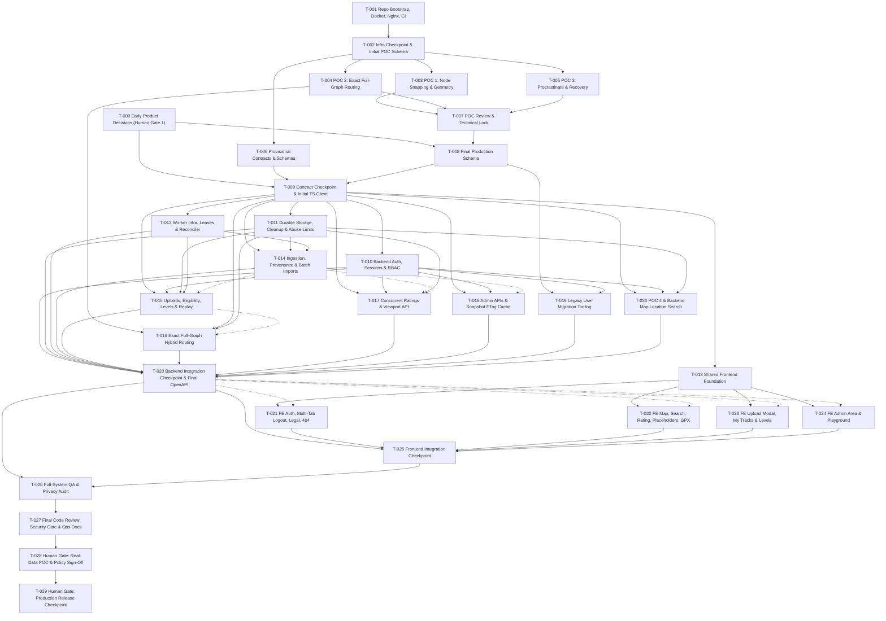

# OnTrack v2.4 — Engineering Execution Plan & Dependency DAG (`TASKS.md`)

**Inputs:** `docs/PRD.md` (v2.4), `docs/SPEC.md` (v2.4, `AC-1`–`AC-112`), `docs/ARCHITECTURE.md` (v2.4)  
**Workflow Rules:** `.agents/rules/team-workflow.md`  
**Total Tasks:** `31` (`T-000`–`T-030`)

---

## 1. Swarm Coordination, Lifecycle & Change-Impact Rules

### 1.1 Task Lifecycle & Dependency Semantics
The **actual dependency graph** (not phase headings) governs when tasks run. Every task declares two distinct dependency lists:
- **Start Dependencies:** Prerequisites required before an agent may begin coding (`IN_PROGRESS`) — e.g., frozen contracts, initial schema, or shared interfaces.
- **Completion Dependencies:** Prerequisites required before a task may transition from `IMPLEMENTED` → `INTEGRATED` → `VERIFIED` → `DONE` (real backend/service integration, passing integration tests, QA & review).

```text
TODO → CONTRACT_READY → IN_PROGRESS → IMPLEMENTED → INTEGRATED → VERIFIED → DONE
```

- **No Mock-Only Completion:** A task working solely against mocks or stubs stops at `IMPLEMENTED`; it may never be marked `DONE` (`[x]`) until all **Completion Dependencies**, real integration tests, and code/security reviews pass.
- **Incremental QA & Early Security Review:** Every implementation task ships its own unit + integration tests and passes scoped code review. Security-sensitive tasks (`T-010`, `T-011`, `T-012`, `T-015`, `T-017`, `T-018`) run an early `security-auditor` check before moving to `VERIFIED`.
- **Change-Impact & Reverification Protocol:** Whenever POC results (`T-007`, `T-028`) or product decisions (`T-000`, `T-028`) alter a contract, config policy, provider, queue, password rule, or snapping threshold:
  1. Identify all affected requirements and `SPEC AC-*`.
  2. Identify affected contracts and tasks.
  3. Reopen affected `DONE` tasks to `IN_PROGRESS`.
  4. Regenerate `openapi.json` and `frontend/src/app/api-client/` via `T-020`.
  5. Re-run all affected unit, integration, and E2E suites.
  6. Re-run `security-auditor` for any affected security boundary.
  7. Update `docs/QA_REPORT.md` — production release cannot reuse stale QA evidence.

### 1.2 Exclusive Shared-File Ownership (Zero Overlap)

No two parallel tasks may own the same file or nested directory. Shared files are exclusively modified at designated checkpoints:

| Shared Resource / Path | Sole Owner Task(s) |
|---|---|
| `docker-compose.yml`, `nginx/`, `.env.example`, `backend/pyproject.toml`, `backend/Dockerfile`, `frontend/package.json`, `.github/workflows/ci.yml` | `T-001` (init), `T-029` (prod) |
| `backend/app/core/db.py`, `backend/app/core/config.py`, `backend/alembic/versions/0001_poc_foundation.py` | `T-002` (init), `T-007` (POC config updates) |
| `backend/app/core/models.py`, `backend/alembic/versions/0002_production_schema.py` | `T-008` (final schema), `T-020` (checkpoint) |
| `backend/app/core/rate_limit.py`, `backend/app/workers/cleanup_jobs.py` | `T-011` |
| `backend/app/workers/app.py`, `backend/app/workers/reconciler.py`, `backend/app/workers/lease.py` | `T-012` |
| `backend/app/workers/ingestion_jobs.py` | `T-014` |
| `backend/app/contracts/`, `backend/openapi.json`, `frontend/src/app/api-client/`, `frontend/src/app/shared/contracts/` | `T-009` (freeze/gen), `T-020` (final sync) |
| `backend/app/main.py` (FastAPI router & middleware wiring) | `T-020` |
| `frontend/src/app/core/`, `frontend/src/app/shared/map/`, `frontend/src/app/shared/ui/`, `frontend/src/assets/i18n/shared/` | `T-013` |
| `frontend/src/assets/i18n/{auth,map,upload,admin}/` | `T-021` (`auth/`), `T-022` (`map/`), `T-023` (`upload/`), `T-024` (`admin/`) — strictly scoped per feature |
| `frontend/src/app/app.routes.ts`, `frontend/src/app/app.config.ts` | `T-025` |
| `frontend/src/app/features/legal/legal-content.ts` | `T-021` (bilingual `he`/`en` dev placeholder + guard), `T-029` (approved bilingual prod copy) |

### 1.3 Credit-Safe Batch Execution Policy (Mandatory for Orchestrator / Swarm)

To keep token/credit consumption predictable and prevent half-finished runs if quota runs low, the orchestrator **MUST** obey these execution limits:
1. **Execute ONLY ONE Batch per swarm run** (2–3 tasks max per run unless the user explicitly names a different set), then **STOP**, summarize completed tasks, and wait for the user to confirm they have enough credits for the next batch.
2. **Concurrency Cap:** Spawn **at most 2–3 concurrent worker agents** at any time — never fan out 5–10 agents simultaneously.
3. **Commit-Per-Task Checkpoint:** As soon as a task passes its scoped tests/review, update its checkbox in `docs/TASKS.md` (`[x]`) and create an atomic `git commit` so zero progress is lost if credits run out mid-batch; the next run resumes from the first `[ ]` task in the active batch.
4. **Token-Thrifty Context Reading:** Workers read only `docs/TASKS.md` (their assigned task) and the **relevant sections** of `docs/SPEC.md` and `docs/ARCHITECTURE.md` (using line ranges rather than re-reading all 4 full documents on every turn).

| Batch | Tasks in Batch | Max Parallel Workers | Relative Credit Cost | Stop Condition |
|---|---|---|---|---|
| **Batch 1** | `T-001` → `T-002` | 1 (sequential) | **Low** | Repo skeleton, Docker & initial POC schema green |
| **Batch 2** | `T-003`, `T-004` | 2 | **Medium** | Snapping POC & Routing POC harnesses pass |
| **Batch 3** | `T-005`, `T-006` → `T-007` | 2, then 1 | **Low–Medium** | Queue POC & technical choices locked |
| **Batch 4** | `T-008` → `T-009` | 1 (sequential) | **Medium** | Production schema + frozen OpenAPI & Angular client |
| **Batch 5** | `T-010`, `T-011`, `T-012` | 3 | **Medium** | Auth, Storage/Limits, and Worker infra green |
| **Batch 6** | `T-013`, `T-019`, `T-030` | 3 | **Medium** | Angular i18n/RTL shell, User Migration, Search API |
| **Batch 7** | `T-014` → `T-015` → `T-016` | 2 (start), 1 (integrate) | **Medium–High** | Ingestion/Batch, Uploads/Levels, Hybrid Routing |
| **Batch 8** | `T-017`, `T-018` → `T-020` | 2, then 1 | **Medium** | Ratings/Viewport, Admin APIs, Backend Checkpoint |
| **Batch 9A** | `T-021`, `T-022` | 2 | **Medium** | FE Auth/Legal/404 + FE Map/Search/Rating/GPX |
| **Batch 9B** | `T-023`, `T-024` → `T-025` | 2, then 1 | **Medium** | FE Upload/My Tracks + FE Admin + FE Checkpoint |
| **Batch 10** | `T-026` → `T-027` | 1–2 | **Medium–High** | Full E2E/Privacy QA + Final Review/Security & Docs |
| **Batch 11** *(Human)* | `T-028` → `T-029` | Human-gated | **Low** | Real-data POC, bilingual legal copy, prod deploy |

---

## 2. Execution Dependency Graph (Derived Directly from Task Dependencies)

Solid arrows (`-->`) = **Start Dependencies** · Dashed arrows (`-.->`) = **Completion-Only Dependencies**



### Critical Paths & Parallelism Summary
- **Critical Path to Implementation Readiness (`T-027`):** `T-001 → T-002 → (T-003/T-004/T-005) → T-007 → T-008 → T-009 → (T-011/T-012) → T-014 → T-020 → T-025 → T-026 → T-027` *(with `T-000` running in parallel with `T-001`–`T-007` so early product decisions are ready before `T-008`!)*.
- **Critical Path to Production Readiness (`T-029`):** Implementation Critical Path `→ T-028 → T-029`.
- **Maximum Parallelism:**
  - `T-000` runs concurrently with `T-001`–`T-007` (does NOT block bootstrap or POCs).
  - Phase 1: `T-003`, `T-004`, `T-005`, `T-006` run in parallel.
  - Phase 3: `T-010`, `T-011`, `T-012`, `T-013` run in parallel.
  - Phase 4: Backend (`T-014`, `T-015`, `T-016`, `T-017`, `T-018`, `T-019`, `T-030`) AND Frontend (`T-021`, `T-022`, `T-023`, `T-024`) start concurrently against frozen `T-009` contracts and shared `T-013` components, then synchronize at `T-020` and `T-025`.

---

## 3. Detailed Execution Tasks (`T-000`–`T-029`)

### Phase 0 — Product Decisions & Technical Foundation

- [x] **T-000: [Human Product Gate 1] Approve Early Policy Decisions Affecting Schema & Contracts** — **APPROVED**
  - **Start Dependencies:** None
  - **Completion Dependencies:** Product-owner sign-off recorded in `docs/PRD.md` §10.1 *(Completed)*
  - **Owned Paths:** `docs/PRD.md` §10.1 (decisions recorded in place; no new decision doc)
  - **Input Artifacts:** `docs/PRD.md` §10.1 Gate 1 table
  - **Output Artifacts:** Confirmed Gate 1 decisions recorded in `PRD.md` §10.1: `FREE_ROUTE_CREATIONS = 0` default (configurable), legacy 4–16 char password policy retained for now, `system` admins exempt from upload threshold, `inactive` users blocked from login & protected APIs, and all remaining Gate 1 defaults approved (`24h` grace on future rejections only, in-flight reservation release on independent eligibility, 6-decimal `normalized_fingerprint` same-user duplicates, cross-user duplicates allowed, 0-new-edge uploads qualify, 1 editable report/user/edge, initial difficulty excluded from mean, rating allowed without route entitlement, GPX upload format)
  - **Acceptance Criteria:** Governs `AC-1`–`AC-2`, `AC-8`, `AC-33`–`AC-34`, `AC-38`, `AC-46`, `AC-57`, `AC-69`–`AC-75`, `AC-81`–`AC-83`, `AC-94`, `AC-99`
  - **POC / Approval Gate:** Gate 1 satisfied — `T-008` and `T-009` are now unblocked on product decisions
  - **Definition of Done:** All 13 Gate 1 rows confirmed in `PRD.md` §10.1. *(Done)*

- [x] **T-001: Repository Bootstrap, Docker Compose, Nginx & CI**
  - **Start Dependencies:** None
  - **Completion Dependencies:** None
  - **Owned Paths:** `docker-compose.yml`, `nginx/`, `.env.example`, `backend/pyproject.toml`, `backend/Dockerfile`, `frontend/package.json`, `.github/workflows/ci.yml`
  - **Input Artifacts:** `docs/ARCHITECTURE.md` §3, §4.15
  - **Output Artifacts:** Runnable monorepo, Docker Compose (`nginx`, `api`, `worker`, `postgres` with `pgrouting/pgrouting` verified on target CPU), persistent shared file volume mounted by `api` & `worker`, Nginx config (`try_files`, `/api/` proxy, `client_max_body_size 12m` for `MAX_UPLOAD_MB=10` + multipart overhead, per-IP `limit_req` zones), GitHub Actions CI, Playwright Desktop + emulated Android Chrome & iOS Safari profiles
  - **Acceptance Criteria:** Infrastructure prerequisite for `AC-48`, `AC-50`, `AC-52`, `AC-88`
  - **POC / Approval Gate:** Verify `pgrouting/pgrouting` CPU architecture compatibility
  - **Definition of Done:** `docker compose up` boots cleanly; CI lint/typecheck/placeholder jobs pass.

- [x] **T-002: [Infrastructure Checkpoint] Database Extensions, Health, Public Config & Initial POC Schema**
  - **Start Dependencies:** `T-001`
  - **Completion Dependencies:** `T-001`
  - **Owned Paths:** `backend/app/core/db.py`, `backend/app/core/config.py`, `backend/app/health/`, `backend/alembic/versions/0001_poc_foundation.py`
  - **Input Artifacts:** `docs/ARCHITECTURE.md` §4.2, §7
  - **Output Artifacts:** PostGIS + pgRouting extensions, minimal disposable/evolvable POC tables (`nodes` with `ele` + metric GiST index, `edges`, minimal `uploads`/`tracks` for POCs, `graph_metadata`), `GET /api/health` (cheap DB ping), `GET /api/config/public` (`support_email`, `network_layer_min_zoom`, `max_upload_mb`)
  - **Acceptance Criteria:** `AC-48` (backend health)
  - **POC / Approval Gate:** Infrastructure Checkpoint — must pass before Phase 1 POCs start
  - **Definition of Done:** Migration `0001` upgrades/downgrades cleanly on Testcontainers PostGIS/pgRouting; health & public config integration tests pass.

---

### Phase 1 — Parallel Technical Validation (POCs & Provisional Contracts)

*(All four tasks `T-003`, `T-004`, `T-005`, `T-006` run concurrently once `T-002` is `DONE`.)*

- [x] **T-003: POC 1 — Node Snapping, Point Reduction & Geometry Quality Benchmark**
  - **Start Dependencies:** `T-002`
  - **Completion Dependencies:** `T-002`
  - **Owned Paths:** `backend/app/domain/geo/`, `backend/tests/poc/test_snapping_poc.py`, `backend/tests/fixtures/geo/`
  - **Input Artifacts:** `docs/ARCHITECTURE.md` §4.8, §9; `docs/PRD.md` §6.3
  - **Output Artifacts:** Pure GPX (all `<trk>`/`<trkseg>`, `defusedxml`) & KML (`lon,lat` fix) parsers, `file_sha256` & canonical 6-decimal `normalized_fingerprint`, geodesic point reduction, transaction-locked node snapping (same-job visibility, deterministic ties, unordered edge reuse, straight-line `edges.geom` matching `length_m`, no self-loops), synthetic fixtures (`(5,5),(10,10),(20,20),(20,10),(30,20)` m; sparse, dense, reverse, switchbacks, parallel trails, overpasses, no-elevation, 5,000-pt stress, multi-segment), and reusable CLI runner for real legacy tracks
  - **Acceptance Criteria:** `AC-44`, `AC-53`, `AC-54`, `AC-64`, `AC-65`, `AC-94`, `AC-96` (synthetic gate)
  - **POC / Approval Gate:** Snapping POC Gate (synthetic) — measures counts, max/percentile node spacing, geometry deviation, false/missed joins, redundant edges, route quality, CPU/RAM/DB I/O, p95 latency
  - **Definition of Done:** All synthetic snapping fixtures and metrics logged; CLI ready for `T-028` real-data run.

- [x] **T-004: POC 2 — Exact Full-Graph pgRouting & RoutingProvider Benchmark**
  - **Start Dependencies:** `T-002`
  - **Completion Dependencies:** `T-002`
  - **Owned Paths:** `backend/app/integrations/routing/`, `backend/tests/poc/test_routing_poc.py`
  - **Input Artifacts:** `docs/ARCHITECTURE.md` §4.7, §9; `docs/PRD.md` §6.2
  - **Output Artifacts:** `RoutingProvider` protocol, `OpenRouteServiceProvider`, `GraphHopperProvider`, `FakeRoutingProvider` (bounded timeouts, retries, `429` handling), exact full-graph `pgr_dijkstra` benchmark (`distance` vs. `hops`; exact `pgr_bdDijkstra` evaluation if needed — no approximate bounding-box pruning) on 1×, 5×, 10× synthetic graphs under concurrent writes, optimal-outside-bbox fixture (`AC-78`), and live provider comparison CLI
  - **Acceptance Criteria:** `AC-24`–`AC-30`, `AC-62`, `AC-78` (routing core)
  - **POC / Approval Gate:** Routing POC Gate (synthetic) — verifies exact optimality and records `EXPLAIN ANALYZE` + p50/p95 latencies
  - **Definition of Done:** Exact routing passes `AC-78` and scaling benchmarks; live comparison CLI ready for `T-028`.

- [x] **T-005: POC 3 — Procrastinate Transactional Enqueue, Lease Liveness & Abandoned `PROCESSING` Recovery**
  - **Start Dependencies:** `T-002`
  - **Completion Dependencies:** `T-002`
  - **Owned Paths:** `backend/app/workers/queue_poc.py`, `backend/tests/poc/test_queue_poc.py`
  - **Input Artifacts:** `docs/ARCHITECTURE.md` §4.5, §9
  - **Output Artifacts:** Verified Procrastinate same-connection transactional enqueue with SQLAlchemy 2, rollback atomicity, heartbeat/stalled-job evaluation, `lease_expires_at` + `last_heartbeat_at` + `active_attempt_id` universal fencing (`ACTIVE`/`REJECTED`/`RETRY`/`TECHNICAL_FAILED`), worker-kill mid-`PROCESSING` recovery test, and documented go/no-go decision (fallback order: RabbitMQ + Celery + Transactional Outbox → custom `SKIP LOCKED` only with justification)
  - **Acceptance Criteria:** `AC-58`–`AC-60`, `AC-63`, `AC-79`, `AC-80` (queue proof)
  - **POC / Approval Gate:** Queue POC Gate — determines final worker/queue schema fields for `T-008`
  - **Definition of Done:** Killed-worker recovery, healthy-long-job non-reclamation, and stale-worker fencing all pass on Testcontainers Postgres.

- [x] **T-006: Provisional Service Protocols & Draft API Schemas**
  - **Start Dependencies:** `T-002`
  - **Completion Dependencies:** `T-002`
  - **Owned Paths:** `backend/app/contracts/provisional/`
  - **Input Artifacts:** `docs/ARCHITECTURE.md` §4, §8; `docs/SPEC.md`
  - **Output Artifacts:** Draft Python protocols (`EligibilityService`, `IngestionService`, `RatingService`, `RoutingProvider`, `TrackSource`, `FileStorageAdapter`), error envelope `{code, message, details?}`, and draft Pydantic schemas for decision-independent endpoints (auth shell, health, map/GPX, admin users/network) — explicitly marking Gate 1 policy-dependent fields as provisional until `T-000`
  - **Acceptance Criteria:** Contract readiness prerequisite for `T-009`
  - **POC / Approval Gate:** Must NOT freeze Gate 1 policy-dependent contracts before `T-000`
  - **Definition of Done:** Draft protocols typecheck cleanly and list all Gate 1 open fields explicitly.

---

### Phase 2 — Architecture & Contract Finalization

- [x] **T-007: POC Review & Technical Choice Finalization**
  - **Start Dependencies:** `T-003`, `T-004`, `T-005`
  - **Completion Dependencies:** `T-003`, `T-004`, `T-005`
  - **Owned Paths:** `docs/QA_REPORT.md` (Phase 1 POC findings section), `backend/app/core/config.py` (calibrated synthetic defaults)
  - **Input Artifacts:** POC test outputs from `T-003`, `T-004`, `T-005`
  - **Output Artifacts:** Recorded synthetic POC metrics (hardware, DB size, latencies, `EXPLAIN ANALYZE`, node spacing/deviation), confirmed queue choice (Procrastinate vs. RabbitMQ+Celery+Outbox), confirmed exact routing algorithm (`pgr_dijkstra` vs. `pgr_bdDijkstra`), confirmed lease/heartbeat fields needed in `T-008`
  - **Acceptance Criteria:** `AC-64`, `AC-65`, `AC-78`, `AC-79`, `AC-80`, `AC-96` (synthetic)
  - **POC / Approval Gate:** Technical gate before final production schema (`T-008`)
  - **Definition of Done:** POC results recorded in `docs/QA_REPORT.md`; no unmeasured claims; architecture parameters locked for Phase 3.

- [ ] **T-008: Final Production Database Schema & Alembic Migrations**
  - **Start Dependencies:** `T-000`, `T-007`
  - **Completion Dependencies:** `T-000`, `T-007`
  - **Owned Paths:** `backend/app/core/models.py`, `backend/alembic/versions/0002_production_schema.py`, `backend/app/configuration/models.py`
  - **Input Artifacts:** Approved Gate 1 decisions (`T-000`), POC schema findings (`T-007`), `docs/ARCHITECTURE.md` §7
  - **Output Artifacts:** Final SQLAlchemy/GeoAlchemy2 models and Alembic migration implementing every table, FK, index, unique constraint, and view in `ARCHITECTURE.md` §7 (`users` including `preferred_language` defaulting to `'he'`, `sessions` with `session_id`, `app_config`, single `graph_metadata(id=1)`, `uploads` with `normalized_fingerprint`/lease/snapshot fields, `upload_segments`, `tracks`, `ingestion_runs`, `nodes` with `ele`, `edges`, `edge_contributions(edge_id, ingestion_run_id)`, `edge_ratings`, `edge_difficulty` view, `route_usage` with `attempt_id`/replay fields, `idempotency_records`, `batch_imports`, `batch_files`, and chosen queue schema)
  - **Acceptance Criteria:** Schema foundation for `AC-1`–`AC-112`
  - **POC / Approval Gate:** Requires `T-000` + `T-007` so schema reflects confirmed policies and POC findings
  - **Definition of Done:** Clean upgrade/downgrade and constraint tests pass on Testcontainers PostGIS/pgRouting.

- [ ] **T-009: [Contract Checkpoint] Freeze Stable API Contracts & Generate Initial Angular Client**
  - **Start Dependencies:** `T-000`, `T-006`, `T-008`
  - **Completion Dependencies:** `T-000`, `T-006`, `T-008`
  - **Owned Paths:** `backend/app/contracts/`, `backend/openapi.json`, `frontend/src/app/api-client/`, `frontend/src/app/shared/contracts/`
  - **Input Artifacts:** `T-000` approvals, `T-006` provisional schemas, `T-008` final schema
  - **Output Artifacts:** Frozen Python service protocols (including `GeocodingProvider` and `derive_contribution_level` schema), finalized Pydantic request/response schemas & stable machine-readable error/enum codes (including `preferred_language`, `PATCH /api/me/preferences`, `session_id`/`expected_session_id`, `contribution_level`, `GET /api/map/search`, `request_id` replay, `truncated` viewport, `ingestion_runs` status), initial exported `backend/openapi.json`, generated Angular TypeScript API client, mock fixtures, and shared frontend component & i18n key-scope contracts
  - **Acceptance Criteria:** Contract baseline for all Phase 3 & 4 parallel workers
  - **POC / Approval Gate:** Contract Checkpoint — unblocks all parallel Phase 3 backend & frontend work
  - **Definition of Done:** OpenAPI validates cleanly; generated Angular client compiles; contract snapshot versioned.

---

### Phase 3 — Parallel Backend & Frontend Foundations

*(All four tasks `T-010`, `T-011`, `T-012`, `T-013` start concurrently once `T-009` is `DONE`.)*

- [ ] **T-010: Backend Auth, Multi-Tab Sessions, Password Policy & RBAC** *(Early Security Review)*
  - **Start Dependencies:** `T-009`
  - **Completion Dependencies:** `T-009`
  - **Owned Paths:** `backend/app/auth/`, `backend/app/users/`, `backend/tests/integration/test_auth.py`
  - **Input Artifacts:** `T-008` schema, `T-009` auth contracts, `T-000` password/`inactive` policy
  - **Output Artifacts:** `POST /api/auth/register` (confirmed FR-001 4–16 char rules + Argon2id + optional `preferred_language` defaulting to `'he'`), `POST /api/auth/login` (256-bit SHA-256-hashed token + non-secret `session_id` + `preferred_language`, `HttpOnly; Secure; SameSite=Lax`, constant-time anti-enumeration, blocks `inactive` users with identical generic error), `POST /api/auth/logout` (supports `expected_session_id` to ignore stale multi-tab retries), `GET /api/auth/me` (includes `preferred_language` & derived `ACTIVE`-only `contribution_level`), `PATCH /api/me/preferences` (`preferred_language: 'he' | 'en'`), CSRF `Origin` + `X-Requested-With` middleware, `current_user` (denies `inactive`) & `require_admin` dependencies (`401` vs. `403`)
  - **Acceptance Criteria:** `AC-2`–`AC-5`, `AC-8`–`AC-11` (backend), `AC-13` (auth), `AC-70` (401/403), `AC-100`–`AC-103` (auth response), `AC-111` (preference API)
  - **POC / Approval Gate:** Early `security-auditor` check before `VERIFIED`
  - **Definition of Done:** All auth unit + integration tests and early security audit pass.

- [ ] **T-011: Durable File Storage, Safe Cleanup & Abuse Protection Middleware** *(Early Security Review)*
  - **Start Dependencies:** `T-009`
  - **Completion Dependencies:** `T-009`
  - **Owned Paths:** `backend/app/integrations/storage/`, `backend/app/core/rate_limit.py`, `backend/app/workers/cleanup_jobs.py`, `backend/tests/integration/test_storage_limits.py`
  - **Input Artifacts:** `T-008` schema, `T-009` storage contracts, `docs/ARCHITECTURE.md` §4.15
  - **Output Artifacts:** `FileStorageAdapter` (local temp → flush + `fsync` → atomic rename → dir `fsync`; S3-compatible PUT verification), `SELECT … FOR UPDATE SKIP LOCKED` draft cleanup + aged orphan cleanup (`ORPHAN_FILE_GRACE_MINUTES`), per-user/IP rate & concurrency limits, `MAX_ACTIVE_DRAFTS_PER_USER`, DB `statement_timeout`, actionable `429` error responses
  - **Acceptance Criteria:** `AC-88`, `AC-91`, `AC-92`
  - **POC / Approval Gate:** Early `security-auditor` check before `VERIFIED`
  - **Definition of Done:** Concurrent confirm-vs-cleanup, storage-failure rollback, and rate/draft-limit tests pass.

- [ ] **T-012: Worker Infrastructure, Lease Heartbeat, Reconciler & Operational Alerts** *(Early Security Review)*
  - **Start Dependencies:** `T-009`
  - **Completion Dependencies:** `T-009`
  - **Owned Paths:** `backend/app/workers/app.py`, `backend/app/workers/reconciler.py`, `backend/app/workers/lease.py`, `backend/tests/integration/test_worker_recovery.py`
  - **Input Artifacts:** `T-005`/`T-007` queue decision, `T-008` schema, `T-009` worker contracts
  - **Output Artifacts:** Production worker entrypoint (Procrastinate or approved fallback), periodic heartbeat/lease renewal helper, reconciler covering `PENDING`, `RETRY`, and expired-lease `PROCESSING` without reclaiming healthy long-running jobs, universal `active_attempt_id` fencing helper (`ACTIVE`/`REJECTED`/`RETRY`/`TECHNICAL_FAILED`), priority queues (user uploads > batch files), `TECHNICAL_FAILED` operational alert hook
  - **Acceptance Criteria:** `AC-63`, `AC-79`, `AC-80`, `AC-90` (queue infra)
  - **POC / Approval Gate:** Early `security-auditor` check before `VERIFIED`
  - **Definition of Done:** Worker crash, lease renewal, fencing, and priority integration tests pass.

- [ ] **T-013: Shared Frontend Foundation (i18n + RTL/LTR, Shell, Auth State, HTTP Interceptors, Shared Map & UI Primitives)**
  - **Start Dependencies:** `T-009`
  - **Completion Dependencies:** `T-009`
  - **Owned Paths:** `frontend/src/app/core/`, `frontend/src/app/shared/map/`, `frontend/src/app/shared/ui/`, `frontend/src/assets/i18n/shared/`
  - **Input Artifacts:** `T-009` generated Angular client & shared frontend/i18n contracts
  - **Output Artifacts:** Runtime i18n foundation (`@jsverse/transloco`, default `'he'`, `he.json`/`en.json` shared catalogs + CI key-parity check, zero hardcoded UI strings), Angular CDK `BidiModule` + dynamic `<html lang dir>` RTL/LTR switching without page reload or state loss, CSS logical properties baseline, global **language selector (`עברית / EN`)** on both guest and authenticated shells syncing `localStorage` & `PATCH /api/me/preferences`, application shell & navbar (`Hello, <First> <Last>` paired with distinct **contribution level badge/icon**, My Tracks link, `My Routes` **Coming Soon** placeholder, Admin link for `system`, `Logout`), Signals-based AuthStateService with cross-tab `BroadcastChannel`/`localStorage` `logout_pending` coordination, HTTP interceptors (`401`, `X-Requested-With`, localized `429`/error-code mapping), 60 s health poller & red outage banner, global loading spinner (`FR-015` exact scope), reusable Leaflet wrapper component (Israel Hiking tiles, Canvas renderer, `Plan Route`/`Rate Trails` hooks), shared `difficultyColor` helper, persistent `<ot-difficulty-legend>` (with unverified external connector note), reusable contribution-level badge component, and common RTL-safe Angular Material dialogs/form primitives
  - **Acceptance Criteria:** Foundation for `AC-11`, `AC-14`–`AC-16`, `AC-32`, `AC-48`–`AC-49`, `AC-52`, `AC-101`–`AC-102`, `AC-108`–`AC-112`
  - **POC / Approval Gate:** Unblocks all parallel Phase 4 frontend feature tasks (`T-021`–`T-024`) — i18n & RTL established before any feature UI is written
  - **Definition of Done:** Angular unit tests for runtime i18n/RTL switching, shell, interceptors, multi-tab `logout_pending`, color mapping, and shared map component pass.

---

### Phase 4 — Parallel Product Feature Development (Backend & Frontend)

*(Schedule each task immediately when its **Start Dependencies** are satisfied. Backend feature tasks `T-014`–`T-019` and Frontend feature tasks `T-021`–`T-024` run concurrently against `T-009` contracts and `T-013` shared components; tasks with Completion-Only Dependencies finish `IMPLEMENTED` against contracts/fixtures and move to `INTEGRATED`/`DONE` once their completion dependencies finish.)*

#### Backend Feature Workstreams

- [ ] **T-014: Ingestion Pipeline, Separated Provenance (`ingestion_runs`) & Durable Batch Imports**
  - **Start Dependencies:** `T-009`, `T-011`, `T-012` *(uses `T-003` pure domain geo functions)*
  - **Completion Dependencies:** `T-009`, `T-011`, `T-012`
  - **Owned Paths:** `backend/app/ingestion/`, `backend/app/workers/ingestion_jobs.py`, `backend/app/integrations/mail/`, `backend/tests/integration/test_ingestion_batch.py`
  - **Input Artifacts:** `T-003` domain parsers/snapping, `T-008` schema, `T-011` storage, `T-012` worker infra
  - **Output Artifacts:** Shared async `IngestionService` (config snapshot persisted for retries, `ele` capture on new nodes, `tracks` `ON CONFLICT DO NOTHING`, per-submission `ingestion_runs`, `edge_contributions(edge_id, ingestion_run_id)`, consistent lock order with `graph_metadata` last, deadlock/serialization retries, universal `active_attempt_id` fencing), `TrackSource` (`LocalDirectoryTrackSource`, `S3TrackSource`, test fake), durable `batch_files` tracking & crash resume, `POST /api/admin/imports` duplicate lock, decoupled at-least-once **localized (`he` RTL / `en` LTR)** SMTP completion/failure email job rendered in the initiating admin's `preferred_language` with `email_sent_at` best-effort suppression
  - **Acceptance Criteria:** `AC-43`–`AC-45`, `AC-57`, `AC-61`, `AC-63`–`AC-65`, `AC-77` (retry snapshot), `AC-79`–`AC-80`, `AC-89`–`AC-90`, `AC-96`, `AC-99`, `AC-111` (localized emails)
  - **POC / Approval Gate:** None beyond `T-007`
  - **Definition of Done:** All ingestion, provenance, interrupted-batch, priority, and mail-decoupling integration tests pass.

- [ ] **T-015: User Uploads, Canonical Duplicate Policy, Eligibility, Grace & Owned Free-Allowance Replay** *(Early Security Review)*
  - **Start Dependencies:** `T-009`, `T-010`, `T-011`, `T-012` *(starts against `IngestionService` contract)*
  - **Completion Dependencies:** `T-014` *(real ingestion integration)*
  - **Owned Paths:** `backend/app/tracks/`, `backend/app/eligibility/`, `backend/tests/integration/test_uploads_entitlement.py`
  - **Input Artifacts:** `T-000` Gate 1 policy decisions, `T-009` contracts, `T-010` auth, `T-011` storage/limits, `T-012` queue
  - **Output Artifacts:** `POST /api/uploads/validate` (durable storage before DB insert, `file_sha256` & `normalized_fingerprint`, draft quota), `POST /api/uploads/{id}/confirm` (`202`, `DRAFT` row lock, payload-bound `Idempotency-Key`, same-user `normalized_fingerprint` constraint, atomic `PENDING` + enqueue), `DELETE /api/uploads/{id}`, `GET /api/me/uploads`, `GET /api/me/entitlement` (`system` admin exemption confirmed; `FREE_ROUTE_CREATIONS` default `0`), pure `derive_contribution_level(active_count)` (`0–5` Explorer, `6–9` Adventurer, `10–19` Trailblazer, `20+` Trail Master — strictly `ACTIVE` only, independent of provisional credit/roles/rating weights), rejection-triggered session grace (`SELECT … FOR UPDATE`), owned free-allowance reservation state machine (`attempt_id`, TTL, in-flight session & eligibility reevaluation before settlement, atomic temporary `response_json` replay storage, uniform `request_id` payload binding)
  - **Acceptance Criteria:** `AC-53`–`AC-61`, `AC-66`–`AC-73`, `AC-81`–`AC-83`, `AC-91`–`AC-92`, `AC-94`, `AC-99`, `AC-100`–`AC-103`
  - **POC / Approval Gate:** Early `security-auditor` check before `VERIFIED`
  - **Definition of Done:** All upload, concurrency, grace, allowance-race, replay, and real-ingestion integration tests pass.

- [ ] **T-016: Exact Full-Graph Hybrid Routing Service & Endpoint**
  - **Start Dependencies:** `T-004`, `T-009`, `T-011` *(starts against `EligibilityService` stub & `RoutingProvider` contract)*
  - **Completion Dependencies:** `T-015` *(real entitlement & replay integration)*
  - **Owned Paths:** `backend/app/routing/`, `backend/tests/integration/test_routing.py`
  - **Input Artifacts:** `T-004` routing POC & providers, `T-009` routing/eligibility contracts, `T-011` rate limits
  - **Output Artifacts:** `POST /api/routes` structured around reusable two-point `calculate_leg(origin, destination)` helper (anticipating future multi-waypoint composition without implementing multi-waypoint or difficulty-aware costs in MVP): uniform `request_id` replay/entitlement/reservation (`Tx1`) → short `REPEATABLE READ READ ONLY` snapshot (strict nearest-node KNN `CLOSE`→`FAR` + exact full-graph `pgr_dijkstra`/`pgr_bdDijkstra`, difficulty-neutral) → external provider calls with **no open DB tx** → continuity verification → atomic in-flight session/eligibility reevaluation & ownership-verified settlement (`Tx2`) returning `edge_id`, optional `ele`, `avg_difficulty`, `display_level`, and admin-only playground diagnostics
  - **Acceptance Criteria:** `AC-24`–`AC-30`, `AC-62`, `AC-71`–`AC-72`, `AC-78`, `AC-81`–`AC-83`, `AC-88`, `AC-93`
  - **POC / Approval Gate:** Uses exact algorithm confirmed in `T-007`
  - **Definition of Done:** All hybrid routing branches, optimal-outside-bbox, concurrent routing during ingestion, and real-entitlement settlement tests pass.

- [ ] **T-017: Concurrent Edge Ratings & Validated Viewport Network APIs** *(Early Security Review)*
  - **Start Dependencies:** `T-009`, `T-010`, `T-011` *(starts against seeded `ACTIVE` edges)*
  - **Completion Dependencies:** `T-014` *(concurrent ingestion + rating integration)*
  - **Owned Paths:** `backend/app/ratings/`, `backend/app/network/`, `backend/tests/integration/test_ratings_network.py`
  - **Input Artifacts:** `T-008` schema, `T-009` contracts, `T-010` auth, `T-011` rate limits
  - **Output Artifacts:** `GET/PUT /api/network/edges/{id}/rating` (short per-edge `SELECT … FOR UPDATE` lock, unique `(edge_id, user_id)` upsert, exact committed mean/count, `graph_metadata` last, bounded deadlock/serialization retry, rate limit, zero author PII), `GET /api/network/edges?bbox=…&zoom=…` (validates coordinates, max bbox span/area independently of forged `zoom`, indexed spatial query with deterministic `LIMIT + 1` and `truncated` flag, `statement_timeout`, rate limit)
  - **Acceptance Criteria:** `AC-33`–`AC-34`, `AC-74`–`AC-76`, `AC-84`–`AC-85`, `AC-87`–`AC-88`, `AC-93`
  - **POC / Approval Gate:** Early `security-auditor` check before `VERIFIED`
  - **Definition of Done:** Concurrent 10-user ratings, concurrent rating+ingestion, forged-zoom bbox, and privacy tests pass.

- [ ] **T-018: Administrative APIs (Config, Users Directory & Snapshot-Consistent All-Data Map)** *(Early Security Review)*
  - **Start Dependencies:** `T-009`, `T-010` *(starts against seeded graph & config)*
  - **Completion Dependencies:** `T-014`, `T-017` *(cache invalidation across ingestion & ratings)*
  - **Owned Paths:** `backend/app/admin/`, `backend/app/configuration/router.py`, `backend/tests/integration/test_admin.py`
  - **Input Artifacts:** `T-008` schema, `T-009` contracts, `T-010` `require_admin`
  - **Output Artifacts:** `GET/PUT /api/admin/config` (atomic validation of all 5 settings, zero secrets), `GET /api/admin/users` (no password hashes or `created_at`), `GET /api/admin/network/edges` & `/nodes` (auth-first before `304`/cache hit, single `REPEATABLE READ READ ONLY` snapshot for `revision` + GeoJSON `ETag`, 600 s process cache keyed by revision + params)
  - **Acceptance Criteria:** `AC-13`, `AC-39`, `AC-41`–`AC-42`, `AC-46`–`AC-47`, `AC-77`, `AC-86`, `AC-93`
  - **POC / Approval Gate:** Early `security-auditor` check before `VERIFIED`
  - **Definition of Done:** Snapshot-consistent ETag, auth-first `304`, config rollback, and field-redaction tests pass.

- [ ] **T-019: Legacy User Account Migration Tooling & Verification**
  - **Start Dependencies:** `T-008`, `T-010`
  - **Completion Dependencies:** `T-008`, `T-010`
  - **Owned Paths:** `backend/app/migration/`, `backend/tests/integration/test_user_migration.py`
  - **Input Artifacts:** `T-008` user schema, `T-010` Argon2id auth service
  - **Output Artifacts:** CLI tool to inspect legacy hash formats, preserve user IDs/usernames/emails/roles (`regular`, `system`, `inactive`), migrate compatible secure hashes with on-login Argon2id rehash, flag incompatible hashes for support-assisted reset, and verify migrated logins
  - **Acceptance Criteria:** Legacy continuity prerequisite for `T-029`
  - **POC / Approval Gate:** None (executed against real legacy DB in `T-029`)
  - **Definition of Done:** Migration CLI and integration tests pass on synthetic legacy fixtures.

- [ ] **T-030: POC 4 & Backend Map Location Search (`GeocodingProvider` Evaluation & `GET /api/map/search`)**
  - **Start Dependencies:** `T-009`, `T-010`, `T-011`
  - **Completion Dependencies:** `T-009`, `T-010`, `T-011`
  - **Owned Paths:** `backend/app/integrations/geocoding/`, `backend/app/search/`, `backend/tests/poc/test_geocoding_poc.py`, `backend/tests/integration/test_search.py`
  - **Input Artifacts:** `T-009` `GeocodingProvider` protocol, `T-010` `current_user`, `T-011` rate limits
  - **Output Artifacts:** Provider-independent `GeocodingProvider` adapter (kept separate from `routing/`), `FakeGeocodingProvider` for automated tests, candidate provider evaluation benchmark CLI (comparing Israel Hebrew & English coverage, POIs/natural sites, autocomplete, caching/usage terms, quotas & cost without hardcoding a provider prematurely), and authenticated `GET /api/map/search?q=…&lang=…` (no route-entitlement check; bounded timeout, rate limit, safe empty/error/quota responses, permitted short-TTL caching)
  - **Acceptance Criteria:** `AC-104`, `AC-106`, `AC-107` (backend)
  - **POC / Approval Gate:** Live provider selection confirmed in `T-028` once evaluation credentials/queries are reviewed
  - **Definition of Done:** Unit, integration, rate-limit, and provider-error tests pass; evaluation CLI ready for `T-028`.

#### Frontend Feature Workstreams

*(All four tasks `T-021`–`T-024` start concurrently once `T-013` is `DONE`, developing against `T-009`'s generated client & mocks, and move to `INTEGRATED`/`DONE` once `T-020` completes.)*

- [ ] **T-021: Frontend Auth Pages, Multi-Tab `logout_pending`, Bilingual Legal Guard & 404**
  - **Start Dependencies:** `T-013`
  - **Completion Dependencies:** `T-020`
  - **Owned Paths:** `frontend/src/app/features/auth/`, `frontend/src/app/features/legal/`, `frontend/src/app/features/not-found/`, `frontend/src/assets/i18n/auth/`
  - **Input Artifacts:** `T-009` client, `T-013` shell/auth/i18n state, `T-000` approved password rules
  - **Output Artifacts:** Fully localized (`he` RTL / `en` LTR, CSS logical properties, zero hardcoded strings) `/register` live 5-item checklist, `/login` anti-enumeration error & `SUPPORT_EMAIL` `mailto:`, multi-tab logout-pending UI indicator & recovery flow, bilingual `/privacy-and-terms-of-use` (`legal-content.ts` 9 sections in `he` + `en` with production placeholder build guard), `/404` page
  - **Acceptance Criteria:** `AC-1`, `AC-3`–`AC-4`, `AC-6`–`AC-8`, `AC-10`–`AC-12`, `AC-14`–`AC-15`, `AC-48`–`AC-51`, `AC-98` (bilingual build guard), `AC-109`–`AC-112`
  - **POC / Approval Gate:** None
  - **Definition of Done:** Feature unit + mock tests pass (`IMPLEMENTED`), then real-API tests pass after `T-020` (`DONE`).

- [ ] **T-022: Frontend Route Planning Map, Edge Rating Mode, Disambiguation, Replay & GPX 1.1 Export**
  - **Start Dependencies:** `T-013`
  - **Completion Dependencies:** `T-020`
  - **Owned Paths:** `frontend/src/app/features/map/`, `frontend/src/assets/i18n/map/`
  - **Input Artifacts:** `T-009` client, `T-013` shared map/legend/i18n components
  - **Output Artifacts:** Fully localized (`he` RTL / `en` LTR, CSS logical properties, preserving markers/route on runtime language switch) `/track-map` (geolocation with silent fallback, **responsive Hebrew/English location search bar** with ~300 ms debounce + RxJS `switchMap` cancellation, selectable results list, temporary search marker without mutating Start/Finish, explicit `Set as Start`/`Set as Finish` actions, empty/ambiguous/error/quota feedback, `Plan Route` default / `Rate Trails` mode toggle, 3-click Start/Finish with read-only 3-decimal display & full-precision submit, `Clear All` clearing search marker too, entitlement lock banner + Upload CTA), **Coming Soon placeholders** (`Save Route` after route generation, `Add Waypoint`/`Multi-Point Route`, `AI Route Planner` including `Multi-Stop AI Planning` preview — zero backend calls), logical `request_id` lifecycle & replay recovery after ambiguous network failure (even at `0` remaining allowance), viewport network layer (zoom-in hint on `zoom < min_zoom` or `truncated: true`), touch-friendly edge rating dialog with **nearby-edge disambiguation picker**, actionable `429` handling, and pure client-side GPX 1.1 exporter (`route.gpx`, single `<trkseg>`, finite `<ele>` only, preserved after eligibility loss)
  - **Acceptance Criteria:** `AC-16`–`AC-23`, `AC-29`, `AC-31`–`AC-32`, `AC-35`–`AC-37`, `AC-74`, `AC-76`, `AC-82`, `AC-87`–`AC-88`, `AC-97`, `AC-104`–`AC-110`, `AC-112`
  - **POC / Approval Gate:** None
  - **Definition of Done:** GPX 1.1 XSD unit tests, replay unit tests, and real-API integration pass after `T-020`.

- [ ] **T-023: Frontend Track Upload Modal & Personal Page (`My Tracks`)**
  - **Start Dependencies:** `T-013`
  - **Completion Dependencies:** `T-020`
  - **Owned Paths:** `frontend/src/app/features/upload/`, `frontend/src/app/features/my-tracks/`, `frontend/src/assets/i18n/upload/`
  - **Input Artifacts:** `T-009` client, `T-013` shared map/legend/dialog/i18n primitives
  - **Output Artifacts:** Fully localized (`he` RTL / `en` LTR, preserving uploaded filenames verbatim without translation) responsive upload modal (full-screen mobile sheet; validation error feedback & replacement; server-geometry preview keeping multi-segment gaps; mandatory overall difficulty 1–3 with no default; `Idempotency-Key` `202` confirm updating entitlement immediately; draft cancel), `My Tracks` page (**contribution level visual badge, `ACTIVE` count & tracks remaining to next level — no next target at `Trail Master`**, `My Routes` **Coming Soon** placeholder, non-draft submissions, credit/status badges, friendly rejection/technical-delay notices, entitlement/grace/free summary, upload CTA, in-flight polling refreshing level when upload becomes `ACTIVE`)
  - **Acceptance Criteria:** `AC-53`–`AC-58`, `AC-61`, `AC-68`, `AC-73`, `AC-88`, `AC-91`, `AC-94`, `AC-100`–`AC-102`, `AC-108`–`AC-110`, `AC-112`
  - **POC / Approval Gate:** None
  - **Definition of Done:** Unit + real-API upload & polling flows pass after `T-020`.

- [ ] **T-024: Frontend Admin Area (Config, All-Data Map, Users Directory, Batch Import & Playground)**
  - **Start Dependencies:** `T-013`
  - **Completion Dependencies:** `T-020`
  - **Owned Paths:** `frontend/src/app/features/admin/`, `frontend/src/assets/i18n/admin/`
  - **Input Artifacts:** `T-009` client, `T-013` shared map/legend/i18n components
  - **Output Artifacts:** Fully localized (`he` RTL / `en` LTR, CSS logical properties) `system`-guarded admin area inside SPA: Configuration form (all 5 settings with validation & feedback, zero secrets), Repository Map (`Load all tracks` bold dashed by difficulty + `Load all points` circular markers with popups + global spinner), read-only Users Directory (preserving user names/usernames verbatim), Batch Import triggers (`cloud`/`server`), Route-Planning Playground showing admin diagnostics & honoring confirmed admin entitlement exemption
  - **Acceptance Criteria:** `AC-13`, `AC-38`–`AC-40`, `AC-42`–`AC-43`, `AC-46`–`AC-47`, `AC-77`, `AC-109`–`AC-110`, `AC-112`
  - **POC / Approval Gate:** None
  - **Definition of Done:** Unit + real-API admin flows pass after `T-020`.

---

### Phase 5 — Integration Checkpoints & System Verification (Implementation Readiness)

- [ ] **T-020: [Backend Integration Checkpoint] FastAPI Router Wiring, Final Migrations & Final OpenAPI Sync**
  - **Start Dependencies:** `T-010`, `T-011`, `T-012`, `T-014`, `T-015`, `T-016`, `T-017`, `T-018`, `T-019`, `T-030`
  - **Completion Dependencies:** Same
  - **Owned Paths:** `backend/app/main.py`, `backend/alembic/`, `backend/openapi.json`, `frontend/src/app/api-client/`
  - **Input Artifacts:** All Phase 3–4 backend modules (including `T-030` search)
  - **Output Artifacts:** Wired FastAPI app with all routers, auth/CSRF/rate-limit middleware, single clean Alembic migration chain, final `openapi.json`, and regenerated Angular TypeScript API client
  - **Acceptance Criteria:** Full backend integration suite across `AC-2`–`AC-94`, `AC-99`–`AC-107`
  - **POC / Approval Gate:** Backend Integration Checkpoint — satisfies Completion Dependencies for `T-021`–`T-024`
  - **Definition of Done:** Full backend pytest + Testcontainers suite green; regenerated Angular client compiles with zero breaking drift.

- [ ] **T-025: [Frontend Integration Checkpoint] Angular Route Registration & Full Build Verification**
  - **Start Dependencies:** `T-020`, `T-021`, `T-022`, `T-023`, `T-024`
  - **Completion Dependencies:** Same
  - **Owned Paths:** `frontend/src/app/app.routes.ts`, `frontend/src/app/app.config.ts`
  - **Input Artifacts:** Final Angular client (`T-020`) + all Phase 4 frontend modules (`T-021`–`T-024`)
  - **Output Artifacts:** Wired lazy-loaded Angular application, verified direct Nginx refresh on `/privacy-and-terms-of-use` and `/404`, verified production bundle build (confirming `AC-98` placeholder guard triggers when legal copy is unreplaced)
  - **Acceptance Criteria:** Frontend build & integration gate for `T-026`
  - **POC / Approval Gate:** Frontend Integration Checkpoint
  - **Definition of Done:** Zero TypeScript/lint/Angular unit errors; production build succeeds with dev-guard verified.

- [ ] **T-026: Full-System Automated QA Suite & Data Privacy Verification**
  - **Start Dependencies:** `T-020`, `T-025`
  - **Completion Dependencies:** `T-020`, `T-025`
  - **Owned Paths:** `frontend/e2e/`, `backend/tests/integration/test_privacy_authz.py`, `docs/QA_REPORT.md`
  - **Input Artifacts:** Integrated backend & frontend, `docs/SPEC.md` (`AC-1`–`AC-99`)
  - **Output Artifacts:** End-to-end Playwright suite (Desktop `1280×800`, emulated **Android Chrome** touch, emulated **iOS Safari** touch covering both **Hebrew RTL and English LTR**, map taps, location search, edge disambiguation, upload modal, rating dialog, large admin map, GPX download), dedicated cross-API privacy & authz verification (`AC-93`), and complete `docs/QA_REPORT.md` with Gate 7–8 items explicitly marked `PENDING_HUMAN_GATE`
  - **Acceptance Criteria:** `AC-1`–`AC-94`, `AC-96` (synthetic), `AC-97`, `AC-99`–`AC-112`
  - **POC / Approval Gate:** Full-System QA Gate (emulated mobile clearly distinguished from real-device verification)
  - **Definition of Done:** Zero failures across all implementation-readiness ACs; `docs/QA_REPORT.md` records exact reproducible evidence.

- [ ] **T-027: Final Parallel Code Review, Security Audit Gate & Operational Documentation**
  - **Start Dependencies:** `T-026`
  - **Completion Dependencies:** `T-026`
  - **Owned Paths:** `README.md`, `docs/RUNBOOK.md` (review sign-offs logged in `docs/QA_REPORT.md`)
  - **Input Artifacts:** Full repository diff, `docs/QA_REPORT.md`
  - **Output Artifacts:** Parallel `code-reviewer` (`APPROVED`) and `security-auditor` (zero `SECURITY_BLOCK` across SQL parameterization, XXE, Argon2id, `HttpOnly`/`Secure` cookies, multi-tab `logout_pending`, CSRF, stale-worker fencing, reservation ownership, storage `fsync`/cleanup race, abuse limits, privacy/secrets), plus `README.md` and `docs/RUNBOOK.md` (env vars, worker/`TECHNICAL_FAILED` recovery, batch recovery, legacy migration, backup/restore drill, POC CLIs)
  - **Acceptance Criteria:** Implementation Readiness sign-off
  - **POC / Approval Gate:** Gatekeeping Stage (must pass before Phase 6 production cutover)
  - **Definition of Done:** Both reviewers approve; operational docs reviewed and complete.

---

### Phase 6 — Human-Supplied Real-Data Validation & Production Release

*(Requires human-supplied data, credentials, and approvals; MUST NEVER be marked `DONE` from synthetic tests.)*

- [ ] **T-028: [Human Gate] Real-Dataset Snapping Benchmark, Live Provider Comparison & Policy Sign-Off**
  - **Start Dependencies:** `T-027` *(or earlier for `T-003`/`T-004` CLIs once human supplies real tracks & live API keys)*
  - **Completion Dependencies:** `T-027` + human-supplied legacy track archive, live ORS & GraphHopper keys, and product-owner approvals
  - **Owned Paths:** `docs/QA_REPORT.md` (real-data POC section), `docs/PRD.md` §10.1 (Gate 2–3 approvals)
  - **Input Artifacts:** Legacy track archive, live ORS & GraphHopper API keys, `T-003`/`T-004` benchmark CLIs
  - **Output Artifacts:** Measured real-data snapping quality report (counts, spacing, deviation, false/missed joins, redundant edges, 5×/10× scaling, hardware/DB/query plans), 20–30 Israeli pair live routing provider comparison, **live geocoding provider evaluation & selection (`T-030`, `FR-025`)**, signed-off routing objective, topology error limits, thresholds, contribution level naming (`FR-024`), and final product policies. **Trigger Change-Impact Protocol (§1.1)** for any setting or code changed after `T-027`
  - **Acceptance Criteria:** `AC-96` (real-data gate)
  - **POC / Approval Gate:** Real-Data POC & Product Policy Gate
  - **Definition of Done:** Real benchmarks recorded, policies approved, and all impacted tests/reviews re-verified.

- [ ] **T-029: [Production Release Checkpoint] Legal Copy, Legacy Migration, Deploy, Real-Device Mobile & Smoke Tests**
  - **Start Dependencies:** `T-028`
  - **Completion Dependencies:** `T-028` + approved 9-section legal copy + production VPS/TLS/secrets
  - **Owned Paths:** `frontend/src/app/features/legal/legal-content.ts` (approved prod copy), production deployment config, `docs/QA_REPORT.md` (final Gate C release sign-off)
  - **Input Artifacts:** Approved legal copy, production VPS/TLS/SMTP/S3/provider secrets, legacy user dump & track archive
  - **Output Artifacts:** Production build with approved **bilingual (`he` + `en`)** legal text (`AC-98`), TLS HTTPS deployment (`Secure` cookies), applied Alembic migrations, executed legacy user migration (`T-019`) & legacy track re-ingestion (`T-014`), verified real-device Android Chrome & iOS Safari checks in both RTL & LTR (`AC-52`, `AC-112`), verified off-host backup & restore drill, and passing deployed production smoke tests (`AC-95`)
  - **Acceptance Criteria:** `AC-52` (real devices), `AC-95`, `AC-98`, `AC-112` (real devices)
  - **POC / Approval Gate:** Final Production Release Checkpoint
  - **Definition of Done:** Zero failing tests across `AC-1`–`AC-112`, backup/restore verified, and final Gate C release evidence recorded in `docs/QA_REPORT.md`.
